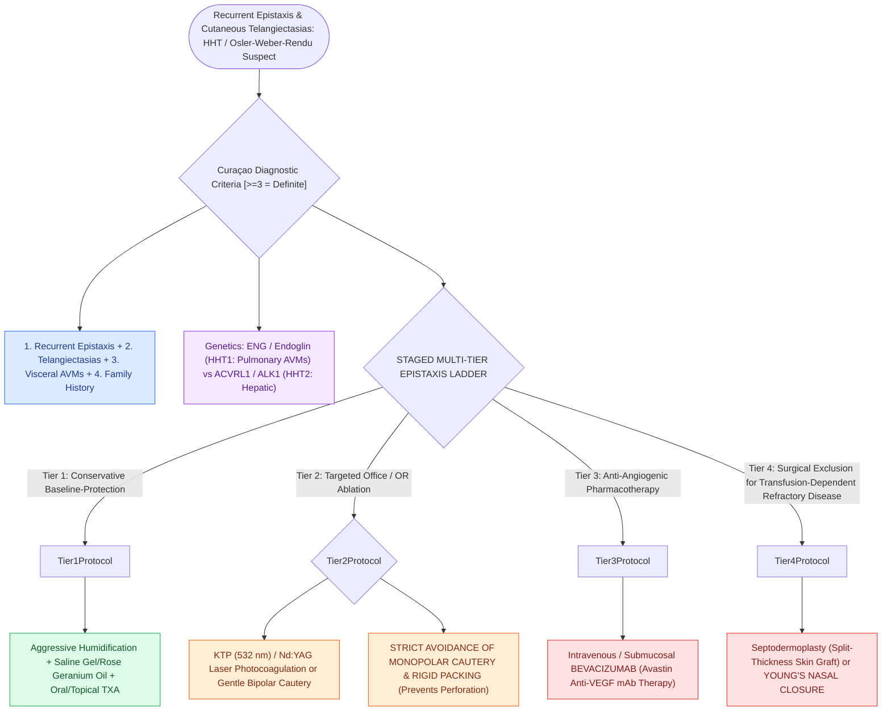

# Hereditary hemorrhagic telangiectasia manifests with mucosal AVMs and recurrent epistaxis

## Active Recall

> [!question]- What are the four Curacao diagnostic criteria for Hereditary Hemorrhagic Telangiectasia?
> *Answer / Clinical Rationale*: (1) **Spontaneous recurrent epistaxis**, (2) **Multiple mucocutaneous telangiectasias**, (3) **Visceral AVMs** (pulmonary, cerebral, hepatic), and (4) **First-degree relative with HHT** (3 or 4 = Definite).

> [!question]- Why is monopolar electrocautery and aggressive nasal packing contraindicated in HHT epistaxis?
> *Answer / Clinical Rationale*: Monopolar current causes extensive thermal necrosis, and packing shears fragile telangiectatic vessels, leading to large **septal perforations** that severely worsen turbulent airflow and bleeding.

## Core Clinical & Mechanistic Principles
**Hereditary Hemorrhagic Telangiectasia (HHT / Osler-Weber-Rendu Disease)** is an autosomal dominant vascular dysplasia characterized by abnormal direct connections between arteries and veins lacking a capillary bed, forming fragile **telangiectasias and arteriovenous malformations (AVMs)**.

Mutations occur in **ENG (Endoglin / HHT1)** and **ACVRL1 (ALK1 / HHT2)** in the TGF-$\beta$ / BMP signaling pathways.

### Visceral Arteriovenous Malformations (Pulmonary AVM Screening)
Beyond sinonasal mucosal telangiectasias, visceral organ screening is vital to prevent fatal neurological and embolic complications:
- **Pulmonary AVMs (PAVMs)**:
  - Present in **approximately $40\%$ of patients with HHT** (higher prevalence in HHT1 / *ENG* mutations).
  - *Paradoxical Embolism Hazard*: Right-to-left intrapulmonary vascular shunting bypasses the capillary filtration bed of the lungs, allowing septic microemboli and venous thrombi to reach the systemic arterial circulation, leading to **cryptogenic embolic stroke or recurrent polymicrobial brain abscesses**.
  - *Screening Standard*: Transthoracic contrast echocardiography (**bubble study**)—delayed appearance of microbubbles in the left atrium after 3 to 8 cardiac cycles confirms intrapulmonary right-to-left shunting, mandating thin-slice chest CT and catheter embolotherapy with detachable coils/vascular plugs for feeding vessels $\ge 2–3\text{ mm}$.
- **Cerebral & Hepatic AVMs**: Brain MRI screening identifies cerebral AVMs ($10\%$); hepatic AVMs ($40–70\%$) can cause high-output cardiac failure or portal hypertension.

### Staged Multi-Tier Epistaxis Management
- **Conservative**: Humidification, mucosal emollients (rose geranium oil), tranexamic acid (oral/topical).
- **In-Office / OR Coagulation**: **KTP / Nd:YAG laser photocoagulation** or bipolar cautery (monopolar and aggressive packing must be avoided to prevent septal perforation).
- **Systemic Anti-VEGF / Bevacizumab**: Intravenous or submucosal **Bevacizumab (Avastin)** inhibits hyperactive angiogenesis.
- **Young’s Procedure (Nasal Closure)**: Complete surgical closure of the nasal vestibular introitus for refractory, life-threatening transfusion-dependent epistaxis.

## Connected Concepts & Graph Traversal
- **SPA Ligation**: [[The crista ethmoidalis guides endoscopic sphenopalatine artery ligation|Endoscopic SPA Ligation]]
- **Anatomy**: [[The 24-12-6 rule governs anterior and posterior ethmoidal artery surgical localization|AEA & PEA Ligation]]
- **Laser Craft**: [[The Lund-Kennedy endoscopic staging system tracks mucosal edema, polyps, and discharge|Endoscopic Staging]]
- **Anatomical Foundation**: [[Endoscopic sphenopalatine artery ligation requires crista ethmoidalis resection and systematic multi-branch control to prevent recurrent epistaxis|Endoscopic SPA Multi-Branch Ligation]]
- **Surgical Craft**: [[Kiesselbach plexus anterior epistaxis is managed with cautery and anterior nasal packing|Anterior Epistaxis]]
