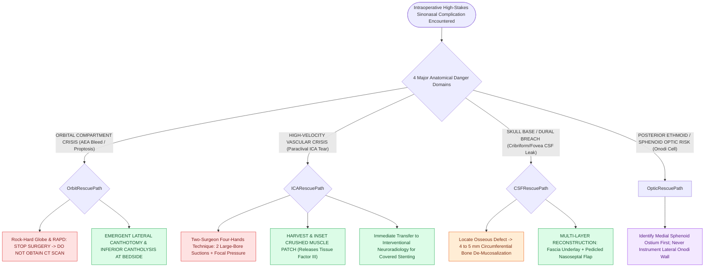

# High-stakes sinonasal complications require proactive landmarking and emergency rescue protocols

## Active Recall

> [!question]- What is the immediate bedside rescue maneuver for an acute retrobulbar hematoma following FESS?
> *Answer / Clinical Rationale*: Emergent **lateral canthotomy and inferior cantholysis** to decompress the orbital compartment and restore central retinal artery perfusion.

> [!question]- What is the definitive biological patch used to achieve endoscopic hemostasis during an internal carotid artery injury?
> *Answer / Clinical Rationale*: An **autologous crushed skeletal muscle patch** (releasing concentrated Tissue Factor / Factor III), held under direct continuous suction and pressure for 10–15 minutes.

## Core Clinical & Mechanistic Principles
Complications in Endoscopic Sinus Surgery (FESS) and Expanded Endoscopic Skull Base Surgery (EEA) are catastrophic when critical anatomical boundaries are violated. Proactive landmarking and pre-rehearsed emergency rescue protocols are mandatory across all seven tiers.

### Master Sinonasal Complication Rescue Matrix

> [!CAUTION] **Tier I: [[Incisive uncinectomy exposes the ethmoid infundibulum while protecting the nasolacrimal duct|Nasolacrimal Duct]] Injury & Mucus Recirculation**
> - **Critical Anatomical Landmark**: Hard bone of the lacrimal crest anterior to uncinate; natural maxillary ostium postero-inferior to lacrimal bulge.
> - **Failure Mode**: Transection of nasolacrimal duct causing epiphora; creation of separate fontanelle antrostomy causing [[Separate inferior antrostomies cause recirculating mucus and recalcitrant sinusitis|mucus recirculation]].
> - **Rescue Protocol**: Keep antrostomy posterior to lacrimal line. Unify all [[Maxillary antrostomy requires incorporating accessory fontanelle ostia to prevent recirculation|accessory ostia]] into a single continuous mega-antrostomy.

> [!WARNING] **Tier II: [[Onodi cells place the optic nerve and carotid artery at risk during posterior ethmoidectomy|Onodi Cell]] Optic Nerve / Carotid Transection**
> - **Critical Anatomical Landmark**: Horizontal dividing septum across sphenoid face on coronal CT; natural sphenoid ostium medially.
> - **Failure Mode**: Mistaking an Onodi cell for sphenoid; instrumenting laterally and transecting the **optic nerve** or carotid.
> - **Rescue Protocol**: Identify sphenoid ostium medially in sphenoethmoidal recess first; never dissect laterally in posterior ethmoid without absolute sphenoid identification.

> [!CAUTION] **Tier III: Retrobulbar Hematoma & Medial Rectus Injury**
> - **Critical Anatomical Landmark**: [[Lamina papyracea dehiscence predisposes to orbital fat herniation and medial rectus injury|Lamina papyracea]]; [[Supraorbital ethmoid cells suspend the anterior ethmoidal artery below the skull base|anterior ethmoidal artery]] mesentery.
> - **Failure Mode**: AEA transection retracting into orbit causing orbital compartment syndrome ($IOP > 40\text{ mmHg}$); medial rectus transection.
> - **Rescue Protocol**: Immediate emergent bedside [[Retrobulbar hematoma requires emergent bedside lateral canthotomy and cantholysis|Lateral Canthotomy & Inferior Cantholysis]]. Do not send for CT scan.

> [!WARNING] **Tier IV: [[Draf III modified Lothrop unites both frontal sinuses into a common cavity|Draf III]] Neo-Ostium Stenosis & Cribriform CSF Leak**
> - **Critical Anatomical Landmark**: Frontal beak; [[First olfactory filum marks the posterior limit of frontal drill-out to avoid CSF leak|first olfactory filum]] / posterior frontal wall.
> - **Failure Mode**: Intracranial entry through cribriform plate; circular osteoneogenesis stenosis.
> - **Rescue Protocol**: Drill strictly anterior to first olfactory filum. Apply mucosal free grafts over denuded bone to prevent circular contracture.

> [!WARNING] **Tier V: [[Sinonasal inverting papilloma requires subperiosteal excision and hyperostotic bone drill-out|Inverting Papilloma]] Recurrence & Persistent SPA Bleeding**
> - **Critical Anatomical Landmark**: Crista ethmoidalis; hyperostotic tumor origin site.
> - **Failure Mode**: Missed posterior septal artery branch causing recurrent hemorrhage; mucosal-only stripping causing tumor recurrence ($>40\%$).
> - **Rescue Protocol**: Ligate all branches exiting SPF. Perform [[Sinonasal exophytic and oncocytic papillomas differ from inverting papilloma in malignant potential|subperiosteal excision]] and drill hyperostotic bone with diamond burr.

> [!CAUTION] **Tier VI: High-Flow CSF Leak & Reconstruction Breakdown**
> - **Critical Anatomical Landmark**: [[The Hadad-Bassagasteguy nasoseptal flap is pedicled on the posterior septal artery|Posterior septal artery pedicle]]; raw cortical bone margin.
> - **Failure Mode**: Placing flap over intact mucosa causing mucocele/fistula; flap pedicle torsion.
> - **Rescue Protocol**: De-mucosalize bone for $4\text{–}5\text{ mm}$ around defect. Multi-layer reconstruction with fascia underlay and vascularized [[Temporoparietal fascia free and pedicled flaps provide vascularized tissue when nasoseptal flaps fail|NSF]] overlay.

> [!CAUTION] **Tier VII: Internal Carotid Artery (ICA) Exsanguinating Laceration**
> - **Critical Anatomical Landmark**: Paraclival / parasellar ICA prominences; Vidian canal.
> - **Failure Mode**: High-velocity arterial tear causing blinding hemorrhage, hypovolemic shock, and fatal stroke.
> - **Rescue Protocol**: Two-surgeon four-hands continuous suction; direct focal cottonoid pressure; harvest and apply **crushed muscle patch**; emergency transfer to endovascular angiography.

## Connected Concepts & Graph Traversal
- **Orbital Rescue**: [[Retrobulbar hematoma requires emergent bedside lateral canthotomy and cantholysis|Lateral Canthotomy]]
- **Carotid Rescue**: [[Intraoperative ICA injury requires two-surgeon suction and crushed muscle patch hemostasis|ICA Crisis Protocol]]
- **CSF Repair**: [[Multi-layer skull base reconstruction combines underlay, inlay, and overlay barriers|Skull Base Reconstruction]]
- **Restenosis**: [[Nasal beak drill-out and mucosal grafting prevent neo-ostium restenosis in Draf III|Draf III Restenosis Prevention]]
- **High-Stakes Safety**: [[Iatrogenic skull base cribriform leaks require immediate intraoperative multi-layer graft repair|Iatrogenic Skull Base Repair]]
- **Anatomical Foundation**: [[Image-guided surgery registration and real-time tracking enhance navigation in distorted anatomy|Image-Guided Surgery (IGS)]]
