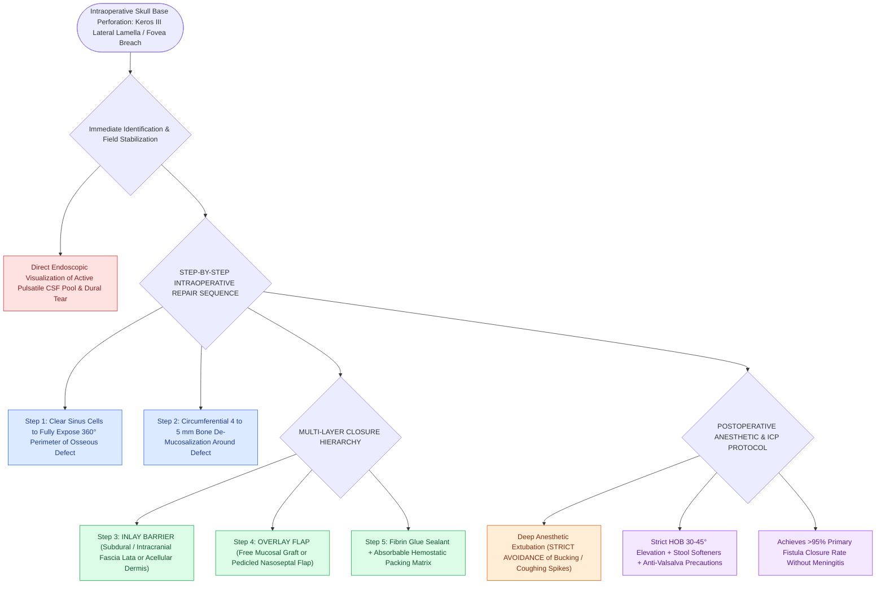

# Iatrogenic skull base cribriform leaks require immediate intraoperative multi-layer graft repair

## Active Recall

> [!question]- What is the single most vulnerable anatomical site for iatrogenic skull base perforation during FESS?
> *Answer / Clinical Rationale*: The **lateral lamella of the cribriform plate** (especially in Keros Type III anatomy), where the bone is paper-thin and enters the olfactory fossa.

> [!question]- Why must surrounding respiratory mucosa be completely de-epithelialized around the iatrogenic defect before placing a free mucosal graft?
> *Answer / Clinical Rationale*: To allow direct adherence and vascular inosculation of the graft to raw bone; placing a graft over intact mucosa causes graft slippage, persistent CSF fistula, and **iatrogenic mucocele formation**.

## Core Clinical & Mechanistic Principles
Iatrogenic skull base perforation with CSF leak occurs in **$<0.5\text{–}1.0\%$ of routine FESS cases**, most frequently at the **lateral lamella of the cribriform plate (Keros Type III)** or the posterior ethmoid roof.

Immediate recognition and definitive **intraoperative multi-layer graft repair** achieves success rates $>95\%$, preventing catastrophic postoperative meningitis, pneumocephalus, and revision surgery.

### Anesthetic & Postoperative Protocol
- Wake patient without coughing or bucking; extubate deep or with [[TIVA and greater palatine canal blocks optimize surgical field visibility in FESS|remifentanil]] suppression.
- Strict bed rest with head of bed elevated $30^\circ\text{–}45^\circ$, stool softeners, and antiemetics for $48\text{ hours}$.

## Connected Concepts & Graph Traversal
- **Anatomy**: [[The Keros classification stages olfactory fossa depth and lateral lamella vulnerability|Keros Classification]]
- **Bed Preparation**: [[CSF leak defect preparation requires circumferential bone de-mucosalization|De-Mucosalization Craft]]
- **Layering Hierarchy**: [[Multi-layer skull base reconstruction combines underlay, inlay, and overlay barriers|Multi-Layer Repair]]
- **Critical Safety & Complication**: [[Lumbar drain placement and ICP management lower the risk of postoperative CSF fistula recurrence|Lumbar Spinal Drainage Protocol]]
- **Critical Safety / Complication**: [[Esthesioneuroblastoma Kadish and Hyams staging determines craniofacial resection and adjuvant therapy|Esthesioneuroblastoma (ENB)]]
