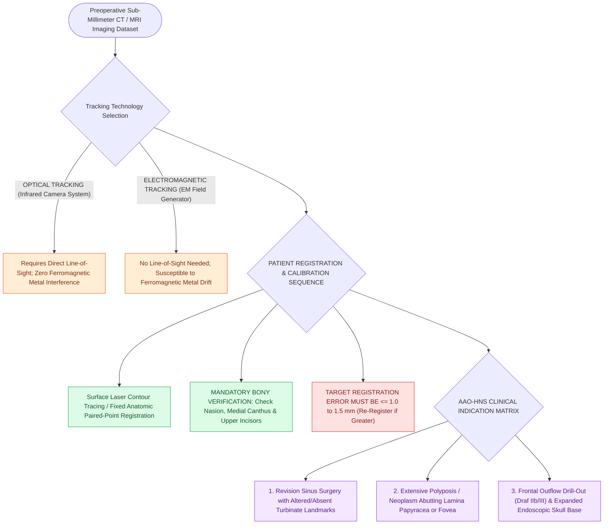

# Image-guided surgery registration and real-time tracking enhance navigation in distorted anatomy

## Active Recall

> [!question]- What is the primary operational difference between optical and electromagnetic image-guided surgery systems?
> *Answer / Clinical Rationale*: **Optical systems require an uninterrupted direct line-of-sight** between infrared cameras and trackers, while **EM systems do not require line-of-sight** but can experience tracking distortion from nearby ferromagnetic metals.

> [!question]- What target registration accuracy must be verified on fixed surface landmarks before relying on navigation?
> *Answer / Clinical Rationale*: Target registration error (TRE) should be **$< 1.5\text{ mm}$ for sinus surgery and $< 1.0\text{ mm}$ for skull base resections**, verified against fixed invariant bony landmarks (medial canthus, nasion, rhinion, anterior nasal spine, upper incisors).

> [!question]- What are the seven AAO-HNS consensus indications for intraoperative stereotactic computer-assisted navigation?
> *Answer / Clinical Rationale*: (1) **Revision sinus surgery**; (2) **Distorted sinus anatomy** (developmental, postoperative, or traumatic); (3) **Extensive sinonasal polyposis**; (4) Pathology involving the **frontal, posterior ethmoid, or sphenoid sinuses**; (5) Disease abutting the **skull base, orbit, optic nerve, or internal carotid artery**; (6) **CSF rhinorrhea** or skull base defects; and (7) Benign or malignant **sinonasal and skull base neoplasms**.

## Core Clinical & Mechanistic Principles
**Image-Guided Surgery (IGS / Surgical Navigation)** correlates preoperative high-resolution CT and MRI datasets with real-time intraoperative instrument location using **optical (infrared)** or **electromagnetic (EM)** tracking systems.

Accuracy must be verified to within **$\le 1.0\text{–}1.5\text{ mm}$** before proceeding.

### Mandatory Clinical Indications (AAO-HNS Guidelines) & Technical Safeguards
1. Revision sinus surgery with lost anatomical landmarks.
2. Distorted sinonasal anatomy (polyposis, developmental, previous trauma, osteoma) or extensive sinonasal polyposis.
3. Pathology involving the frontal, posterior ethmoid, or sphenoid sinuses, or disease abutting the skull base, [[Lamina papyracea dehiscence predisposes to orbital fat herniation and medial rectus injury|lamina papyracea]], optic nerve, or ICA.
4. Expanded skull base surgery, sinonasal/skull base neoplasms, and CSF rhinorrhea / defect repair.
5. Frontal sinus drill-outs ([[Draf IIb frontal sinusotomy extends from lamina papyracea to the nasal septum|Draf IIb]], [[Nasal beak drill-out and mucosal grafting prevent neo-ostium restenosis in Draf III|Draf III]]).

- **Tracking Modality Nuances**: **Optical (infrared)** cameras track passive retroreflective spheres/active LEDs on a rigid headframe and are immune to metal, but fail immediately if line-of-sight is blocked. **Electromagnetic (EM)** emitter coils track flexible curved suctions, malleable probes, and balloon catheters without line-of-sight, but suffer field distortion from ferromagnetic objects (headrests, drill handpieces, metallic retractors, dental hardware) within **$20\text{ cm}$** of the field generator.
- **Registration & CT-MRI Fusion**: **Paired-point registration** (radiopaque fiducials or external landmarks) or **surface-matching** (laser/contact facial contour cloud) co-registers high-resolution **$0.625\text{ mm}$ bone-algorithm CT** with gadolinium T1/T2 MRI (combining bony boundary precision with dural/optic/cavernous soft-tissue detail).
- **The Static Navigation Trap ("Brain Shift")**: IGS is an adjunct to visual anatomy and the [[The CLOSE checklist systematically evaluates critical radiological danger zones|CLOSE checklist]], never a substitute. Because navigation tracks static preoperative imaging, tumor debulking or CSF drainage causes intracranial **"brain shift" ($5\text{–}10\text{ mm}$)**—verify fixed cortical bone contours against invariant landmarks rather than trusting soft-tissue margins alone.

## Connected Concepts & Graph Traversal
- **Checklist Planning**: [[The CLOSE checklist systematically evaluates critical radiological danger zones|CLOSE Checklist]]
- **Skull Base Navigation**: [[Transcribriform EEA provides access to olfactory groove meningiomas and esthesioneuroblastomas|Transcribriform EEA]]
- **Frontal Drill-out**: [[Draf III modified Lothrop unites both frontal sinuses into a common cavity|Draf III Drill-Out]]
- **High-Stakes Safety**: [[High-stakes sinonasal complications require proactive landmarking and emergency rescue protocols|Sinonasal Complication Matrix]]
- **Sphenoid Carotid Landmark**: [[Intersphenoid sinus septations frequently insert directly onto the internal carotid canal|Intersphenoid Septum Carotid Insertion]]
- **Olfactory Fossa Metric**: [[The Keros classification stages olfactory fossa depth and lateral lamella vulnerability|Keros Classification]]
- **Vascular Crisis Management**: [[Intraoperative ICA injury requires two-surgeon suction and crushed muscle patch hemostasis|Carotid Artery Hemostasis]]
