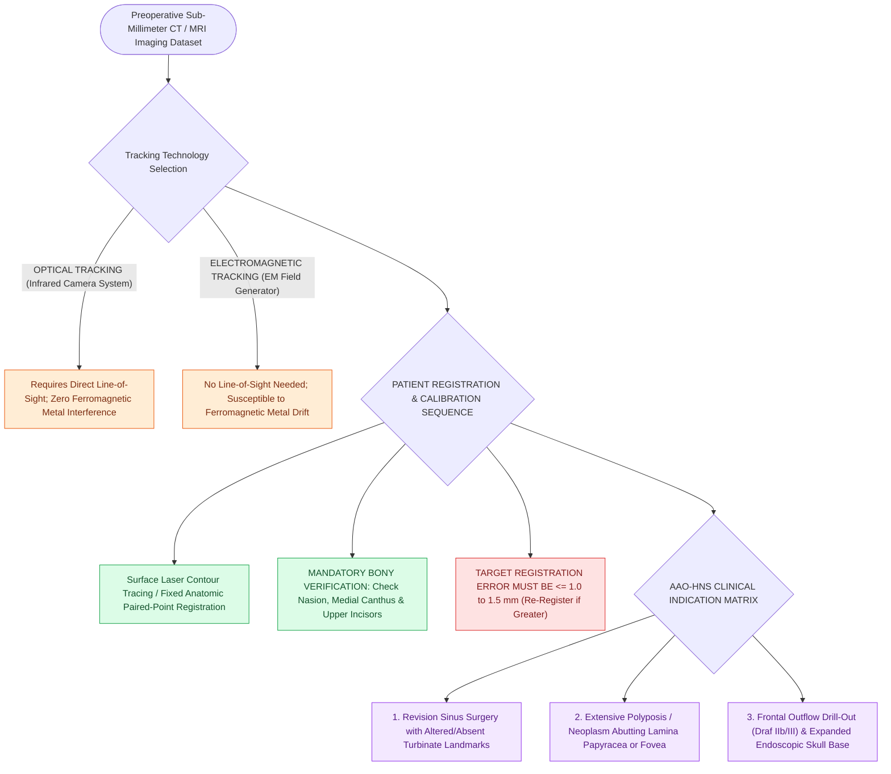

# Image-guided surgery registration and real-time tracking enhance navigation in distorted anatomy

## Active Recall

> [!question]- What is the primary operational difference between optical and electromagnetic image-guided surgery systems?
> *Answer / Clinical Rationale*: **Optical systems require an uninterrupted direct line-of-sight** between infrared cameras and trackers, while **EM systems do not require line-of-sight** but can experience tracking distortion from nearby ferromagnetic metals.

> [!question]- What target registration accuracy must be verified on fixed surface landmarks before relying on navigation?
> *Answer / Clinical Rationale*: Target registration error should be **$\le 1.0\text{–}1.5\text{ mm}$**, verified on hard bony landmarks (medial canthus, nasion, incisors).

## Core Clinical & Mechanistic Principles
**Image-Guided Surgery (IGS / Surgical Navigation)** correlates preoperative high-resolution CT and MRI datasets with real-time intraoperative instrument location using **optical (infrared)** or **electromagnetic (EM)** tracking systems.

Accuracy must be verified to within **$\le 1.0\text{–}1.5\text{ mm}$** before proceeding.

### Mandatory Clinical Indications (AAO-HNS Guidelines)
1. Revision sinus surgery with lost anatomical landmarks.
2. Distorted sinonasal anatomy (polyposis, previous trauma, osteoma).
3. Disease abutting the skull base, [[Lamina papyracea dehiscence predisposes to orbital fat herniation and medial rectus injury|lamina papyracea]], or optic nerve.
4. Expanded skull base surgery and CSF leak repair.
5. Frontal sinus drill-outs ([[Draf IIb frontal sinusotomy extends from lamina papyracea to the nasal septum|Draf IIb]], [[Nasal beak drill-out and mucosal grafting prevent neo-ostium restenosis in Draf III|Draf III]]).

## Connected Concepts & Graph Traversal
- **Checklist Planning**: [[The CLOSE checklist systematically evaluates critical radiological danger zones|CLOSE Checklist]]
- **Skull Base Navigation**: [[Transcribriform EEA provides access to olfactory groove meningiomas and esthesioneuroblastomas|Transcribriform EEA]]
- **Frontal Drill-out**: [[Draf III modified Lothrop unites both frontal sinuses into a common cavity|Draf III Drill-Out]]
- **High-Stakes Safety**: [[High-stakes sinonasal complications require proactive landmarking and emergency rescue protocols|Sinonasal Complication Matrix]]
- **Diagnostic Evaluation**: [[Intersphenoid sinus septations frequently insert directly onto the internal carotid canal|Intersphenoid Septum Carotid Insertion]]
- **Surgical Technique**: [[Balloon catheter sinus dilatation widens paranasal ostia via high-pressure microfracture remodeling while requiring transillumination or image guidance to prevent false passage|Balloon Catheter Dilatation]]
- **Multimodal Tracking Fusion**: [[Stereotactic image-guided navigation combines electromagnetic or optical tracking with CT-MRI fusion to maintain spatial orientation in distorted revision sinus and skull base surgery|Stereotactic Image-Guided Navigation]]
