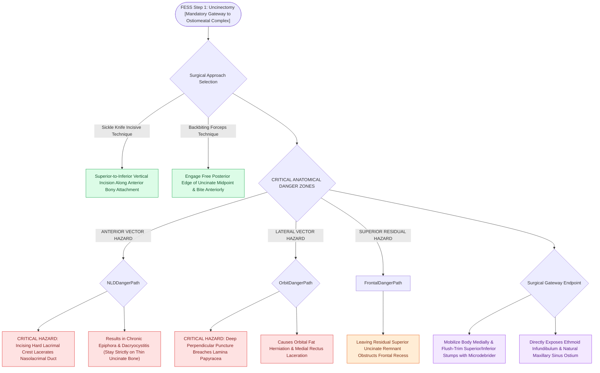

# Incisive uncinectomy exposes the ethmoid infundibulum while protecting the nasolacrimal duct

## Active Recall

> [!question]- What anatomical structure is at risk if the anterior uncinectomy incision is carried too far anteriorly into dense cortical bone?
> *Answer / Clinical Rationale*: The **nasolacrimal duct (NLD)**, which courses within the hard bone of the lacrimal groove anterior to the uncinate attachment.

> [!question]- Why is the removal of the superior uncinate remnant critical during uncinectomy?
> *Answer / Clinical Rationale*: The superior remnant attaches to the lamina papyracea, skull base, or middle turbinate. Leaving this uncinate flake intact mechanically obstructs the **frontal recess** outflow tract.

## Core Clinical & Mechanistic Principles
**Uncinectomy** is the initial and mandatory "gateway" step of functional endoscopic sinus surgery (FESS). Complete resection of the uncinate process opens the **ethmoid infundibulum** and exposes the **natural maxillary sinus ostium**.

### Step-by-Step Incisive vs Backbiting Technique
1. **Palpation**: Palpate the uncinate with a ball-tipped seeker to assess mobility and depth relative to the [[Draf IIb frontal sinusotomy extends from lamina papyracea to the nasal septum|lamina papyracea]].
2. **Incisive Uncinectomy (Sickle Knife)**:
   - Place a sickle knife at the superior junction of the uncinate and lateral nasal wall.
   - Incise vertically from **superior to inferior**, staying strictly within the uncinate bone.
   - **CRITICAL LANDMARK**: Stay posterior to the hard bone of the lacrimal crest to avoid transecting the **nasolacrimal duct (NLD)**.
3. **Backbiting Uncinectomy**:
   - Introduce a pediatric or standard backbiting forceps into the middle meatus.
   - Engage the free posterior edge of the uncinate process at its midpoint and bite anteriorly.
4. **Remnant Removal**:
   - Grasp the freed uncinate body with straight Blakesley or Takahashi forceps and mobilize it medially and anteriorly.
   - Use a [[Powered microdebrider blade selection and suction irrigation maintain clean surgical optics|microdebrider]] to flush-trim the inferior uncinate stump along the inferior turbinate and the superior uncinate root.

## Critical Failure Modes & Error Traps
- **Nasolacrimal Duct Injury**: Placing the incision too far anteriorly on the hard bone of the maxilla lacerates the nasolacrimal duct, leading to post-operative epiphora or dacryocystitis.
- **Lamina Papyracea Breach**: Penetrating the uncinate too deeply or perpendicular to the lateral wall punctures the lamina papyracea, entering orbital fat (see [[Lamina papyracea dehiscence predisposes to orbital fat herniation and medial rectus injury|Lamina Papyracea Dehiscence]]).
- **Missed Superior Uncinate Remnant**: Leaving a residual superior uncinate flap blocks the frontal recess (a primary cause of persistent frontal sinusitis).

## Connected Concepts & Graph Traversal
- **Anatomy**: [[The uncinate process superior attachment dictates the frontal sinus drainage pathway|Uncinate Attachments]]
- **Next Step**: [[Maxillary antrostomy requires incorporating accessory fontanelle ostia to prevent recirculation|Maxillary Antrostomy]]
- **Infundibulum Space**: [[The hiatus semilunaris and infundibulum form the primary drainage channel of the ostiomeatal complex|Ethmoid Infundibulum]]
- **Orbital Risk**: [[Lamina papyracea dehiscence predisposes to orbital fat herniation and medial rectus injury|Lamina Papyracea Injury]]
- **Surgical Craft**: [[Entering the ethmoid bulla inferomedially avoids orbital and skull base penetration|Anterior Ethmoidectomy Technique]]
- **Diagnostic Evaluation**: [[Draf I frontal sinusotomy clears obstructing ethmoid cells without instrumenting the ostium|Draf I Frontal Sinusotomy]]
- **Anatomical Foundation**: [[Modified medial maxillectomy provides wide maxillary access while preserving the nasolacrimal duct and inferior turbinate head with a nasal floor mucosal flap|Modified Medial Maxillectomy]]
