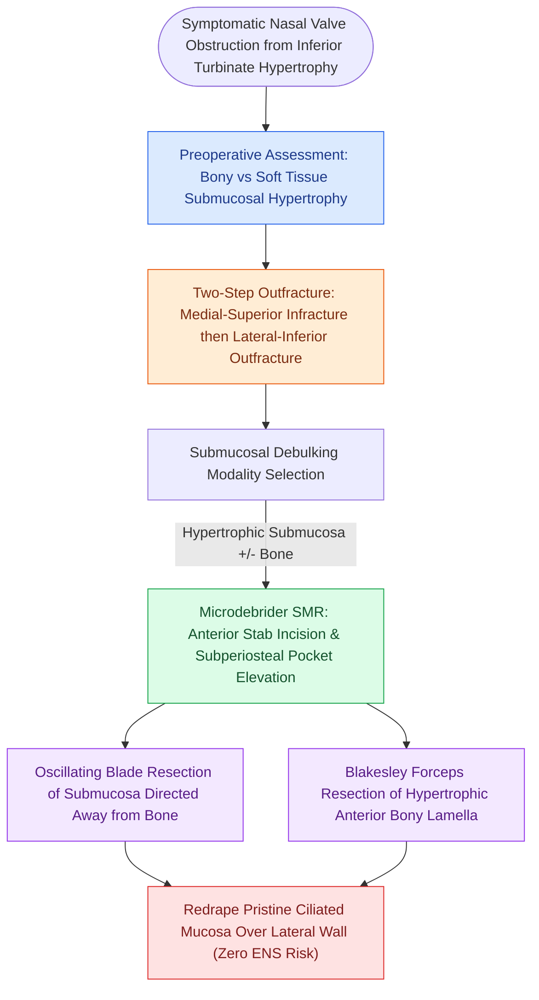

# Inferior turbinate submucosal resection with outfracture provides durable volume reduction while preserving ciliated mucosal function

## Active Recall

> [!question]- Why does microdebrider-assisted submucosal resection provide superior long-term nasal airway outcomes compared to superficial laser ablation or electrocautery?
> *Answer / Clinical Rationale*: Microdebrider submucosal resection selectively sculpts and debulks the hypertrophic venous sinusoids and bone within a closed subperiosteal pocket while preserving the overlying pseudostratified ciliated columnar respiratory epithelium; in contrast, superficial thermal ablation destroys the ciliary bed, causing prolonged crusting, delayed healing, and higher recurrence rates.

> [!question]- What anatomic region of the inferior turbinate governs the vast majority of nasal airway resistance, and why should aggressive posterior resection be avoided?
> *Answer / Clinical Rationale*: The anterior-most 2 cm of the inferior turbinate (contributing to the internal nasal valve) accounts for the predominant portion of nasal airway resistance; posterior resection yields minimal functional airway improvement while dramatically increasing the risk of severe arterial hemorrhage from sphenopalatine artery branches.

## Core Clinical & Mechanistic Principles
The inferior turbinate is an independent laminar facial bone lined by specialized pseudostratified ciliated respiratory epithelium with an expansive submucosal bed of capacious venous erectile sinusoids. These capacitance vessels modulate airway caliber, humidify inspired air, and participate in [[The nasal cycle provides alternating autonomic mucosal congestion and decongestion|the autonomic nasal cycle]]. 

When medical therapies fail to relieve chronic mucosal or bony hypertrophy, surgical reduction is indicated. However, the surgeon must treat the inferior turbinate as a vital functional organ; aggressive non-selective amputation destroys aerodynamic resistance and causes catastrophic atrophic rhinitis or empty nose syndrome (ENS). Furthermore, preserving healthy turbinate tissue maintains donor availability for reconstructive corridors, such as [[The inferior turbinate flap pedicled on the inferior turbinate artery repairs anterior floor defects|the inferior turbinate pedicled vascular flap]].

### Surgical Hierarchy & Craft Execution
1. **Inferior Turbinate Outfracture**:
   - Outfracture addresses the lateral bony architecture. The inferior turbinate attaches to the lateral nasal wall at an oblique angle.
   - *Step 1*: A Freer elevator is placed deep into the inferior meatus beneath the turbinate, infracturing the bone upward and medially to loosen the lateral wall attachment.
   - *Step 2*: A Boies-Goldman or Freer elevator is placed along the superomedial surface, exerting firm pressure in an **inferior-lateral vector** to displace the bony lamella into the inferior meatus.
   - *Safety Boundary*: Care must be taken not to traumatize the orifice of the nasolacrimal duct (Hasner's valve) located in the anterior roof of the inferior meatus.
2. **Submucosal Resection (SMR) with Microdebrider**:
   - Under endoscopic visualization, the anterior head is infiltrated with 1% lidocaine with 1:100,000 epinephrine.
   - A vertical stab incision is placed just posterior to the anterior mucocutaneous junction.
   - A Freer elevator creates a subperiosteal pocket along the lateral and medial surfaces of the turbinate bone.
   - An oscillating microdebrider blade is introduced into the soft tissue pocket with the cutting aperture directed away from the overlying mucosal envelope. Slow oscillation facilitates controlled morselization of the erectile tissue.
   - If significant bony hypertrophy exists, Blakesley forceps are inserted into the pocket to grasp and fracture the anterior one-third to one-half of the bony concha.
3. **Long-Term Comparative Evidence**:
   - Passali et al. demonstrated in a landmark 6-year randomized trial that submucosal resection combined with outfracture achieved the highest durability of nasal airflow and preserved mucociliary clearance compared to electrocautery, cryotherapy, laser, and turbinectomy.
   - Yanez et al. confirmed a 93% symptom improvement at 10-year follow-up using microdebrider-assisted submucosal turbinoplasty.
   - Total or near-total turbinectomy is strictly contraindicated due to mucosal crusting, recurrent epistaxis, loss of aerodynamic laminar resistance, and debilitating paradoxical obstruction (empty nose syndrome).

## Connected Concepts & Graph Traversal
- **🔗 Pediatric Radiofrequency Stiffening (Pediatrics)**: [[Radiofrequency ablation of the inferior turbinates and soft palate stiffens tissue through submucosal fibrosis]]
- **🔗 Sleep Architecture Outcomes (Pediatrics)**: [[Nasal surgery alone improves CPAP compliance and subjective daytime somnolence without normalizing AHI]]
- **Rhinogenic Contact Point Triggers**: [[Rhinogenic contact point headache arises from mucosal contact between the nasal septum and turbinates]]
- **Endoscopic Corridor Expansion**: [[Endoscopic septoplasty enables targeted spur resection and improves middle meatal access while minimizing mucosal dissection]]
- **Postoperative Hemostasis**: [[Topical hemostatic matrix agents and nasal packing mitigate postoperative epistaxis and synechiae]]
