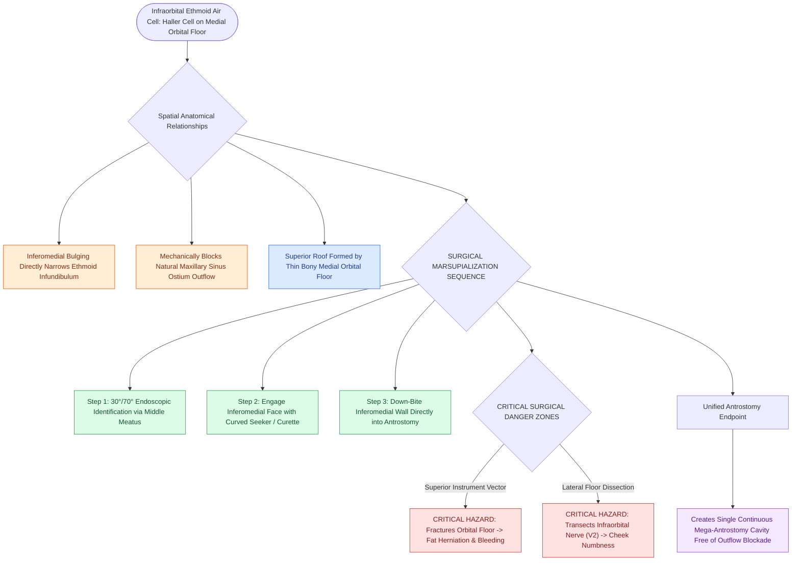

# Infraorbital Haller cells narrow the ethmoid infundibulum and maxillary ostium

## Active Recall

> [!question]- How does an infraorbital Haller cell contribute to recurrent maxillary sinusitis?
> *Answer / Clinical Rationale*: It expands into the medial orbital floor and lateral wall of the ethmoid infundibulum, mechanically compressing the infundibulum and blocking the **natural maxillary sinus ostium**.

> [!question]- What neurovascular structure lies immediately adjacent to the roof of a Haller cell?
> *Answer / Clinical Rationale*: The **infraorbital nerve (V2)** within the infraorbital canal along the orbital floor.

## Core Clinical & Mechanistic Principles
A **Haller cell (infraorbital ethmoid cell)** is an anterior or posterior ethmoid air cell that pneumatizes along the **medial orbital floor** and the superior aspect of the **maxillary sinus ostium / ethmoid infundibulum**.

### Pathological & Surgical Significance
1. **Infundibular Stenosis**: As a Haller cell enlarges, it projects inferomedially, severely narrowing the **ethmoid infundibulum** and impinging on the natural maxillary sinus ostium, causing recurrent or recalcitrant maxillary sinusitis.
2. **Orbital Floor Dehiscence**: The superior wall of a Haller cell is formed directly by the **orbital floor** (housing the infraorbital nerve canal).
3. **Surgical Hazard**: During uncapping of a Haller cell, instrumenting too superiorly or forcefully can fracture the orbital floor, injuring the **infraorbital nerve (V2)** or causing [[Lamina papyracea dehiscence predisposes to orbital fat herniation and medial rectus injury|orbital fat herniation]] and [[Retrobulbar hematoma requires emergent bedside lateral canthotomy and cantholysis|retrobulbar hematoma]].

## Surgical Nuances & Dissection Protocol
- **Identification on CT**: Evaluated on coronal CT beneath the medial orbital rim flanking the superior maxillary sinus.
- **Marsupialization**: Using a $30^\circ$ or $70^\circ$ endoscope and a curved curette or through-cutting forceps, uncapp the inferomedial wall of the Haller cell into the maxillary antrostomy, creating a single unified drainage cavity.

## Connected Concepts & Graph Traversal
- **Checklist Framework**: [[The CLOSE checklist systematically evaluates critical radiological danger zones|CLOSE Checklist (Lamina & Orbit)]]
- **Infundibulum Anatomy**: [[The hiatus semilunaris and infundibulum form the primary drainage channel of the ostiomeatal complex|Ethmoid Infundibulum]]
- **Surgical Antrostomy**: [[Maxillary antrostomy requires incorporating accessory fontanelle ostia to prevent recirculation|Maxillary Antrostomy Technique]]
- **Orbital Risk**: [[Lamina papyracea dehiscence predisposes to orbital fat herniation and medial rectus injury|Orbital Injury Risk]]
- **Diagnostic Imaging**: [[Supraorbital ethmoid cells suspend the anterior ethmoidal artery below the skull base|AEA Mesentery Anatomy]]
- **Anatomical Foundation**: [[Onodi cells place the optic nerve and carotid artery at risk during posterior ethmoidectomy|Onodi Cell Anatomy]]
