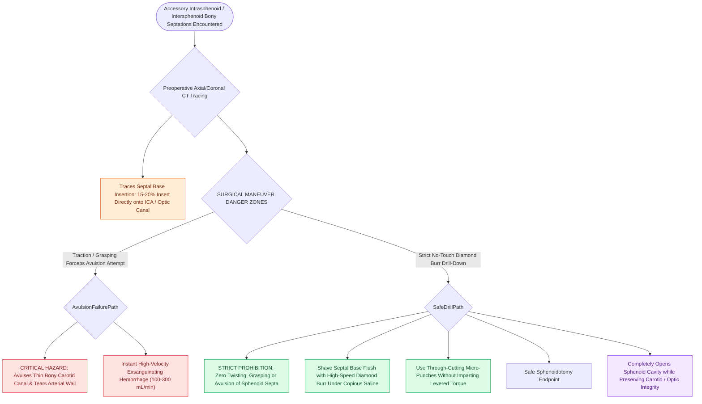

# Intersphenoid sinus septations frequently insert directly onto the internal carotid canal

## Active Recall

> [!question]- Why is twisting or avulsing an intrasphenoid septum with grasping forceps strictly prohibited?
> *Answer / Clinical Rationale*: In up to 20% of cases, the septum inserts directly onto the thin or dehiscent **internal carotid artery canal**; avulsing the bone risks tearing the carotid wall and causing catastrophic hemorrhage.

> [!question]- What is the proper technique for removing a septum that inserts onto the carotid canal?
> *Answer / Clinical Rationale*: Shaving the septum down with a **diamond burr under continuous cold irrigation** or dividing it sharply with through-cutting punches without pulling.

## Core Clinical & Mechanistic Principles
During sphenoid sinus surgery, accessory intersphenoid and intrasphenoid bony septations are commonly encountered. In **up to $15\text{–}20\%$ of patients**, an intrasphenoid septum inserts **directly onto the bony prominence of the internal carotid artery (ICA)** or optic canal.

### Safe Surgical Management Protocol
1. **Never Avulse Septations**: Never use twisting or traction forces on septa within the sphenoid sinus.
2. **Diamond Burr Drill-Down**: The base of the septum must be drilled down flush using a **diamond burr with copious irrigation**, or carefully trimmed with micro-scissors/punches.
3. **Preoperative CT Review**: The insertion of every intersphenoid septum must be systematically traced on preoperative axial and coronal CT (Part of the [[The CLOSE checklist systematically evaluates critical radiological danger zones|CLOSE Checklist]]).

## Connected Concepts & Graph Traversal
- **Checklist Assessment**: [[The CLOSE checklist systematically evaluates critical radiological danger zones|CLOSE Checklist ("S" for Sphenoid)]]
- **Carotid Crisis**: [[Intraoperative ICA injury requires two-surgeon suction and crushed muscle patch hemostasis|ICA Injury Protocol]]
- **Sphenoid Ostium**: [[The sphenoid sinus ostium lies medial to the superior turbinate above the choana|Sphenoidotomy Execution]]
- **Anatomical Foundation**: [[Image-guided surgery registration and real-time tracking enhance navigation in distorted anatomy|Image-Guided Surgery (IGS)]]
- **High-Stakes Safety**: [[High-stakes sinonasal complications require proactive landmarking and emergency rescue protocols|Sinonasal Complication Matrix]]
