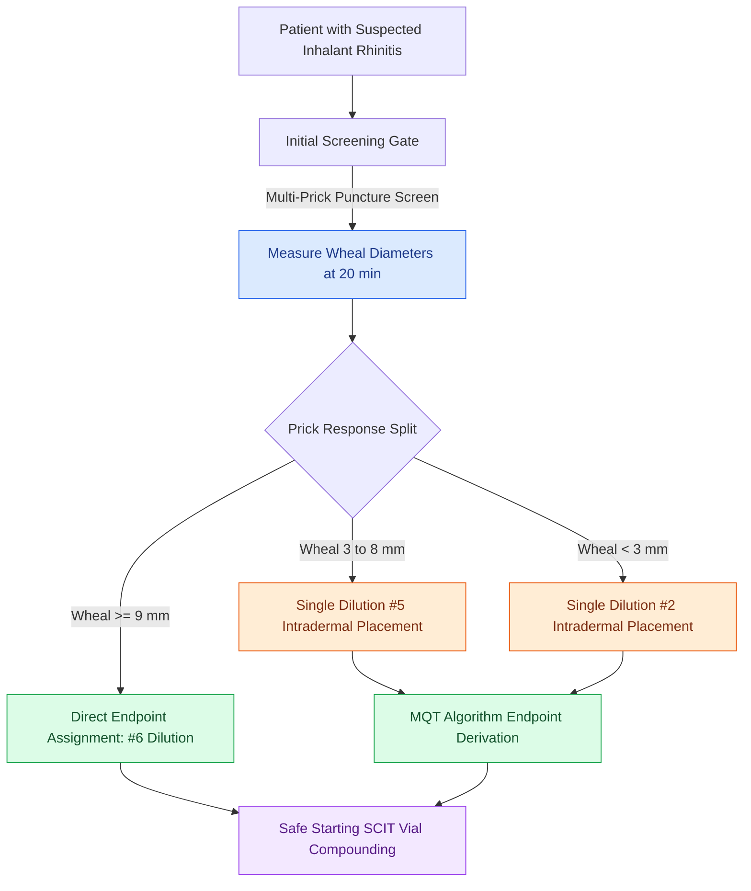

# Intradermal dilutional testing IDT and modified quantitative testing MQT quantify allergic sensitization to guide safe immunotherapy escalation

## Active Recall

> [!question]- How is the allergic endpoint defined in intradermal dilutional testing (IDT / skin endpoint titration), and what is a confirming wheal?
> *Answer / Clinical Rationale*: In IDT using sequential 1:5 dilutions (labeled #1 through #6), an initial 4-mm intradermal wheal expands to 5 mm via normal physical diffusion at 10 minutes. The **endpoint** is defined as the **most dilute antigen concentration producing a positive wheal $\ge 7\text{ mm}$ in diameter (at least $2\text{ mm}$ greater than physical diffusion)**, provided that the **next stronger dilution produces a confirming wheal that is at least $2\text{ mm}$ larger still** (e.g., progression pattern 5-5-7-9 mm).

> [!question]- What are the key pharmacological washout intervals required before performing cutaneous allergy testing?
> *Answer / Clinical Rationale*: First-generation antihistamines (diphenhydramine, chlorpheniramine) require a **48 to 72-hour** washout. Second-generation antihistamines (cetirizine, loratadine, fexofenadine) require **7 days** (desloratadine up to 10–14 days). Tricyclic antidepressants require **7 days** due to intrinsic H1-antagonism. **Beta-blockers must be avoided** because they induce resistance to rescue epinephrine and risk severe refractory bronchospasm or unopposed alpha-adrenergic hypertensive crisis during systemic anaphylaxis.

## Core Clinical & Mechanistic Principles
Inhalant allergy diagnosis bridges physical symptoms with [[Type 2 CRS exhibits eosinophilic inflammation responsive to targeted biologics|Type 2 IgE-mediated hypersensitivity]]. While epicutaneous prick/puncture testing provides a rapid qualitative screen, otolaryngologic allergy practice frequently employs **intradermal dilutional testing (IDT)** or blended **modified quantitative testing (MQT)** to establish quantitative thresholds. Quantitative sensitivity mapping allows precise, individualized formulation of subcutaneous immunotherapy (SCIT) vials, minimizing the hazard of systemic anaphylaxis while expediting escalation to therapeutic maintenance doses.

### Testing Methodology, Epicutaneous vs In Vitro Assays & Craft Nuance
1. **Intradermal Dilutional Testing (IDT / SET)**:
   - Utilizes standardized 1:5 serial dilutions starting at dilution #6 (1:62,500 w/v) up to dilution #2 (1:100 w/v). A #1 dilution (1:20 w/v) is never used as an endpoint due to false-positive non-specific irritant whealing.
   - 0.01 mL of extract is injected intradermally to form a uniform 4-mm bleb, measured across orthogonal diameters after 10 minutes.
2. **Modified Quantitative Testing (MQT)**:
   - Combines multi-tine skin prick testing with selective intradermal tests (#2 or #5 dilution), decreasing testing time and patient discomfort while preserving 95% concordance with full IDT batteries.
3. **In Vitro Serum Specific IgE (sIgE / ImmunoCAP)**:
   - Indicated when cutaneous testing is contraindicated due to severe dermographism, generalized atopic dermatitis, active beta-blocker therapy, or inability to withdraw from antihistamines.

## Connected Concepts & Graph Traversal
- **Immunological Foundation**: [[Type 2 CRS exhibits eosinophilic inflammation responsive to targeted biologics|Type 2 Eosinophilic Inflammation]]
- **Allergic Rhinosinusitis Phenotype**: [[Allergic fungal rhinosinusitis presents with eosinophilic mucin and Charcot-Leyden crystals|Allergic Fungal Rhinosinusitis]]
- **Aspirin Hypersensitivity**: [[AERD manifests with asthma, nasal polyps, and severe aspirin-induced respiratory reactions|AERD Triad]]
- **Autonomic Differential**: [[Transnasal endoscopic vidian neurectomy treats refractory non-allergic cholinergic rhinitis|Non-Allergic Vasomotor Rhinitis]]
- **🔗 Critical Anaphylaxis Rescue (Laryngology)**: [[Mast cell-mediated histaminergic angioedema responds rapidly to epinephrine, antihistamines, and corticosteroids|Acute Mast Cell / Histaminergic Degranulation]]
- **Biologic Therapy**: [[Allergen immunotherapy induces regulatory T cells and IgG4 blocking antibodies to modulate allergic rhinitis and prevent asthma progression|Allergen Immunotherapy Escalation]]
- **SCIT/SLIT Dosing Route Mechanism**: [[Allergen immunotherapy via subcutaneous injections or sublingual dosing induces regulatory T cells and allergen-specific IgG4 blocking antibodies to restore immune tolerance|SCIT vs SLIT Immunotherapy]]
