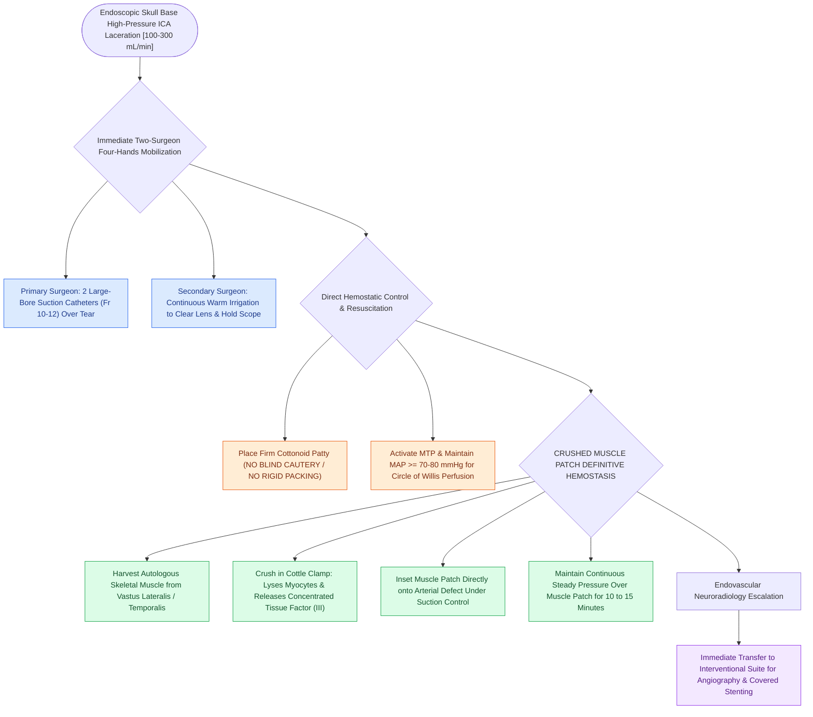

# Intraoperative ICA injury requires two-surgeon suction and crushed muscle patch hemostasis

## Active Recall

> [!question]- Why is blind bipolar electrocautery or aggressive packing with hard instruments strictly prohibited during an acute ICA laceration?
> *Answer / Clinical Rationale*: Blind cautery will enlarge the arterial laceration or transect adjacent cranial nerves, while hard packing can cause complete vessel occlusion or induce a **traumatic pseudoaneurysm** that ruptures postoperatively.

> [!question]- What biological factor released by crushed skeletal muscle promotes rapid arterial hemostasis?
> *Answer / Clinical Rationale*: Concentrated **Tissue Factor (Factor III)**, which rapidly triggers the extrinsic coagulation pathway and thrombin generation at the bleeding site.

## Core Clinical & Mechanistic Principles
Intraoperative laceration of the **Internal Carotid Artery (ICA)** during [[Diagnostic rigid nasal endoscopy utilizes a standardized three-pass examination sequence|endoscopic]] skull base surgery is a catastrophic, life-threatening emergency with high mortality ($>10\text{–}15\%$) and stroke rates. Blood exits the high-pressure artery at $>100\text{–}300\text{ mL/min}$, completely blinding the endoscopic view within seconds.

Immediate survival and cerebral perfusion depend on a rehearsed, step-by-step **two-surgeon crisis protocol**.

### Why Crushed Muscle Outperforms Synthetic Hemostatics
- **Tissue Factor (Factor III) Release**: Crushing skeletal muscle mechanically lyses myocytes, releasing massive concentrations of **Tissue Factor** directly onto the high-velocity arterial tear, rapidly initiating the extrinsic clotting cascade.
- **Biomechanical Seal**: The conformable, fibromuscular patch adheres tenaciously to the arterial adventitia and surrounding bone under continuous pressure, resisting arterial pulsatile displacement.

## Connected Concepts & Graph Traversal
- **Checklist Prevention**: [[The CLOSE checklist systematically evaluates critical radiological danger zones|CLOSE Checklist]]
- **Anatomy & Dehiscence**: [[Sphenoid sinus pneumatization patterns dictate carotid and optic canal exposure|Sphenoid Carotid Dehiscence]]
- **Corridors**: [[Transclival EEA provides midline access to clival chordomas and chondrosarcomas|Transclival EEA]]
- **Anatomical Foundation**: [[Transpterygoid EEA exposes juvenile nasopharyngeal angiofibromas and lateral sphenoid defects|Transpterygoid EEA]]
- **High-Stakes Safety**: [[Retrobulbar hematoma requires emergent bedside lateral canthotomy and cantholysis|Retrobulbar Hematoma Protocol]]
- **Surgical Craft**: [[Acute invasive fungal rhinosinusitis requires emergent surgical debridement and systemic amphotericin B|Acute Invasive Fungal Rhinosinusitis (AIFRS)]]
- **Structural / Flap Alternative**: [[Temporoparietal fascia free and pedicled flaps provide vascularized tissue when nasoseptal flaps fail|Temporoparietal Fascia Flap (TPFF)]]
