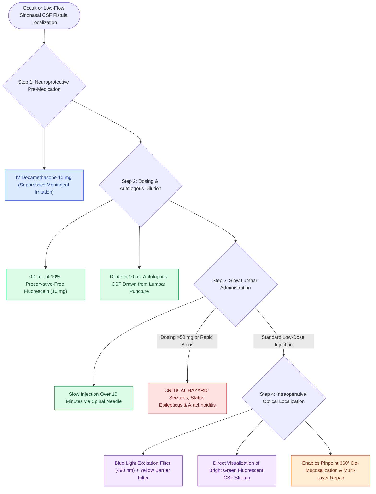

# Intrathecal fluorescein enables visual localization of occult dural defects

## Active Recall

> [!question]- What is the standard safe dosing and administration protocol for intrathecal fluorescein in CSF leak repair?
> *Answer / Clinical Rationale*: **$0.1\text{ mL}$ of 10% preservative-free fluorescein (10 mg)** diluted into **$10\text{ mL}$ of autologous CSF**, slowly injected via lumbar puncture over **10 minutes**.

> [!question]- What catastrophic neurological complication is associated with high-dose or rapid bolus injection of intrathecal fluorescein?
> *Answer / Clinical Rationale*: **Grand mal seizures**, status epilepticus, and severe chemical meningitis.

## Core Clinical & Mechanistic Principles
**Intrathecal Fluorescein** is an established diagnostic adjunct for intraoperative visual localization of occult, low-flow, or complex multi-site [[Beta-2 transferrin and high-resolution CT localize sinonasal CSF fistulas|sinonasal]] CSF fistulas. It provides bright, high-contrast, fluorescent green illumination of escaping CSF under blue-light / yellow-filter endoscopy.

### Safety Rules & Neurotoxicity Prevention
- **Low-Dose Threshold**: The total dose must **never exceed $50\text{ mg}$ ($0.5\text{ mL}$ of 10% solution)**. Standard recommended adult dose is **$10\text{–}25\text{ mg}$ ($0.1\text{–}0.25\text{ mL}$)**.
- **Toxicity Risks of Overdose**: High doses ($>100\text{ mg}$) or rapid bolus injection can cause **seizures**, chemical arachnoiditis, opisthotonos, and cranial nerve palsies.
- **Pre-Medication**: Administer $10\text{ mg}$ IV dexamethasone prior to injection to minimize meningeal irritation.

## Connected Concepts & Graph Traversal
- **Biochemical Confirmation**: [[Beta-2 transferrin and high-resolution CT localize sinonasal CSF fistulas|Beta-2 Transferrin]]
- **Defect Preparation**: [[CSF leak defect preparation requires circumferential bone de-mucosalization|Defect Preparation]]
- **Multi-Layer Closure**: [[Multi-layer skull base reconstruction combines underlay, inlay, and overlay barriers|Skull Base Reconstruction]]
- **Anatomical Foundation**: [[Spontaneous CSF leaks are strongly associated with idiopathic intracranial hypertension and elevated BMI|Spontaneous CSF Leaks & IIH]]
- **Surgical Craft**: [[Endoscopic repair of cerebrospinal fluid rhinorrhea employs systematic biochemical confirmation, intrathecal fluorescein localization, and multilayer underlay dural reconstruction to achieve primary closure|Endoscopic CSF Rhinorrhea Repair]]
