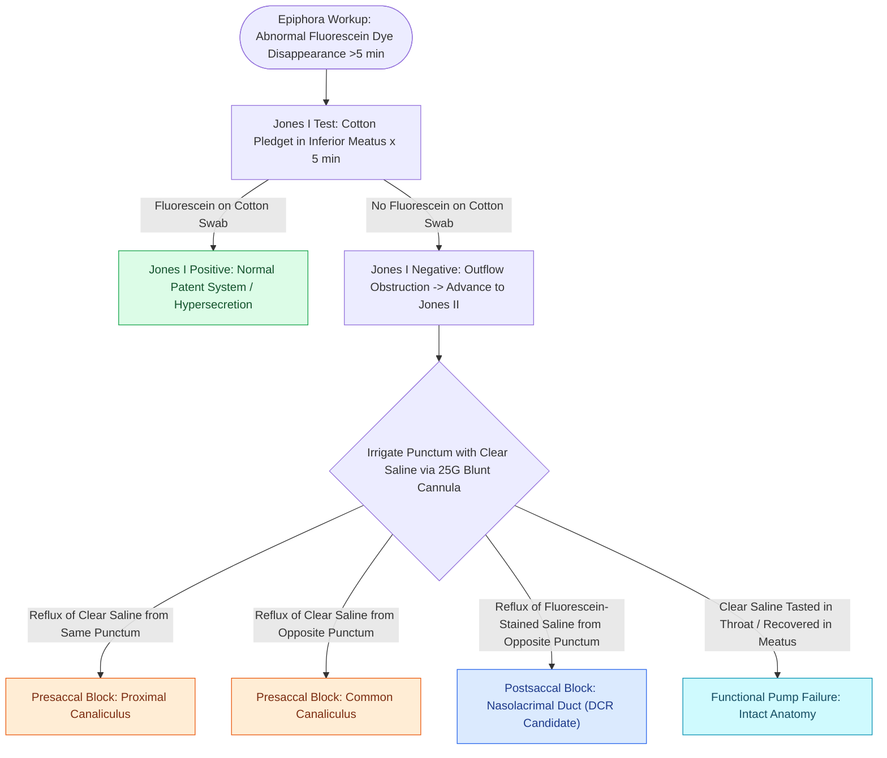

# Jones primary and secondary dye tests differentiate canalicular from nasolacrimal duct obstruction

## Active Recall

> [!question]- In Jones II secondary dye testing, what anatomical site of obstruction is indicated when fluorescein-stained saline refluxes from the opposite punctum?
> *Answer / Clinical Rationale*: **Nasolacrimal duct obstruction (postsaccal blockage)**. Clear irrigated saline enters the lacrimal sac, mixes with residual fluorescein that pooled in the sac during the Jones I test, and is forced retrograde out the opposite punctum because distal outflow through the nasolacrimal duct is occluded.
*(CummingsReview2017, Ch4, p.74)*

> [!question]- How do "hard stop" versus "soft stop" sensations during Bowman lacrimal probing differentiate presaccal from saccal pathology?
> *Answer / Clinical Rationale*: A **hard stop** occurs when the rigid Bowman probe traverses the canaliculi unhindered and impacts the medial bony wall of the lacrimal sac (lacrimal bone), confirming canalicular patency. A **soft stop** occurs when spongy, elastic resistance is encountered before reaching the bony fossa, indicating canalicular stenosis, tortuosity, or common canalicular occlusion.
*(CummingsReview2017, Ch4, p.74)*

> [!question]- What result on Jones II testing distinguishes an anatomical canalicular obstruction from a functional lacrimal pump failure?
> *Answer / Clinical Rationale*: If clear irrigated saline flows freely into the nose and the patient **tastes saline in the pharynx** despite a negative Jones I test, the lacrimal outflow tract is **anatomically patent**, diagnostic of a **functional lacrimal pump failure** (e.g., orbicularis oculi weakness or lid laxity). If saline cannot be irrigated into the pharynx, a physical **anatomical obstruction** is confirmed.
*(CummingsReview2017, Ch4, p.74)*

## Core Clinical & Mechanistic Principles
The evaluation of epiphora requires differentiating **hypersecretion** from **outflow obstruction**, and segregating obstruction into **presaccal** (puncta and canaliculi), **saccal**, or **postsaccal** ([[Incisive uncinectomy exposes the ethmoid infundibulum while protecting the nasolacrimal duct|nasolacrimal duct]]) etiologies. The **Jones dye testing algorithm** provides the definitive, non-invasive physiologic assessment of tear clearance and anatomical patency.

### Pre-Test Evaluation: Dye Disappearance Test
Before instrumentation, the **fluorescein dye disappearance test (DDT)** evaluates baseline physiological clearance. One drop of $2\%$ fluorescein is instilled into each conjunctival fornix without anesthesia. In a normal lacrimal system, symmetric and complete clearance of dye occurs within **5 minutes**. Asymmetric persistent dye pooling confirms impaired outflow.

### Jones I: The Primary Dye Test
The **Jones I test** assesses physiologic tear flow under resting autonomic conditions:
1. Instill $2\%$ fluorescein into the conjunctival sac.
2. Place a small cotton pledget moistened with topical decongestant/anesthetic into the **inferior meatus** at the valve of Hasner.
3. Inspect the pledget at 2 and 5 minutes:
   - **Positive Jones I**: Fluorescein stains the cotton pledget. The system is physiologically patent; epiphora is due to reflex hypersecretion.
   - **Negative Jones I**: No dye is recovered. Indicates an obstruction (anatomical or functional); indicates immediate progression to the Jones II test.

### Jones II: The Secondary Dye Test
The **Jones II test** utilizes positive-pressure hydrostatic irrigation to determine whether fluorescein entered the lacrimal sac during the Jones I test:
1. Wash all residual topical fluorescein from the conjunctival fornix.
2. Anesthetize the punctum, dilate gently with a punctal dilator, and probe with a **00 Bowman probe** to note a **hard stop** (sac entry against medial bony wall) versus **soft stop** (presaccal canalicular blockage).
3. Insert a 25-gauge blunt lacrimal cannula into the inferior canaliculus and irrigate gently with clear, non-dyed normal saline while observing both puncta and placing a fresh cotton pledget in the inferior meatus.

### Diagnostic Interpretation Matrix
1. **Reflux of clear saline from the same punctum**:
   - *Site*: Obstruction of the individual canaliculus being irrigated (proximal to the common canaliculus).
   - *Mechanism*: Fluid cannot pass distally, and because fluorescein never reached the sac, no dye is available to stain the refluxing saline.
2. **Reflux of clear saline from the opposite punctum**:
   - *Site*: Obstruction of the **common canaliculus** or common internal punctum.
   - *Mechanism*: Saline traverses the irrigated canaliculus into the common ampulla, but cannot enter the sac, refluxing retrograde through the open superior canaliculus unstained.
3. **Reflux of fluorescein-stained saline from the opposite punctum**:
   - *Site*: **Nasolacrimal duct obstruction** (postsaccal block).
   - *Mechanism*: Fluorescein spontaneously entered the sac during Jones I but was blocked from exiting the nasolacrimal duct. Irrigated saline fills the sac, mixes with the pooled fluorescein, and hydrostatic pressure drives the dyed mixture out the opposite canaliculus. This finding identifies the classic candidate for endoscopic DCR.
4. **Saline retrieved from nose / tasted in pharynx**:
   - *Stained fluid*: Partial anatomical stenosis of the nasolacrimal duct.
   - *Clear fluid*: **Functional failure of the lacrimal pump** (orbicularis weakness, Seventh nerve palsy, punctal eversion).

## Connected Concepts & Graph Traversal
- **Definitive Surgical Resolution**: [[Endoscopic dacryocystorhinostomy bypasses nasolacrimal duct obstruction via lacrimal sac marsupialization into the middle meatus|Endoscopic DCR Technique]]
- **Fontanelle Surgical Boundary**: [[Controlled middle meatal antrostomy enlargement preserves the anterior inferior fontanelle|Inferior Meatus & Valve of Hasner]]
- **Epithelial Transport Foundation**: [[Respiratory epithelium drives mucociliary clearance toward natural ostia|Mucociliary Transport]]
- **Autonomic Secretomotor Conduit**: [[The Vidian nerve carries parasympathetic secretomotor and sympathetic vasomotor fibers|Vidian Secretomotor Fiber Relay]]
- **Autonomic Parasympathetic Relay**: [[The sphenopalatine ganglion serves as the primary parasympathetic relay for the sinonasal cavity|Sphenopalatine Ganglion Lacrimal Innervation]]
- **Radiological Risk Mapping**: [[The CLOSE checklist systematically evaluates critical radiological danger zones|CLOSE Checklist Lacrimal Assessment]]
- **Diagnostic Evaluation**: [[Endoscopic dacryocystorhinostomy achieves lacrimal sac marsupialization via axillary osteotomy and bivalve mucosal flaps apposed to the agger nasi|Endoscopic DCR Technique]]
- **Anatomical Foundation**: [[Modified medial maxillectomy provides wide maxillary access while preserving the nasolacrimal duct and inferior turbinate head with a nasal floor mucosal flap|Modified Medial Maxillectomy]]
