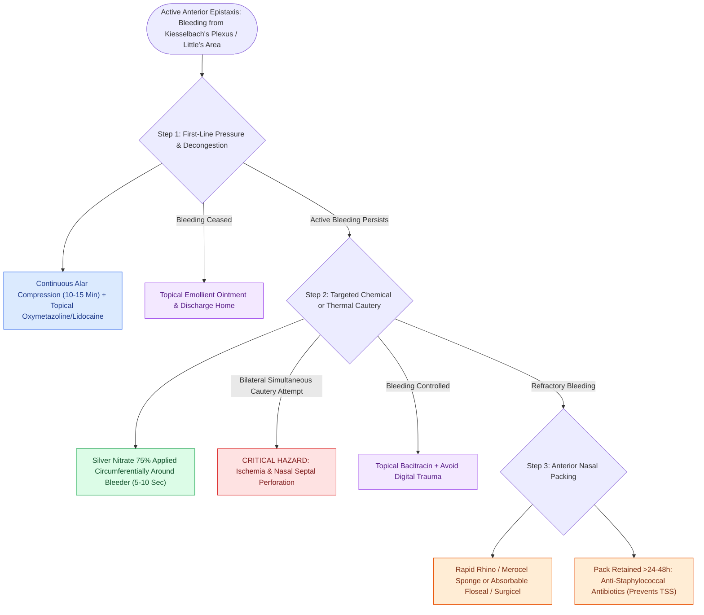

# Kiesselbach plexus anterior epistaxis is managed with cautery and anterior nasal packing

## Active Recall

> [!question]- What four arterial branches anastomose to form Kiesselbach's plexus (Little's area) on the anterior nasal septum?
> *Answer / Clinical Rationale*: (1) **Anterior ethmoidal artery** (ophthalmic artery $\rightarrow$ ICA), (2) **Sphenopalatine artery** (posterior septal / nasopalatine branch $\rightarrow$ ECA), (3) **Greater palatine artery** (via incisive canal $\rightarrow$ ECA), and (4) **Superior labial artery** (septal branch of facial artery $\rightarrow$ ECA). *(Note: The posterior ethmoidal artery supplies the posterosuperior nasal vault and superior turbinate rather than Little's area).*

> [!question]- Why is bilateral simultaneous chemical or thermal cautery on opposite sides of the nasal septum strictly contraindicated?
> *Answer / Clinical Rationale*: Bilateral septal cautery severely compromises the bilateral mucoperichondrial blood supply to the avascular septal quadrilateral cartilage, leading to ischemic necrosis and [[Nasal septal perforation repair requires bilateral mucosal advancement flaps and interposition grafts|nasal septal perforation]].

> [!question]- What is the recommended application duration and spatial technique when using silver nitrate for anterior epistaxis?
> *Answer / Clinical Rationale*: Apply in a **circumferential pattern around the feeding vessel first**, followed by direct application to the bleeding point for **no more than 5 to 10 seconds** until a grayish-white silver proteinate eschar forms.

## Core Clinical & Mechanistic Principles
**Anterior epistaxis** accounts for $>90\%$ of all clinical nosebleeds. It originates from **Kiesselbach's plexus (Little's area)** situated on the anterior-inferior cartilaginous nasal septum:

- **Vascular Anastomotic Grid (Four-Artery Confluence)**:
  - *Internal Carotid System*: [[The 24-12-6 rule governs anterior and posterior ethmoidal artery surgical localization|Anterior ethmoidal]] artery (whereas the posterior ethmoidal artery supplies the posterosuperior nasal vault outside Little's area).
  - *External Carotid System*: [[The crista ethmoidalis guides endoscopic sphenopalatine artery ligation|Sphenopalatine]] (nasopalatine branch), greater palatine (via incisive canal), and superior labial (septal branch) arteries.
- **Pathophysiologic Triggers**: Digital trauma, low ambient humidity, [[Rhinitis subtypes are differentiated into allergic, vasomotor, gustatory, and rhinitis medicamentosa|allergic rhinitis]], topical intranasal corticosteroid misdirection (spraying onto septum rather than lateral wall), and coagulopathy.

### Stepwise Management Algorithm & Craft Nuance
1. **Direct Compression & Topical Decongestion**:
   - Firm continuous manual compression on the lower compressible third of the nose (nasal alae against septum) for $10\text{–}15\text{ minutes}$ with patient leaning forward to prevent aspiration.
   - Topical oxymetazoline $0.05\%$ or phenylephrine with $4\%$ lidocaine on cotton pledgets.
2. **Chemical Cauterization (Silver Nitrate $75\%$ / Potassium Nitrate $25\%$)**:
   - Evacuate clots with a Frazier suction tip.
   - Roll the silver nitrate tip circumferentially around the vessel periphery to coagulate collateral feeders, then touch the central vessel for $5\text{–}10\text{ seconds}$.
   - Immediately blot excess chemical with suction or saline cotton to prevent mucosal run-down and cutaneous tattooing.
3. **Anterior Nasal Packing & Absorbable Matrices**:
   - *Non-Absorbable Packs*: Polyvinyl alcohol sponges (Merocel®) lubricated with antibiotic ointment, or carboxymethylcellulose pneumatic packs (Rapid Rhino®) activated in sterile water.
   - *Absorbable Hemostatics*: Preferred in coagulopathic or thrombocytopenic patients ([[Topical hemostatic matrix agents and nasal packing mitigate postoperative epistaxis and synechiae|Floseal, Surgicel, Gelfoam]]).
   - *Toxic Shock Syndrome Prophylaxis*: Non-absorbable packs left $>24\text{ hours}$ mandate systemic anti-staphylococcal coverage (e.g., cephalexin or amoxicillin-clavulanate) against *S. aureus* TSST-1 exotoxin.

## Connected Concepts & Graph Traversal
- **Posterior Epistaxis Correlate**: [[Posterior epistaxis from sphenopalatine artery arborization requires endoscopic ligation or embolization|Posterior Epistaxis & ESPAL]]
- **Ethmoidal Artery Localization**: [[The 24-12-6 rule governs anterior and posterior ethmoidal artery surgical localization|Ethmoidal Arteries 24-12-6 Rule]]
- **🔗 Iatrogenic Complication (FPRS)**: [[Nasal septal perforation repair requires bilateral mucosal advancement flaps and interposition grafts|Septal Perforation]]
- **Hemostatic Substrates**: [[Topical hemostatic matrix agents and nasal packing mitigate postoperative epistaxis and synechiae|Hemostatic Agents & Packing]]
- **Genetic Vascular Malformation**: [[Hereditary hemorrhagic telangiectasia manifests with mucosal AVMs and recurrent epistaxis|HHT & Osler-Weber-Rendu]]
- **Complication Rescue**: [[Caudal septoplasty corrects caudal subluxation and external valve collapse through swinging-door relocation and L-strut preservation|Caudal Septoplasty]]
