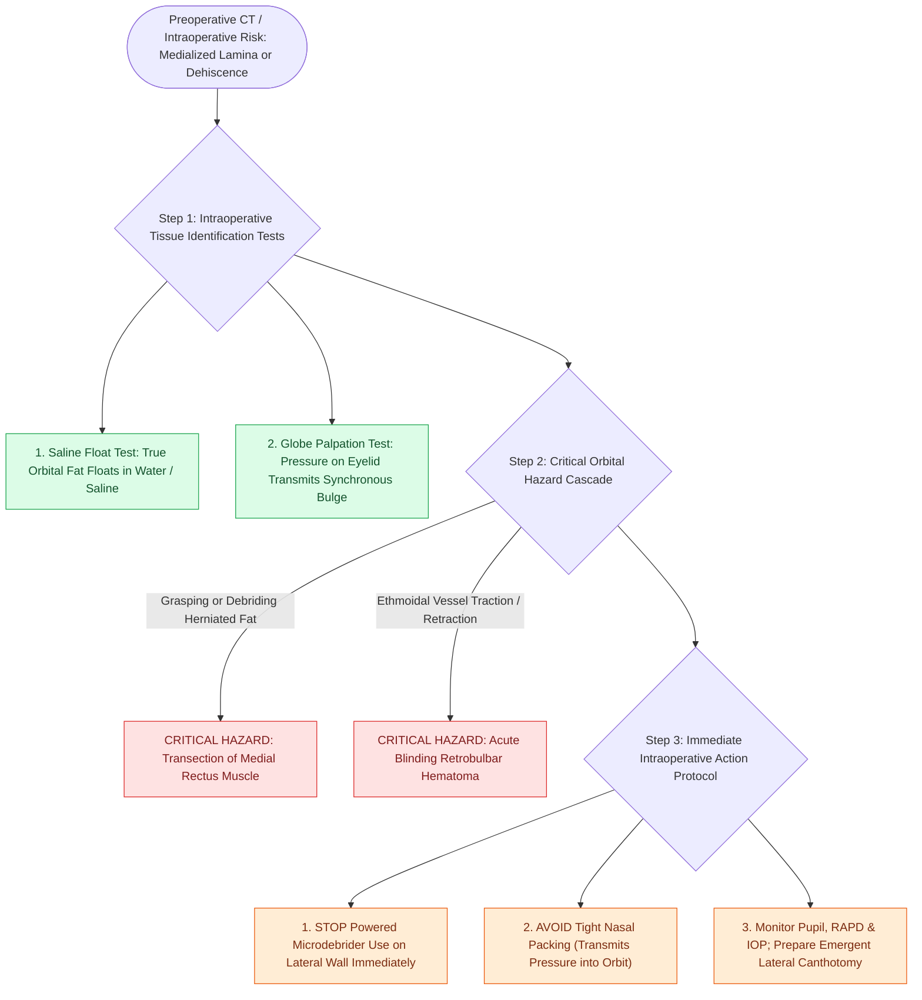

# Lamina papyracea dehiscence predisposes to orbital fat herniation and medial rectus injury

## Active Recall

> [!question]- How can the surgeon immediately differentiate exposed orbital fat from an inflammatory nasal polyp during FESS?
> *Answer / Clinical Rationale*: Orbital fat is yellow, lobulated, and **floats when placed in saline**, whereas inflammatory polyps are dense, vascularized, and sink in liquid. In addition, gentle globe palpation transmits visible movement to orbital fat.

> [!question]- What anatomical deformation occurs in Silent Sinus Syndrome that predisposes the patient to orbital injury during uncinectomy?
> *Answer / Clinical Rationale*: Chronic sub-atmospheric pressure causes inward collapse of the maxillary sinus walls, pulling the **lamina papyracea and orbital floor medially and inferiorly**, placing them directly in the path of the sickle knife.

## Core Clinical & Mechanistic Principles
The **[[Draf IIb frontal sinusotomy extends from lamina papyracea to the nasal septum|lamina papyracea]]** is the paper-thin, translucent ethmoidal plate that forms the medial wall of the orbit. Disruption or congenital dehiscence of this thin bony barrier exposes the periorbita, orbital fat, and **medial rectus muscle** directly to surgical instruments during FESS.

### High-Risk Anatomical Scenarios
1. **Congenital Dehiscence**: Present in up to 5% of normal populations, most frequently along the anterior ethmoid / lamina junction.
2. **Post-Traumatic Dehiscence**: Remote blow-out fractures or previous FESS scarring.
3. **Silent Sinus Syndrome (Chronic Maxillary Atelectasis)**: Negative pressure in an obstructed maxillary sinus causes inward collapse and medial slump of the orbital floor and lamina papyracea into the sinus lumen.

### Recognizing Orbital Fat vs Sinonasal Tissue
- **The Saline Float Test**: Sinonasal mucosa, polyps, and soft tissues sink in saline. **Orbital fat floats in water/saline**.
- **Eye Palpation Test**: Intermittently press on the closed eyelid through the surgical drapes while observing the middle meatus. If orbital contents are breached, pressing the globe transmits visible, synchronized bulging of fat into the ethmoid cavity.

## Critical Complications of Orbital Breach
- **Medial Rectus Transection**: Direct [[Powered microdebrider blade selection and suction irrigation maintain clean surgical optics|microdebrider]] or forceps injury causes immediate permanent diplopia and strabismus.
- **Retrobulbar Hematoma**: Laceration of ethmoidal arterial vessels retracting into the orbit leads to a rapidly expanding, blinding compartment syndrome (see [[Retrobulbar hematoma requires emergent bedside lateral canthotomy and cantholysis|Retrobulbar Hematoma & Lateral Canthotomy]]).

## Connected Concepts & Graph Traversal
- **Checklist Framework**: [[The CLOSE checklist systematically evaluates critical radiological danger zones|CLOSE Checklist]]
- **Emergency Rescue**: [[Retrobulbar hematoma requires emergent bedside lateral canthotomy and cantholysis|Retrobulbar Hematoma Rescue]]
- **Surgical Step**: [[Incisive uncinectomy exposes the ethmoid infundibulum while protecting the nasolacrimal duct|Incisive Uncinectomy]]
- **Anatomical Narrowing**: [[Infraorbital Haller cells narrow the ethmoid infundibulum and maxillary ostium|Haller Cells]]
- **Diagnostic Imaging**: [[Supraorbital ethmoid cells suspend the anterior ethmoidal artery below the skull base|AEA Mesentery Anatomy]]
- **Anatomical Foundation**: [[Onodi cells place the optic nerve and carotid artery at risk during posterior ethmoidectomy|Onodi Cell Anatomy]]
- **Surgical Technique**: [[Balanced endoscopic orbital decompression removes the lamina papyracea and medial floor while sparing the inferomedial strut to prevent diplopia|Balanced Orbital Decompression]]
- **Critical Safety**: [[Endoscopic medial intraconal orbital tumor resection utilizes binarial four-handed dissection and dynamic medial rectus retraction below the plane of resectability|Intraconal Orbital Tumor Resection]]
