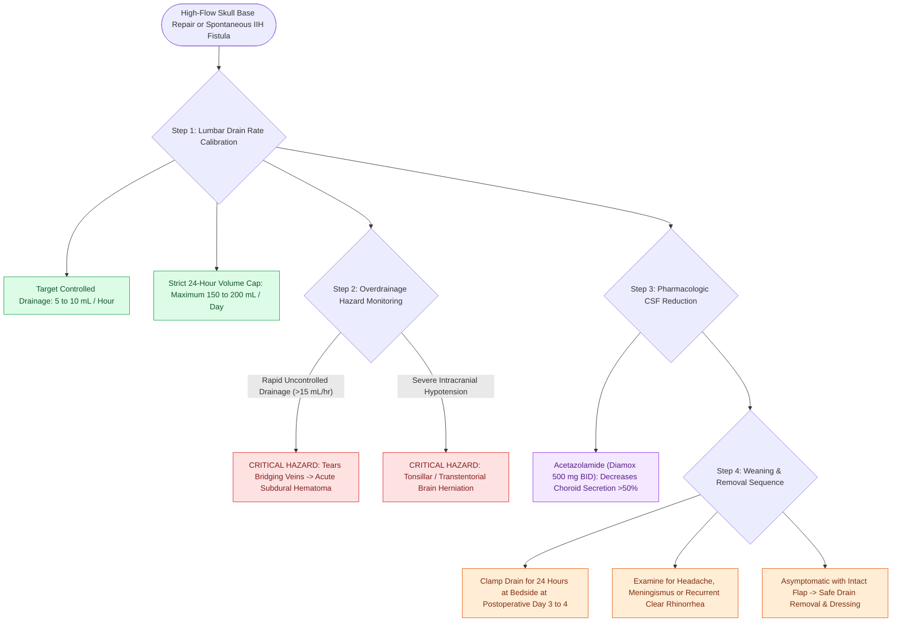

# Lumbar drain placement and ICP management lower the risk of postoperative CSF fistula recurrence

## Active Recall

> [!question]- What is the target hourly drainage volume for a lumbar drain following high-flow skull base repair?
> *Answer / Clinical Rationale*: **$5\text{ to }10\text{ mL/hour}$** (typically capped at $150\text{–}200\text{ mL/day}$) to avoid intracranial hypotension and subdural hemorrhage.

> [!question]- What catastrophic neurological complication can occur from rapid, uncontrolled lumbar drain overdrainage?
> *Answer / Clinical Rationale*: **Transtentorial or tonsillar brain herniation**, acute subdural hematoma (from tearing of bridging cortical veins), and pneumocephalus.

## Core Clinical & Mechanistic Principles
A **Lumbar Spinal Drain** reduces cerebrospinal fluid pressure and volume at the surgical repair site during the critical early healing window ($48\text{–}72\text{ hours}$), protecting vascularized flaps and [[Multi-layer skull base reconstruction combines underlay, inlay, and overlay barriers|multi-layer grafts]] from hydrodynamic displacement by CSF pulsations.

### Safety Monitoring & Weaning Protocol
- **Weaning Sequence**: Clamp the lumbar drain for $24\text{ hours}$ prior to removal; examine the patient for recurrent rhinorrhea or headache.
- **Acetazolamide (Diamox)**: Administer $500\text{ mg}$ PO BID to decrease choroid plexus CSF production by $>50\%$.

## Connected Concepts & Graph Traversal
- **Etiology**: [[Spontaneous CSF leaks are strongly associated with idiopathic intracranial hypertension and elevated BMI|Spontaneous CSF Leaks & IIH]]
- **Multi-Layering**: [[Multi-layer skull base reconstruction combines underlay, inlay, and overlay barriers|Multi-Layer Skull Base Repair]]
- **Intraoperative Dye**: [[Intrathecal fluorescein enables visual localization of occult dural defects|Intrathecal Fluorescein]]
- **High-Stakes Safety**: [[Iatrogenic skull base cribriform leaks require immediate intraoperative multi-layer graft repair|Iatrogenic Skull Base Repair]]
- **Critical Safety / Complication**: [[Esthesioneuroblastoma Kadish and Hyams staging determines craniofacial resection and adjuvant therapy|Esthesioneuroblastoma (ENB)]]
