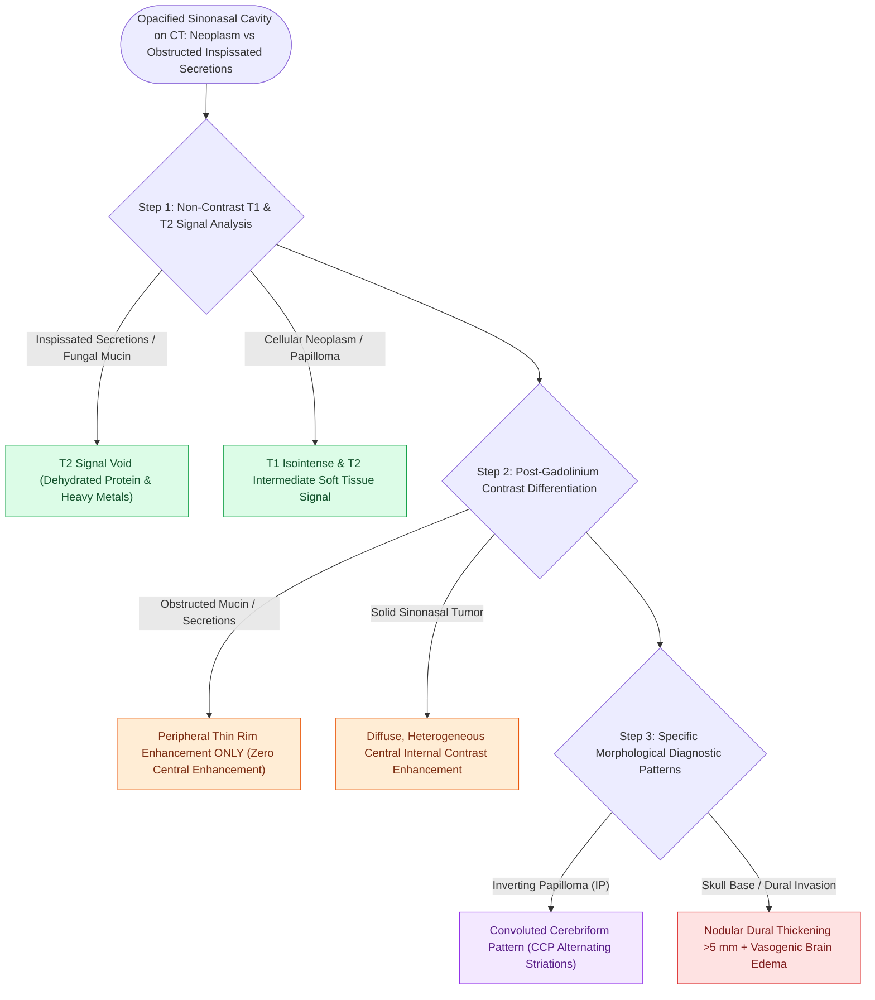

# MRI T1, T2, and contrast protocols differentiate sinonasal neoplasms from inspissated secretions

## Active Recall

> [!question]- How does contrast-enhanced T1 MRI distinguish a sinonasal tumor from entrapped, obstructed sinus secretions?
> *Answer / Clinical Rationale*: A **neoplasm enhances centrally** throughout its vascularized cellular mass, whereas **inspissated secretions show no central enhancement**, demonstrating only a thin rim of mucosal enhancement.

> [!question]- What MRI sign on T2/T1-contrast is characteristic of sinonasal inverting papilloma?
> *Answer / Clinical Rationale*: The **convoluted cerebriform pattern (CCP)**, reflecting the underlying endophytic invagination of tumor epithelium.

## Core Clinical & Mechanistic Principles
While high-resolution CT excels at defining bony skull base architecture, **Magnetic Resonance Imaging (MRI)** is the indispensable modality for differentiating **sinonasal neoplasms from obstructed, inspissated inflammatory secretions**, evaluating dural invasion, and mapping perineural tumor spread.

### The "Convoluted Cerebriform Pattern" (CCP)
- Characteristic MRI finding on T2 and contrast-enhanced T1 images for **sinonasal [[Sinonasal exophytic and oncocytic papillomas differ from inverting papilloma in malignant potential|inverting papilloma]]**, demonstrating alternating hyper- and hypointense parallel lines resembling brain gyri (present in $>80\%$ of IPs).

## Connected Concepts & Graph Traversal
- **Neoplasm Resection**: [[Sinonasal inverting papilloma requires subperiosteal excision and hyperostotic bone drill-out|Inverting Papilloma]]
- **Skull Base Invasion**: [[Transcribriform EEA provides access to olfactory groove meningiomas and esthesioneuroblastomas|Transcribriform EEA]]
- **CSF Fistula Mapping**: [[Beta-2 transferrin and high-resolution CT localize sinonasal CSF fistulas|MR Cisternography]]
- **Diagnostic Imaging**: [[Supraorbital ethmoid cells suspend the anterior ethmoidal artery below the skull base|AEA Mesentery Anatomy]]
- **Anatomical Foundation**: [[Onodi cells place the optic nerve and carotid artery at risk during posterior ethmoidectomy|Onodi Cell Anatomy]]
- **Surgical Craft**: [[Sphenoid sinus pneumatization patterns dictate carotid and optic canal exposure|Sphenoid Pneumatization Patterns]]
- **Critical Safety / Complication**: [[Esthesioneuroblastoma Kadish and Hyams staging determines craniofacial resection and adjuvant therapy|Esthesioneuroblastoma (ENB)]]
