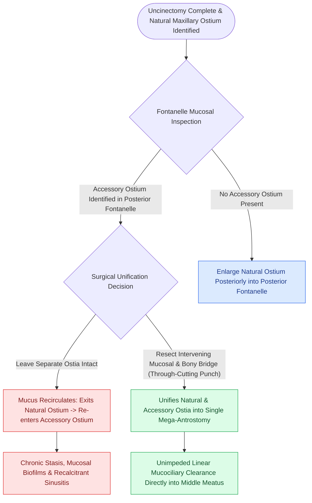

# Maxillary antrostomy requires incorporating accessory fontanelle ostia to prevent recirculation

## Active Recall

> [!question]- Why must the natural maxillary sinus ostium be enlarged posteriorly and inferiorly rather than anteriorly or superiorly?
> *Answer / Clinical Rationale*: Enlarging anteriorly risks transecting the **nasolacrimal duct**, while enlarging superiorly risks penetrating the **orbital floor / [[Draf IIb frontal sinusotomy extends from lamina papyracea to the nasal septum|lamina papyracea]]** and injuring the infraorbital nerve.

> [!question]- What occurs if an accessory ostium in the fontanelle is left separated from the newly created antrostomy?
> *Answer / Clinical Rationale*: The **mucus recirculation phenomenon** develops: mucus exiting the natural ostium re-enters the maxillary sinus through the accessory opening in an endless circular loop.

## Core Clinical & Mechanistic Principles
**Maxillary antrostomy** (Step 2 of FESS) enlarges the natural drainage pathway of the maxillary sinus. The primary surgical objective is to identify the **true natural maxillary ostium** and enlarge it into the [[Controlled middle meatal antrostomy enlargement preserves the anterior inferior fontanelle|posterior fontanelle]], ensuring that all accessory ostia are incorporated into a single unified opening.

### Step-by-Step Surgical Craft
1. **Identifying the Natural Ostium**:
   - Utilize a $30^\circ$ or $70^\circ$ endoscope and a curved ball-tipped probe.
   - Palpate the lateral nasal wall immediately **posterior and inferior to the nasolacrimal duct bulge**.
   - The probe drops into the natural ostium at an angle of roughly $45^\circ$ lateral and inferior.
2. **Posterior & Inferior Enlargement**:
   - Using a straight or curved through-cutting punch, backbiting forceps, or [[Powered microdebrider blade selection and suction irrigation maintain clean surgical optics|microdebrider]], enlarge the ostium **posteriorly into the membranous posterior fontanelle** and **inferiorly toward the inferior turbinate**.
3. **Incorporating Accessory Ostia**:
   - If an accessory fontanelle ostium is identified, completely excise the intervening mucosal and bony bridge to create a single continuous mega-antrostomy, preventing the [[Separate inferior antrostomies cause recirculating mucus and recalcitrant sinusitis|mucus recirculation phenomenon]].
4. **Anterior & Superior Boundaries (DANGER ZONES)**:
   - **Anterior Limit**: The hard bone of the nasolacrimal canal. Do not cut anterior to the natural ostium.
   - **Superior Limit**: The orbital floor and [[Lamina papyracea dehiscence predisposes to orbital fat herniation and medial rectus injury|lamina papyracea]].

## Connected Concepts & Graph Traversal
- **Physiological Hazard**: [[Separate inferior antrostomies cause recirculating mucus and recalcitrant sinusitis|Mucus Recirculation Phenomenon]]
- **Preceding Step**: [[Incisive uncinectomy exposes the ethmoid infundibulum while protecting the nasolacrimal duct|Incisive Uncinectomy]]
- **Next Step**: [[Entering the ethmoid bulla inferomedially avoids orbital and skull base penetration|Anterior Ethmoidectomy]]
- **Haller Cell Impact**: [[Infraorbital Haller cells narrow the ethmoid infundibulum and maxillary ostium|Haller Cell Narrowing]]
- **Diagnostic Evaluation**: [[Draf I frontal sinusotomy clears obstructing ethmoid cells without instrumenting the ostium|Draf I Frontal Sinusotomy]]
- **Surgical Craft**: [[Complete uncinectomy and posterior fontanelle resection unify the natural maxillary ostium with fontanelle defects to prevent mucus recirculation loops|Posterior Fontanelle Resection]]
