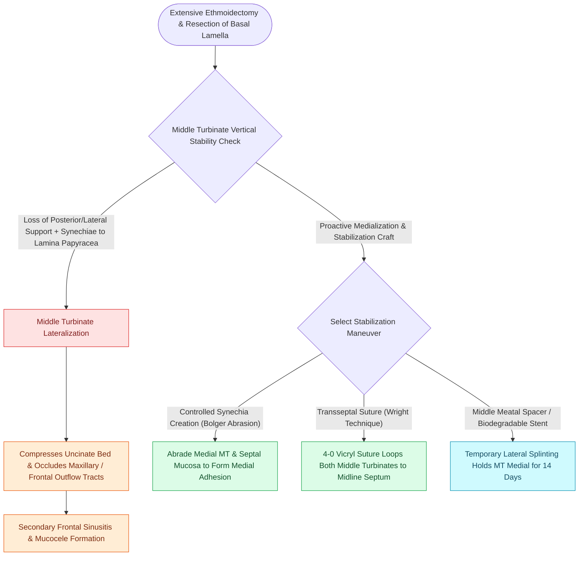

# Middle turbinate lateralization causes secondary ostiomeatal obstruction and frontal sinus stenosis

## Active Recall

> [!question]- Why is middle turbinate lateralization considered the leading cause of revision frontal sinus surgery?
> *Answer / Clinical Rationale*: When the middle turbinate scars laterally against the [[Lamina papyracea dehiscence predisposes to orbital fat herniation and medial rectus injury|lamina papyracea]] or [[Agger nasi cells form the anterior boundary of the frontal recess|agger nasi]], it forms a dense fibrous bridge that **directly closes the frontal recess outflow tract**, trapping mucus and causing recurrent frontal sinusitis or mucoceles.

> [!question]- What surgical technique can be used to hold the middle turbinates in a medialized position postoperatively?
> *Answer / Clinical Rationale*: A **trans-septal mattress suture (concho-septopexy)** or placing a dissolvable middle meatal stent.

## Core Clinical & Mechanistic Principles
**Lateralization of the middle turbinate** is the **single most common cause of surgical failure and revision surgery in FESS**, occurring when an unstable or destabilized middle turbinate adheres to the lateral nasal wall during healing.

### Intraoperative Prevention Techniques
1. **Controlled Synechia Formation (Bolger / Concho-Septopexy)**:
   - Deliberately abrading opposing surfaces of the medial middle turbinate and nasal septum and placing a temporary spacer or suture to create a controlled medial adhesion.
2. **Trans-Septal Suture (Surgicel / Prolene Quilt)**:
   - Passing a 4-0 absorbable suture through the middle turbinate, septum, and contralateral turbinate to secure both turbinates medially.
3. **Preserving the Vertical Basal Lamella**:
   - Avoiding destabilizing the superior vertical lamellar attachment during [[Incisive uncinectomy exposes the ethmoid infundibulum while protecting the nasolacrimal duct|uncinectomy]] and ethmoidectomy.

## Connected Concepts & Graph Traversal
- **Anatomy**: [[The basal lamella of the middle turbinate divides anterior from posterior ethmoid cells|Basal Lamella Architecture]]
- **Frontal Recess**: [[The frontal recess is bounded by the agger nasi, middle turbinate, and skull base|Frontal Recess Boundaries]]
- **Stenting**: [[Topical hemostatic matrix agents and nasal packing mitigate postoperative epistaxis and synechiae|Dissolvable Stents]]
- **High-Stakes Safety**: [[Iatrogenic skull base cribriform leaks require immediate intraoperative multi-layer graft repair|Iatrogenic Skull Base Repair]]
- **Anatomical Foundation**: [[Paradoxical middle turbinate curvature alters middle meatal airflow and surgical access|Paradoxical Middle Turbinate]]
- **Complication Rescue**: [[Middle turbinate suture medialization prevents lateralization and iatrogenic frontal sinus ostial obstruction following ethmoidectomy|MT Suture Medialization]]
- **Prophylactic Partial Resection Alternative**: [[Partial middle turbinectomy provides surgical access and prevents synechiae in selected polyposis or skull base cases while preserving superior attachments to protect olfaction and skull base stability|Partial Middle Turbinectomy]]
- **Recurrence After Revision**: [[Revision endoscopic sinus surgery systematically corrects recurrent middle turbinate lateralization, retained uncinate fragments, and persistent frontal recess cells to restore ostial patency|Revision ESS]]
