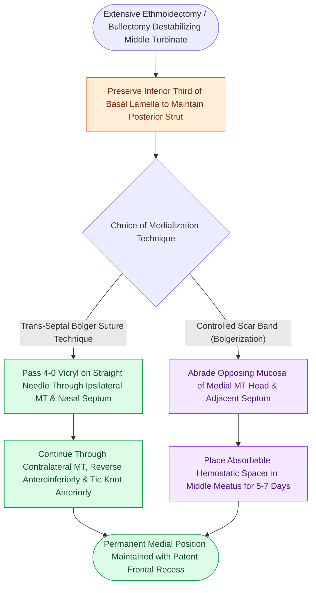

# Middle turbinate suture medialization prevents lateralization and iatrogenic frontal sinus ostial obstruction following ethmoidectomy

## Active Recall

> [!question]- What is the primary pathophysiologic mechanism leading to intractable frontal sinusitis following functional endoscopic sinus surgery?
> *Answer / Clinical Rationale*: Destabilization of the middle turbinate basal lamella allows the remnant turbinate to drift laterally toward the abraded lamina papyracea, forming dense cicatricial synechiae that obstruct the middle meatus and mechanically block frontal sinus drainage.

> [!question]- What are two validated surgical maneuvers used at the conclusion of FESS to ensure stable medial positioning of the middle turbinate?
> *Answer / Clinical Rationale*: (1) Trans-septal through-and-through suture medialization (using 4-0 Vicryl or knot-free barbed suture) securing the middle turbinate to the nasal septum; and (2) controlled mucosal abrading between opposing surfaces of the anterior middle turbinate head and nasal septum to induce a stable medial scar band supported by a temporary middle meatal spacer.

## Core Clinical & Mechanistic Principles
The middle turbinate serves as the cornerstone landmark for endoscopic sinus surgeons, dividing the olfactory cleft medially from the ethmoidal labyrinth laterally. During extensive functional endoscopic sinus surgery (FESS), surgical disruption of the uncinate process, ethmoid bulla, and third lamella weakens the mechanical support of the middle concha. 

As established in [[Middle turbinate lateralization causes secondary ostiomeatal obstruction and frontal sinus stenosis|middle turbinate lateralization pathophysiology]], postoperative mucosal edema and wound contracture exert powerful lateral vectors. If the destabilized turbinate adheres to the dissected lamina papyracea, dense synechiae form, resulting in secondary maxillary, ethmoid, and recalcitrant frontal sinus ostial stenosis. Preserving an unscarred, medialized turbinate also maintains salvage utility for [[The middle turbinate vascularized flap provides an alternative rescue flap for skull base repair|the middle turbinate vascularized rescue flap]].

### Operative Techniques for Medialization
1. **Preservation of the Inferior Basal Lamella**:
   - When entering the posterior ethmoid cells, the superior two-thirds of the basal lamella is fenestrated while the inferior third is strictly preserved. This maintains a rigid posterior osseous strut anchoring the turbinate to the lateral nasal wall and palatine bone.
2. **Trans-Septal Suture Medialization (Bolger Suture)**:
   - A 4-0 polyglactin 910 (Vicryl) suture on a straight cutting needle is advanced endoscopically through the anterior portion of the ipsilateral middle turbinate, across the nasal septum, and through the contralateral middle turbinate.
   - The needle is reversed and passed back across the septum in an anteroinferior position.
   - The suture is secured anteriorly across the septum under endoscopic visualization, drawing both middle turbinates snugly against the nasal septum.
   - Alternatively, a **knot-free suture technique** utilizing barbed absorbable suture eliminates the challenge of tying knots in deep, narrow nasal corridors.
3. **Controlled Scar Band (Adhesion) Creation**:
   - The opposing medial mucosa of the middle turbinate head and the adjacent nasal septum are gently abraded using a microdebrider or sickle knife.
   - An absorbable hemostatic spacer (such as carboxymethylcellulose or gelatin sponge) is placed into the middle meatus to exert gentle medial counterpressure for 5 to 7 days, allowing a permanent, controlled fibrous synechia to fuse the turbinate to the septum away from the frontal recess.
4. **Middle Turbinate Resection Controversies**:
   - Routine middle turbinectomy is controversial. High resection near the skull base risks cribriform plate fracture, CSF leak, and olfactory loss. Conservative partial resection (lower half only) is reserved for severe recalcitrant polyposis, always accompanied by electrocautery of the posterior stump to prevent hemorrhage from sphenopalatine artery branches.

## Connected Concepts & Graph Traversal
- **Basal Lamella Segmentation**: [[The basal lamella of the middle turbinate divides anterior from posterior ethmoid cells]]
- **Frontal Outflow Borders**: [[The frontal recess is bounded by the agger nasi, middle turbinate, and skull base]]
- **Curvature Variations**: [[Paradoxical middle turbinate curvature alters middle meatal airflow and surgical access]]
- **Conchal Surgery Mechanics**: [[Concha bullosa resection requires lateral lamella excision to preserve medial cribriform attachment and middle turbinate stability]]
- **Sphenopalatine Landmarks**: [[The crista ethmoidalis guides endoscopic sphenopalatine artery ligation]]
- **Revision Surgery Correction**: [[Revision endoscopic sinus surgery systematically corrects recurrent middle turbinate lateralization, retained uncinate fragments, and persistent frontal recess cells to restore ostial patency|Revision Endoscopic Sinus Surgery]]
