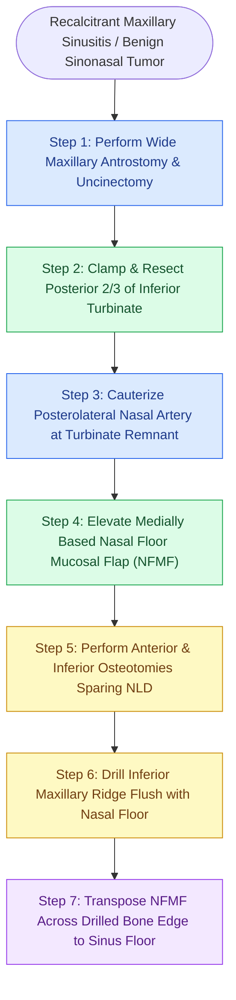

# Modified medial maxillectomy provides wide maxillary access while preserving the nasolacrimal duct and inferior turbinate head with a nasal floor mucosal flap

## Active Recall

> [!question]- How does a modified medial maxillectomy differ from a traditional endoscopic medial maxillectomy?
> *Answer / Clinical Rationale*: A traditional endoscopic medial maxillectomy resects the entire medial maxillary wall including the nasolacrimal duct (requiring DCR) and the entire inferior turbinate, predisposing to empty nose syndrome, chronic crusting, and epiphora. In contrast, the modified medial maxillectomy preserves the anterior one-third head of the inferior turbinate and keeps the nasolacrimal duct intact anterior to the osteotomy, maintaining physiological nasal airflow turbulence and lacrimal drainage.
>
> [!question]- What is the purpose of elevating a medially based nasal floor mucosal flap (NFMF) during modified medial maxillectomy?
> *Answer / Clinical Rationale*: The nasal floor mucosal flap is rolled medially toward the septum prior to bone osteotomies and diamond burr drill-down of the inferior maxillary ridge. Once the medial wall is removed and the ridge drilled flush with the nasal floor, the vascularized mucosal flap is transposed laterally over the exposed bone, preventing postoperative osteitis, circumferential scar contracture, and recalcitrant crusting.

## Core Clinical & Mechanistic Principles

Recalcitrant maxillary sinusitis in patients with cystic fibrosis, dense bacterial biofilms, extensive allergic fungal mucin, or severe mucosal disease following prior Caldwell-Luc surgery frequently fails standard endoscopic [[Controlled middle meatal antrostomy enlargement preserves the anterior inferior fontanelle|middle meatal antrostomy]]. In these pathological states, ciliary clearance along the sinus walls is irreversibly impaired, leading to permanent mucus dependency on gravity drainage and localized topical lavage. A conventional antrostomy leaves the deep dependent floor, anterior lacrimal recess, and alveolar recesses inaccessible to in-office suctioning or high-volume saline irrigations, risking [[Separate inferior antrostomies cause recirculating mucus and recalcitrant sinusitis|mucus recirculation]] and refractory colonization.

The modified endoscopic medial maxillectomy (Woodworth-Grayson technique) creates an unhindered, gravity-dependent communication between the maxillary cavity and the nasal fossa. By resecting the posterior two-thirds of the inferior turbinate and the central bony medial maxillary wall, the surgeon exteriorizes the maxillary sinus completely. Crucially, this modification preserves the anterior attachment of the inferior turbinate (retaining normal inspiratory air heating and humidification) and preserves the nasolacrimal duct at Hasner's valve. Transposing a medially based nasal floor mucosal flap (NFMF) laterally over the drilled inferior maxillary bone ridge seals bare bony edges, promoting rapid mucosal healing by primary intention and abolishing osteitic bone exposure.

### Step-by-Step Surgical Execution

1. **Decongestion and Local Infiltration**: 1% lidocaine with 1:100,000 epinephrine is infiltrated into the inferior turbinate head, anterior axilla, lateral nasal wall, and transorally into the greater palatine canal.
2. **Complete Uncinectomy and Middle Meatal Antrostomy**: The uncinate process is completely excised to expose the natural maxillary ostium, which is enlarged posteriorly to the posterior maxillary wall.
3. **Resection of the Posterior Two-Thirds of Inferior Turbinate**: A Freer elevator medializes the turbinate. A straight hemostat is clamped across the junction of the anterior one-third and posterior two-thirds for 30 seconds to achieve crushing hemostasis. Turbinate scissors incise the turbinate angled posterior to the nasolacrimal duct (Hasner's valve), and the cut is extended posteriorly flush with the posterior maxillary wall.
4. **Hemostasis of the Posterolateral Nasal Artery**: The posterior cut edge of the turbinate remnant is thoroughly cauterized with suction monopolar/bipolar electrocautery to prevent delayed arterial bleeding.
5. **Nasal Floor Mucosal Flap Elevation**: Using a curved Beaver blade, an anterior vertical incision is placed along the nasal floor immediately posterior to Hasner's valve. A posterior incision is made at the plane of the posterior maxillary wall. A straight blade joins these incisions along the lateral nasal floor just below the turbinate attachment. A suction Freer elevator rolls this flap medially toward the septum.
6. **Osteotomy of the Medial Maxillary Wall**: A J-curette perforates the medial maxillary wall into the antrum posterior-inferior to Hasner's valve. Through-cutting or backbiting forceps enlarge the osteotomy anteriorly to the posterior border of the nasolacrimal canal and posteriorly flush with the posterior maxillary wall.
7. **Drill-Down of the Inferior Maxillary Ridge**: A 15-degree high-speed diamond burr planes down the remaining inferior bony ledge until the sinus floor and nasal floor lie flush.
8. **Insetting the Mucosal Flap**: The NFMF is unfurled laterally across the polished bony ridge, covering all raw bone and extending onto the maxillary floor.

### Danger Zones & Complication Avoidance

- **Nasolacrimal Duct Transection**: The anterior osteotomy must strictly remain posterior to the bony lacrimal canal and Hasner's valve. If iatrogenic duct transection occurs, immediate endoscopic dacryocystorhinostomy with bivalve stenting is performed to avoid permanent epiphora.
- **Maxillary Mucosa Stripping**: Intraluminal sinus mucosa should never be completely stripped. Stripping induces osteoneogenesis, dense scar contracture, and hypoplasia of the maxillary antrum.
- **Prolapsed Orbital Fat**: In patients undergoing maxillectomy after prior orbital decompression, orbital fat fills the infundibulum. The inferior and anterior bone cuts must be created first, allowing the medial maxillary wall to be rotated from lateral to medial away from the herniated orbital tissue.

## Connected Concepts & Graph Traversal
- **Anatomical Landmark**: [[Incisive uncinectomy exposes the ethmoid infundibulum while protecting the nasolacrimal duct|Nasolacrimal Duct Anatomy & Hasner Valve]]
- **Surgical Alternative**: [[Sinonasal inverting papilloma requires subperiosteal excision and hyperostotic bone drill-out|Endoscopic Medial Maxillectomy for Inverted Papilloma]]
- **Inflammatory Indication**: [[Non-Type 2 CRS features neutrophilic inflammation associated with cystic fibrosis and ciliopathies|Cystic Fibrosis Refractory Sinusitis]]
- **Flap Vascularity**: [[The inferior turbinate flap pedicled on the inferior turbinate artery repairs anterior floor defects|Inferior Turbinate Vascular Supply]]
- **Complication Management**: [[Posterior epistaxis from sphenopalatine artery arborization requires endoscopic ligation or embolization|Posterolateral Nasal Artery Cauterization]]
