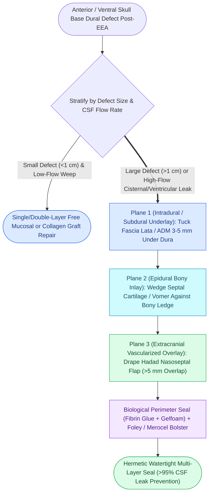

# Multi-layer skull base reconstruction combines underlay, inlay, and overlay barriers

## Active Recall

> [!question]- What is the primary biomechanical purpose of the rigid 'inlay' layer in multi-layer skull base reconstruction?
> *Answer / Clinical Rationale*: It provides rigid structural counter-support to **resist intracranial pressure (ICP) pulsations**, preventing soft-tissue graft herniation and long-term encephalocele formation in large defects ($>1\text{ cm}$).

> [!question]- What soft-tissue flap provides the highest success rate ($>95\%$) as an overlay in high-flow expanded skull base reconstruction?
> *Answer / Clinical Rationale*: The **Hadad-Bassagasteguy nasoseptal flap (NSF)**, pedicled on the posterior septal artery.

## Core Clinical & Mechanistic Principles
Reconstruction of large skull base dural defects ($>1\text{ cm}$) or high-flow intraoperative CSF leaks requires a **multi-layer reconstruction hierarchy**. Combining structural rigidity with watertight soft-tissue barriers prevents brain herniation and resists intracranial pressure (ICP) pulsations.

### The Three Reconstructive Planes
1. **Underlay (Subdural / Intradural)**:
   - Material: Fascia lata, temporalis fascia, collagen matrix, or acellular dermal matrix (ADM).
   - Placement: Tucked $3\text{–}5\text{ mm}$ subdurally beneath the margins of the dura.
2. **Inlay (Epidural / Bony Shelf)**:
   - Material: Autologous septal cartilage, perpendicular plate bone, or vomer.
   - Placement: Wedged against the bony margins to prevent graft sagging under gravitational and hydrodynamic CSF pressure.
3. **Overlay (Extracranial / Nasal Aspect)**:
   - Material: **Vascularized [[The Hadad-Bassagasteguy nasoseptal flap is pedicled on the posterior septal artery|Hadad-Bassagasteguy]] Nasoseptal Flap (NSF)**.
   - Placement: Draped completely across the de-mucosalized skull base, overlapping the defect edges by $>5\text{ mm}$.

## Connected Concepts & Graph Traversal
- **Vascularized Flap**: [[The Hadad-Bassagasteguy nasoseptal flap is pedicled on the posterior septal artery|Nasoseptal Flap (NSF)]]
- **Defect Preparation**: [[CSF leak defect preparation requires circumferential bone de-mucosalization|De-Mucosalization Protocol]]
- **Diagnostics**: [[Beta-2 transferrin and high-resolution CT localize sinonasal CSF fistulas|CSF Leak Diagnostics]]
- **Expanded Corridor**: [[Transsellar EEA provides direct access to pituitary adenomas and Rathke cleft cysts|Transsellar EEA]]
- **High-Stakes Safety**: [[Iatrogenic skull base cribriform leaks require immediate intraoperative multi-layer graft repair|Iatrogenic Skull Base Repair]]
- **Critical Safety & Complication**: [[Lumbar drain placement and ICP management lower the risk of postoperative CSF fistula recurrence|Lumbar Spinal Drainage Protocol]]
- **Critical Safety / Complication**: [[Esthesioneuroblastoma Kadish and Hyams staging determines craniofacial resection and adjuvant therapy|Esthesioneuroblastoma (ENB)]]
- **Surgical Technique**: [[Multi-layer underlay and overlay CSF leak closure employs a bath-plug technique with autologous fat and fascia lata to resist intracranial pressure pulsations|Bath-Plug CSF Closure]]
