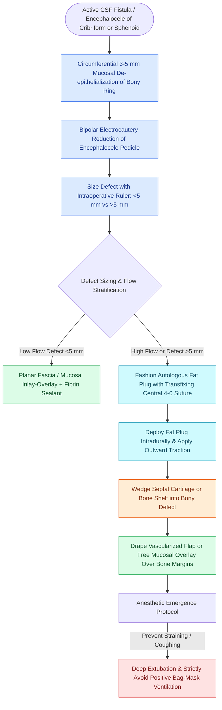

# Multi-layer underlay and overlay CSF leak closure employs a bath-plug technique with autologous fat and fascia lata to resist intracranial pressure pulsations

## Active Recall

> [!question]- How does the bath-plug technique biomechanically resist elevated intracranial pressure pulsations compared to a simple flat underlay graft?
> *Answer / Clinical Rationale*: The bath-plug technique anchors an autologous fat graft with a central transfixing suture pulled through the bony defect; hydrodynamic CSF pressure forces the intracranial portion of the fat plug to mushroom outward against the margins of the internal cranial base, converting expulsile ICP pulsations into self-sealing radial vector forces.

> [!question]- What is the validated safe dosage protocol for intrathecal fluorescein administration during endoscopic skull base repair, and why is high-dose administration hazardous?
> *Answer / Clinical Rationale*: A maximum of **0.1 mL of 10% injectable fluorescein** (or 0.2 mL of 5%) diluted slowly into **10 mL of the patient's own CSF or preservative-free saline** is injected over 10 minutes; excessive concentrations risk chemical meningitis, intractable seizures, opisthotonos, and cranial nerve palsies.

> [!question]- What defect size threshold dictates the incorporation of a rigid structural inlay graft beneath the soft-tissue overlay?
> *Answer / Clinical Rationale*: Defects **greater than 5 mm** (or those associated with an active meningoencephalocele or high-flow cistern opening) require rigid bone or cartilage inlay support to prevent graft sag and secondary late encephalocele formation.

## Core Clinical & Mechanistic Principles
Endoscopic repair of skull base cerebrospinal fluid (CSF) fistulas and encephaloceles achieves success rates exceeding 90% to 95%. Repair failure typically stems from technical displacement of the graft material under hydrodynamic CSF pulsations, particularly in patients with underlying [[Spontaneous CSF leaks are strongly associated with idiopathic intracranial hypertension and elevated BMI|idiopathic intracranial hypertension (IIH)]] or extensive cribriform skull base defects resulting from [[Iatrogenic skull base cribriform leaks require immediate intraoperative multi-layer graft repair|iatrogenic cribriform defects]] during anterior ethmoid surgery.

The **bath-plug technique** resolves the mechanical vulnerability of planar underlay grafts in high-flow defects:
1. **Graft Preparation**: A plug of autologous subcutaneous fat (harvested from the abdomen or thigh) is sized slightly larger (approximately 1.5 times) than the measured diameter of the bony skull base defect. A 4-0 Vicryl or Prolene suture is passed through the center of the fat plug and tied securely, leaving long tails.
2. **Intradural Deployment**: The fat graft is delivered through the sphenoid or cribriform bony defect into the intradural space using an elevator or bayonet forceps.
3. **Sealing Traction**: Gentle outward traction is applied to the central suture while viewing endoscopically. The intracranial portion of the fat plug spreads circumferentially against the intracranial dural margins. Under hydrodynamic CSF pressure, the plug acts as a mechanical stopper, sealing the internal dural aperture.
4. **Rigid Counter-Support & Overlay**: A rigid inlay of autologous septal bone, vomer, or perpendicular plate is wedged into the bony defect against the dural shelf to resist intracranial pressure. The repair is completed by draping a free mucosal graft (harvested from the middle turbinate or nasal floor) or a vascularized pedicled flap over the denuded bony perimeter.

### Operative Stratification & Biomaterial Hierarchy
- **Small Defects (<5 mm) Without Encephalocele**: Successfully sealed with a free mucosal graft (middle turbinate or nasal septum) placed as an onlay, supported by gelatin sponge and biological fibrin sealant.
- **Large Defects (>5 mm) or Encephaloceles**: Mandate a multi-layer composite closure:
  - *Layer 1 (Intradural Underlay)*: Bath-plug fat graft or fascia lata tucked 3 to 5 mm under the dural edge.
  - *Layer 2 (Rigid Inlay)*: Autologous perpendicular plate bone or septal cartilage wedged against the bony ring.
  - *Layer 3 (Overlay)*: Vascularized pedicled flap or free mucosal graft overlapping denuded bone by at least 5 mm.
  - *Layer 4 (External Bolster)*: Absorbable hemostatic matrix perimeter, nonabsorbable sponge packing, or Foley catheter balloon support.

### Perioperative Safety & Intrathecal Fluorescein
- **Intrathecal Fluorescein Protocol**: 0.1 mL of 10% injectable fluorescein mixed with 10 mL of autologous CSF or sterile non-bacteriostatic saline administered slowly via lumbar puncture over 10 minutes prior to nasal packing removal.
- **Optics**: High-power blue-light excitation filters (490 nm) paired with yellow barrier filters (530 nm) maximize fluorescence when micro-fistulas exhibit low-flow weeping.
- **Anesthesia Emergence Rule**: Deep extubation without bucking or coughing is mandatory to prevent acute spikes in intracranial venous and CSF pressure. Positive-pressure mask ventilation is strictly contraindicated to prevent inadvertent tension pneumocephalus through the newly reconstructed skull base.

## Connected Concepts & Graph Traversal
- **Bony Margin Preparation**: [[CSF leak defect preparation requires circumferential bone de-mucosalization|Circumferential De-Mucosalization]]
- **Intraoperative Fistula Localization**: [[Intrathecal fluorescein enables visual localization of occult dural defects|Intrathecal Fluorescein Localization]]
- **Hydrodynamic Pressure Control**: [[Lumbar drain placement and ICP management lower the risk of postoperative CSF fistula recurrence|Lumbar Drainage Protocol]]
- **Vascularized Flap Coverage**: [[The Hadad-Bassagasteguy nasoseptal flap is pedicled on the posterior septal artery|Hadad-Bassagasteguy Nasoseptal Flap]]
- **Anatomical Vulnerability**: [[The Keros classification stages olfactory fossa depth and lateral lamella vulnerability|Keros Classification]]
- **Reconstructive Framework**: [[Multi-layer skull base reconstruction combines underlay, inlay, and overlay barriers|Multi-Layer Reconstruction Hierarchy]]
- **Full Diagnostic-to-Repair Algorithm**: [[Endoscopic repair of cerebrospinal fluid rhinorrhea employs systematic biochemical confirmation, intrathecal fluorescein localization, and multilayer underlay dural reconstruction to achieve primary closure|Endoscopic CSF Rhinorrhea Repair]]
