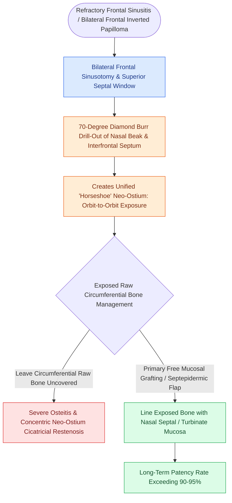

# Nasal beak drill-out and mucosal grafting prevent neo-ostium restenosis in Draf III

## Active Recall

> [!question]- What is the biological mechanism by which mucosal free grafting prevents restenosis following a Draf III drill-out?
> *Answer / Clinical Rationale*: It covers raw cortical bone, preventing air-induced osteitis, fibroblast hyper-proliferation, and reactive **osteoneogenesis**, thereby replacing circular scar contracture with healthy epithelialized mucosal margins.

> [!question]- What anterior visual endpoint indicates that the frontal beak has been drilled adequately during a Draf III?
> *Answer / Clinical Rationale*: Visualization of the **pink subcutaneous soft tissue / periosteum** of the glabella, indicating that all obstructing cortical bone of the internal nasal spine has been removed.

## Core Clinical & Mechanistic Principles
The primary long-term failure mode of a Draf III (Modified Lothrop) procedure is **progressive neo-ostium stenosis**, occurring in up to **$20\text{–}30\%$** of un-grafted cases. 

Stenosis is driven by **osteoneogenesis** (reactive [[Sinonasal inverting papilloma requires subperiosteal excision and hyperostotic bone drill-out|hyperostotic bone]] formation) and circular circumferential scar contracture triggered by:
1. Incomplete removal of the dense cortical bone of the **internal nasal spine (frontal beak)**.
2. Extensive circumferential denudation of cortical bone exposed to air and chronic inflammatory cytokines.

### Step-by-Step Prevention Protocol
1. **Aggressive Anterior Beak Drill-Out**:
   - The dense bone of the frontal beak must be thinned until the pink subcutaneous periosteum / soft tissue of the glabella is visualized anteriorly.
   - Maximizes the anterior-posterior diameter of the neo-ostium ($>1.5\text{–}2.0\text{ cm}$).
2. **Mucosal Free Grafting (The Wormald Technique)**:
   - Harvest free mucosal grafts from the resected middle turbinates or nasal floor.
   - Thinned grafts are placed directly over the exposed, denuded bone of the posterior frontal beak and lateral osteotomy margins.
   - Rapid contact-inhibition prevents granulations and circular contracture, preserving $>90\%$ long-term neo-ostial patency.

## Connected Concepts & Graph Traversal
- **Master Procedure**: [[Draf III modified Lothrop unites both frontal sinuses into a common cavity|Draf III Modified Lothrop]]
- **Posterior Danger**: [[First olfactory filum marks the posterior limit of frontal drill-out to avoid CSF leak|First Olfactory Filum]]
- **Complication Matrix**: [[High-stakes sinonasal complications require proactive landmarking and emergency rescue protocols|High-Stakes Sinonasal Complications]]
- **Diagnostic Evaluation**: [[Draf I frontal sinusotomy clears obstructing ethmoid cells without instrumenting the ostium|Draf I Frontal Sinusotomy]]
- **Critical Safety / Complication**: [[Esthesioneuroblastoma Kadish and Hyams staging determines craniofacial resection and adjuvant therapy|Esthesioneuroblastoma (ENB)]]
- **Complication Rescue**: [[The outside-in Draf III modified endoscopic Lothrop procedure establishes anterior septal and olfactory boundaries before drilling the nasofrontal beak|Outside-In Draf III]]
