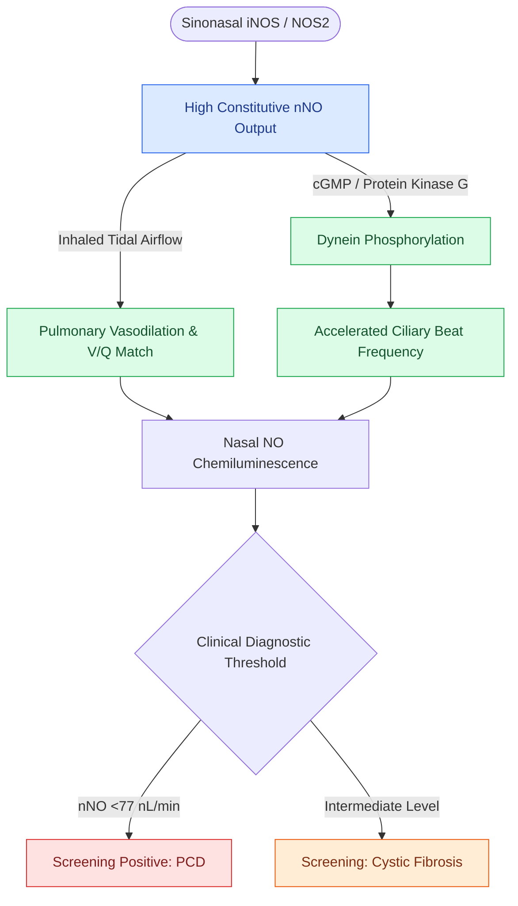

# Nitric oxide produced in the paranasal sinuses provides host defense and ciliary stimulation

## Active Recall

> [!question]- Why is nasal nitric oxide (nNO) testing utilized as the first-line screening assay for Primary Ciliary Dyskinesia?
> *Answer / Clinical Rationale*: Patients with PCD have **profoundly low or undetectable levels of sinonasal nNO**, providing $>95\%$ sensitivity for screening before genetic or electron microscopy testing.

> [!question]- What biochemical pathway mediates the ciliary beat frequency stimulation induced by sinus nitric oxide?
> *Answer / Clinical Rationale*: NO stimulates **soluble guanylyl cyclase to generate cyclic GMP (cGMP)**, activating protein kinase G which phosphorylates dynein motor arms, accelerating ciliary stroke velocity.

## Core Clinical & Mechanistic Principles
The paranasal sinuses—particularly the maxillary and ethmoid sinuses—are the primary physiological factory of **Nitric Oxide (NO)** in the human body, expressing high constitutive levels of **inducible nitric oxide synthase (iNOS / NOS2)** in their [[Respiratory epithelium drives mucociliary clearance toward natural ostia|ciliated respiratory epithelium]].

- **Dual Physiological Roles**:
  1. **Autocrine Ciliary Stimulation**: Endogenous NO diffuses locally to stimulate **soluble guanylyl cyclase**, generating **cyclic GMP (cGMP)** and activating protein kinase G. This cascades to phosphorylate dynein motor arms, accelerating ciliary stroke velocity and enhancing mucociliary clearance.
  2. **Innate Antimicrobial Defense & V/Q Matching**: High intrasinus NO concentrations ($>10,000\text{–}20,000\text{ ppb}$) exert direct bacteriostatic effects against airborne pathogens as part of the [[Epithelial tight junctions and antimicrobial peptides form the primary sinonasal mucosal barrier|epithelial innate immunity barrier]]. Nasally generated NO is continuously inhaled into the lower airways, inducing localized pulmonary vasodilation and optimizing ventilation-perfusion ($V/Q$) matching in the lung bases.

### Fractional Exhaled & Nasal Nitric Oxide in Allergic Rhinitis
- **Allergic Rhinitis NO Elevation**:
  - In contrast to primary ciliary dyskinesia and cystic fibrosis (where nNO is profoundly depressed), **allergic rhinitis is characterized by marked, statistically significant elevations in nasal nitric oxide (nNO)** and fractional exhaled nitric oxide (FeNO).
  - *Mechanism*: Type 2 cytokines (IL-4, IL-13) upregulate mucosal epithelial **inducible nitric oxide synthase (iNOS / NOS2)**, producing an inflammatory surge of NO that correlates directly with mucosal eosinophilia, nasal symptom severity, and allergen exposure. Successful treatment with intranasal corticosteroids suppresses iNOS expression and normalizes nNO levels.

### Diagnostic Role in Ciliopathies & Cystic Fibrosis
- **Nasal Nitric Oxide (nNO) Measurement**:
  - **Primary Ciliary Dyskinesia (PCD)**: Characterized by **extremely low / absent nNO levels ($<77\text{ nL/min}$)**. Measurement of nNO via stationary chemiluminescence during velopharyngeal closure is the gold-standard non-invasive screening tool for [[Non-Type 2 CRS features neutrophilic inflammation associated with cystic fibrosis and ciliopathies|PCD and Kartagener syndrome]].
  - **Cystic Fibrosis (CF)**: Demonstrates moderately reduced nNO due to thickened mucus obstruction and impaired gas diffusion across blocked sinonasal ostia.

## Connected Concepts & Graph Traversal
- **Physiological Basis**: [[Respiratory epithelium drives mucociliary clearance toward natural ostia|Mucociliary Clearance Mechanics]]
- **Ciliopathy & Neutrophilic Endotype**: [[Non-Type 2 CRS features neutrophilic inflammation associated with cystic fibrosis and ciliopathies|Non-Type 2 CRS & Ciliopathies]]
- **Epithelial Barrier & Innate Immunity**: [[Epithelial tight junctions and antimicrobial peptides form the primary sinonasal mucosal barrier|Epithelial Mucosal Barrier]]
- **Drainage Ostium Foundation**: [[The hiatus semilunaris and infundibulum form the primary drainage channel of the ostiomeatal complex|Ostiomeatal Complex Drainage]]
- **Topical Drug Delivery**: [[Steroid-eluting sinus implants deliver localized anti-inflammatory therapy to prevent restenosis|Steroid-Eluting Sinus Implants]]
