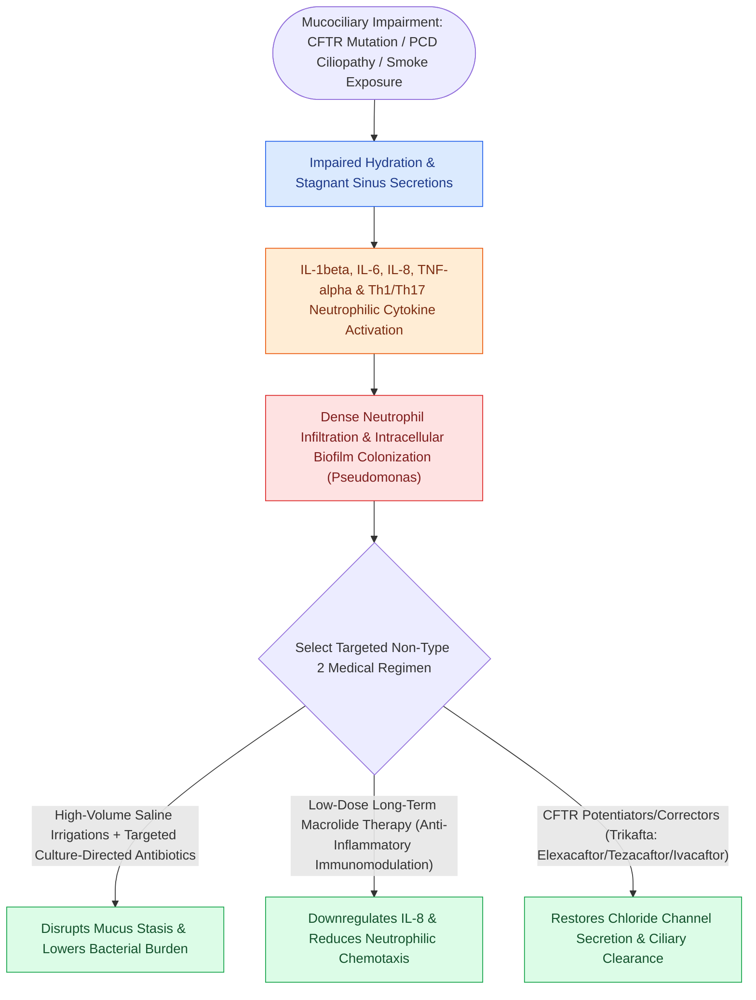

# Non-Type 2 CRS features neutrophilic inflammation associated with cystic fibrosis and ciliopathies

## Active Recall

> [!question]- Why are Type 2 biologics (e.g., Dupilumab, Mepolizumab) ineffective in patients with cystic fibrosis-associated sinusitis?
> *Answer / Clinical Rationale*: Cystic fibrosis sinusitis is driven by **neutrophilic (Non-Type 2 / Th17) inflammation** and CFTR-mediated mucin dehydration, not by the IL-4/IL-5/IL-13 eosinophilic cascade targeted by T2 biologics.

> [!question]- What structural defect on electron microscopy is pathognomonic for Primary Ciliary Dyskinesia?
> *Answer / Clinical Rationale*: Absence or truncation of the **inner and outer dynein arms** in the $9+2$ microtubule axoneme architecture of respiratory cilia.

## Core Clinical & Mechanistic Principles
**Non-Type 2 (T1 / T3) Chronic Rhinosinusitis** is an inflammatory endotype driven by **neutrophilic recruitment**, epithelial barrier failure, and impaired [[Respiratory epithelium drives mucociliary clearance toward natural ostia|mucociliary transport]]. Unlike [[Type 2 CRS exhibits eosinophilic inflammation responsive to targeted biologics|Type 2 disease]], it is characterized by elevated **Interferon-gamma ($\text{IFN}-\gamma$)**, **TNF-$\alpha$**, **IL-8**, and **IL-17A**.

### Classic Etiological Subtypes
1. **Chronic Rhinosinusitis without Nasal Polyps (CRSsNP)**: Most common phenotype in non-T2 disease; driven by Th1/Th17 pathway with mucosal thickening and purulence.
2. **Cystic Fibrosis (CF)**:
   - Autosomal recessive mutation in the **CFTR gene** (chromosome 7), causing defective chloride secretion and unregulated sodium/water hyper-absorption.
   - Dehydrated, hyper-viscous secretions paralyze mucociliary transit; colonized by *Pseudomonas aeruginosa*.
   - **Therapeutic Breakthrough**: **CFTR Modulators (Trikafta: Elexacaftor / Tezacaftor / Ivacaftor)** dramatically restore CFTR channel function and mucosal hydration.
3. **Primary Ciliary Dyskinesia (PCD / Kartagener Syndrome)**:
   - Genetic mutations in **outer/inner dynein arms** (*DNAH5*, *DNAI1*), causing complete ciliary immotility or dysmotility.
   - Triad of Kartagener: *Situs inversus*, *chronic sinusitis*, and *bronchiectasis*.
4. **Immunodeficiency Syndromes**: Common Variable Immunodeficiency (CVID), selective IgA deficiency, and IgG subclass deficiencies.

## Medical Management Paradigm
- **Antibiotics & Biofilm Disruptors**: Culture-directed parenteral or topical irrigations (e.g., tobramycin for *Pseudomonas* in CF).
- **Macrolide Therapy**: Long-term low-dose macrolides (e.g., Azithromycin $250\text{ mg}$ 3x/week) act as immunomodulators, suppressing IL-8 and neutrophil chemotaxis.
- **Biologics Are Ineffective**: Monoclonal antibodies targeting T2 pathways (anti-IL-4/5/IgE) have **no efficacy** in pure non-Type 2 neutrophilic disease.

## Connected Concepts & Graph Traversal
- **Opposing Endotype**: [[Type 2 CRS exhibits eosinophilic inflammation responsive to targeted biologics|Type 2 CRS]]
- **Ciliary Physiology**: [[Respiratory epithelium drives mucociliary clearance toward natural ostia|Mucociliary Clearance Mechanics]]
- **Surgical Antrostomy**: [[Maxillary antrostomy requires incorporating accessory fontanelle ostia to prevent recirculation|Maxillary Antrostomy]]
- **High-Stakes Safety**: [[Separate inferior antrostomies cause recirculating mucus and recalcitrant sinusitis|Mucus Recirculation Phenomenon]]
- **Anatomical Foundation**: [[Nitric oxide produced in the paranasal sinuses provides host defense and ciliary stimulation|Sinonasal Nitric Oxide (nNO)]]
- **Disease Mechanism**: [[Complement activation cascades, MHC antigen presentation, and leukocyte adhesion molecules orchestrate mucosal innate and adaptive immunity|Neutrophilic Selectin-Mediated Recruitment]]
