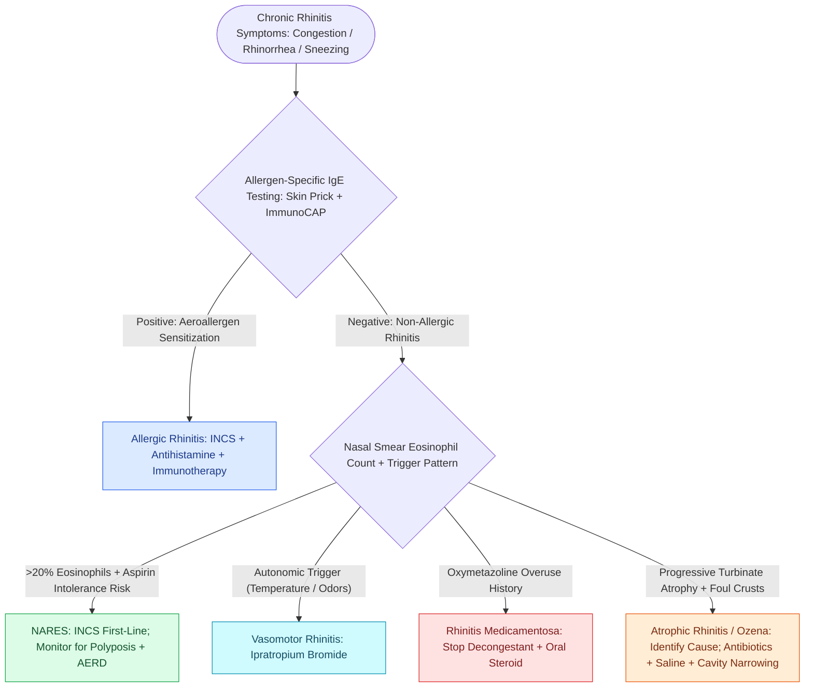

# Nonallergic rhinitis with eosinophilia syndrome NARES features nasal eosinophilia without IgE sensitization and represents a precursor to Samter triad

## Active Recall

> [!question]- What differentiates NARES from allergic rhinitis and why is it considered a precursor to Samter triad?
> *Answer / Clinical Rationale*: **NARES** presents with the same symptoms as allergic rhinitis (sneezing, watery rhinorrhea, nasal pruritus, congestion) but **allergy testing (skin prick and serum-specific IgE) is uniformly negative** — the eosinophilia is non-IgE-mediated. It is a Samter triad precursor because many NARES patients subsequently develop **nasal polyposis** and **aspirin/NSAID intolerance** as the disease evolves into a full AERD phenotype.

> [!question]- What diagnostic findings and medical treatment differentiate NARES from vasomotor rhinitis?
> *Answer / Clinical Rationale*: **NARES** demonstrates **$>20\%$ eosinophils on nasal cytology smear (Hansel stain)** despite negative allergy skin prick and serum-specific IgE testing, and exhibits a **marked first-line therapeutic response to intranasal corticosteroids (INCS)**. By contrast, **vasomotor (idiopathic autonomic) rhinitis** lacks mucosal eosinophilia, is driven by cholinergic parasympathetic hyper-reactivity to temperature/humidity or odor shifts, and responds primarily to **intranasal anticholinergics (ipratropium bromide)** or azelastine.

## Core Clinical & Mechanistic Principles

**Nonallergic rhinitis (NAR)** encompasses a heterogeneous group of rhinitis syndromes sharing one defining feature: **symptoms indistinguishable from allergic rhinitis with uniformly negative allergen-specific IgE testing and negative skin prick tests**. Crucially, this group represents approximately **40–50% of all chronic rhinitis patients**, making it the most underdiagnosed rhinitis category.

### Comprehensive Non-Allergic Rhinitis Classification (Encyclopedia Taxonomy)

| Subtype | Mechanism | Key Features | Primary Treatment |
|---|---|---|---|
| **Vasomotor / Autonomic** | Parasympathetic hyper-reactivity | Triggered by temperature, odors, emotion | Intranasal ipratropium; PNN cryoablation |
| **NARES** | Non-IgE eosinophilic mucosal inflammation | Nasal eosinophilia >20%; aspirin intolerance; polyp risk | Intranasal corticosteroids |
| **Occupational** | IgE or non-IgE sensitization to workplace agents | Latex, wood dust, animal dander, chemicals | Avoidance; respirator; topical steroids |
| **Hormonal** | Estrogen/progesterone mucosal effects | Pregnancy, hypothyroidism, acromegaly | Treat underlying cause; topical steroids |
| **Drug-induced** | Receptor-mediated mucosal effects | ACE inhibitors, beta-blockers, erectile dysfunction drugs | Discontinue offending agent |
| **Rhinitis medicamentosa** | Alpha-adrenergic receptor downregulation | Oxymetazoline/phenylephrine overuse >5 days | Cessation + oral steroid burst + INCS |
| **Gustatory** | Vagal parasympathetic reflex | Hot/spicy food triggers watery rhinorrhea | Pre-prandial ipratropium |
| **Primary atrophic (ozena)** | Progressive turbinate mucosal atrophy | Klebsiella, foul crusts, paradoxical congestion | Antibiotics, saline, nasal emollients, cavity narrowing |
| **Secondary atrophic** | Iatrogenic mucosal loss (surgery/radiation) | Empty nose syndrome | Conservative; turbinate augmentation |

### NARES — Deep Dive

**NARES** (*Nonallergic Rhinitis with Eosinophilia Syndrome*) is characterized by:
- **Nasal smear**: >20% eosinophils (threshold varies; typically >20% by Hansel stain)
- **Negative allergen testing**: Confirms non-IgE-mediated mechanism
- **Demographics**: Middle-aged patients; slight female predominance
- **Pathophysiology**: Mucosal eosinophilic infiltration without systemic IgE sensitization — possibly represents localized mucosal atopy or early non-IgE type 2 inflammation
- **Clinical trajectory**: Many NARES patients develop [[AERD manifests with asthma, nasal polyps, and severe aspirin-induced respiratory reactions|nasal polyposis and aspirin-exacerbated respiratory disease (AERD)]] — making it a critical early diagnosis

**Treatment of NARES**:
- **First-line**: Intranasal corticosteroid sprays (fluticasone, mometasone) — highly effective; unlike vasomotor rhinitis where steroids are second-line
- **Aspirin challenge**: Consider referral for aspirin desensitization if NSAID intolerance develops
- **Monitor for polyp development**: Annual rhinoscopy to detect early polypoid change

### Primary Atrophic Rhinitis (Ozena) — Operative Pearl

### Atrophic Rhinitis Operative Approach (Cavity Narrowing)
In severe primary atrophic rhinitis failing conservative therapy, surgical narrowing of the paradoxically wide nasal cavity restores normal airflow dynamics:
- **Young's operation**: Total closure of one or both nasal cavities; reserved for extreme cases
- **Submucosal injection of fat/dermis**: Augments inferior turbinate size to restore resistance
- **Bone-anchored prostheses**: Rare; maintains cavity patency while reducing turbulent flow

## Critical Failure Modes & Error Traps
- **Misdiagnosing NARES as allergic rhinitis**: Failure to perform a nasal smear leads to undertreatment with antihistamines (ineffective in non-IgE eosinophilic disease) vs effective intranasal steroids
- **Missing the Samter progression**: Not warning NARES patients about aspirin/NSAID sensitivity before prescribing NSAIDs for pain — can trigger severe bronchospasm in those who have progressed to AERD
- **Empty nose syndrome**: Secondary atrophic rhinitis after excessive turbinate resection; patient paradoxically feels severe nasal obstruction despite wide-open cavity — due to disrupted Starling resistor airflow dynamics and absent mucosal sensory feedback

## Connected Concepts & Graph Traversal
- **IgE-Mediated Contrast**: [[Rhinitis subtypes are differentiated into allergic, vasomotor, gustatory, and rhinitis medicamentosa|Rhinitis Subtype Classification]]
- **Aspirin Sensitivity Progression**: [[Non-Type 2 CRS features neutrophilic inflammation associated with cystic fibrosis and ciliopathies|Non-Type-2 CRS Pathway]]
- **Klebsiella Sinonasal Infection**: [[Granulomatosis with polyangiitis presents with necrotizing sinonasal granulomas and saddle nose|Sinonasal Granulomatous DDx]]
- **Biologic Escalation**: [[Biologic therapeutics in chronic rhinosinusitis target IgE, IL-4, IL-5, and IL-13 inflammatory pathways|CRS Biologic Therapy]]
- **Parasympathetic Relay**: [[The sphenopalatine ganglion serves as the primary parasympathetic relay for the sinonasal cavity|Sphenopalatine Ganglion Autonomics]]
- **Olfactory Impairment**: [[Olfactory neuroepithelium contains bipolar sensory neurons and basal stem cells|Olfactory Neuroepithelium and Atrophy]]
