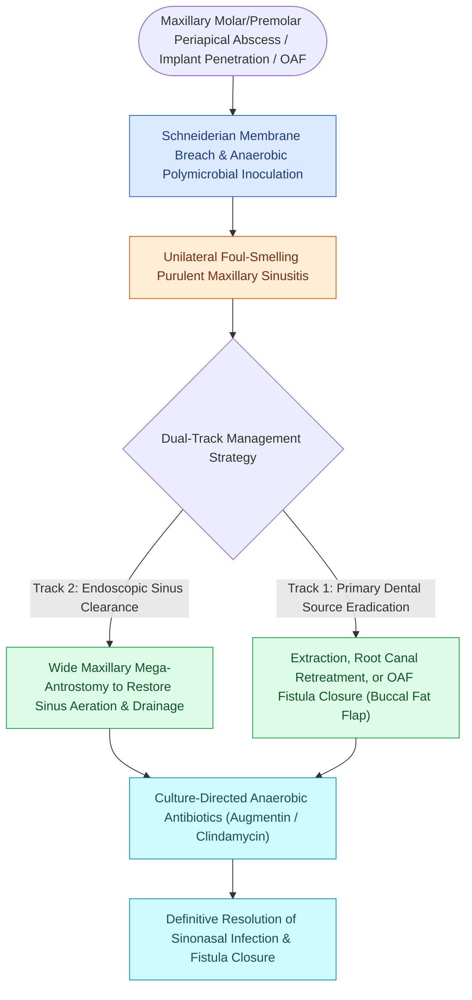

# Odontogenic sinusitis arises from periapical maxillary dental pathology and oroantral fistulas

## Active Recall

> [!question]- Which maxillary teeth have root apices in the closest anatomical proximity to the floor of the maxillary sinus?
> *Answer / Clinical Rationale*: The **maxillary first and second molars**, followed by the second premolar.

> [!question]- What clinical symptom is uniquely characteristic of odontogenic sinusitis compared to rhinogenic sinusitis?
> *Answer / Clinical Rationale*: **Severe unilateral cacosmia (foul/putrid odor)** and foul-tasting drainage, reflecting polymicrobial anaerobic bacterial metabolism.

## Core Clinical & Mechanistic Principles
**Odontogenic Sinusitis (ODS)** accounts for **up to $30\text{–}40\%$ of all unilateral maxillary sinus disease**, resulting from disruption of the thin floor of the maxillary sinus by **periapical dental abscesses, periodontal disease, dental extractions (oroantral fistulas), or maxillary dental implants**.

### Combined Treatment Protocol
1. **Dental Management**: Endodontic therapy (root canal) or extraction of the non-restorable offending tooth.
2. **[[Diagnostic rigid nasal endoscopy utilizes a standardized three-pass examination sequence|Endoscopic]] FESS**: Wide maxillary antrostomy to restore sinus drainage and clear secondary ostiomeatal blockage.
3. **Oroantral Fistula (OAF) Repair**: Fistulas $>5\text{ mm}$ require surgical closure utilizing a **buccal fat pad advancement flap** or palatal transposition flap.

## Connected Concepts & Graph Traversal
- **Antrostomy Craft**: [[Maxillary antrostomy requires incorporating accessory fontanelle ostia to prevent recirculation|Maxillary Antrostomy]]
- **Fungal Connection**: [[Chronic non-invasive fungal ball presents with dense maxillary mycetoma without tissue invasion|Sinonasal Fungal Ball]]
- **Pathology Contrast**: [[Separate inferior antrostomies cause recirculating mucus and recalcitrant sinusitis|Mucus Recirculation]]
- **Anatomical Foundation**: [[Diagnostic rigid nasal endoscopy utilizes a standardized three-pass examination sequence|Three-Pass Nasal Endoscopy]]
- **Surgical Craft**: [[Antrochoanal polyps originate in the posterior maxillary sinus and extend through the accessory ostium into the choana requiring endoscopic surgical removal|Antrochoanal Polyp]]
