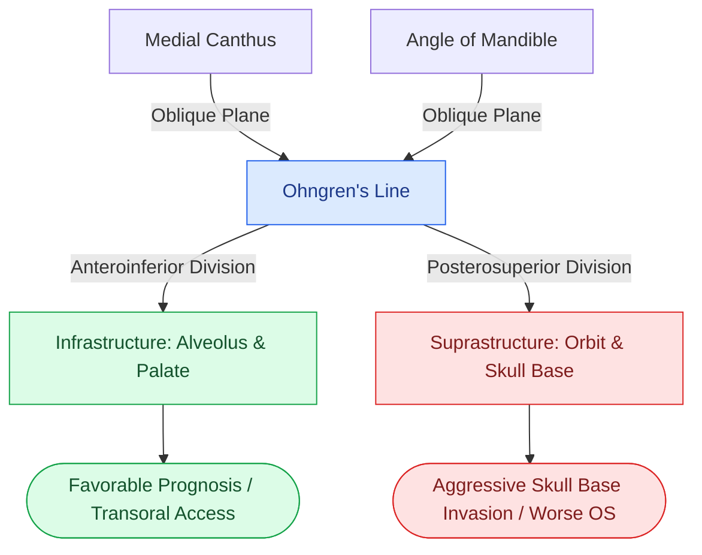

# Ohngren line divides the maxillary sinus into anteroinferior and posterosuperior prognostic compartments

## Active Recall

> [!question]- What specific anatomical landmarks define the plane of Ohngren's line, and how does it divide the maxillary antrum into distinct prognostic regions?
> *Answer / Clinical Rationale*: **Ohngren's line** is a theoretical plane extending from the **medial canthus of the eye to the angle of the mandible (gonion)** on a lateral facial projection. It divides the maxillary sinus into: (1) an **anteroinferior compartment (infrastructure)**, and (2) a **posterosuperior compartment (suprastructure)**.

> [!question]- Why do tumors arising posterosuperior to Ohngren's line carry a significantly worse clinical prognosis than anteroinferior tumors?
> *Answer / Clinical Rationale*: Tumors located posterosuperior to Ohngren's line (suprastructure) have direct anatomical pathways for early, aggressive invasion into the **orbital apex, posterior ethmoid labyrinth, cribriform skull base, pterygopalatine fossa, and infratemporal fossa**, resulting in advanced presentation (T3/T4), higher rates of perineural invasion, and difficult surgical margins compared to anteroinferior lesions (infrastructure) that primarily expand into the palate and alveolar ridge.

## Core Clinical & Mechanistic Principles
In sinonasal surgical oncology, **Ohngren's line** remains a fundamental landmark for conceptualizing the local spread, resectability, and overall prognosis of maxillary sinus malignancies (most commonly squamous cell carcinoma and adenocarcinoma).

### Anatomic Boundaries & Clinical Implications
1. **Anteroinferior Region (Infrastructure)**:
   - **Borders**: Anterior maxillary wall, inferior maxillary sinus floor, hard palate, and maxillary alveolar ridge.
   - **Clinical Presentation**: Dental loosening, ill-fitting dentures, or cheek swelling.
   - **Prognostic Impact**: Favorable overall survival; accessible via standard transoral maxillectomy or endoscopic medial maxillectomy with clear margins.
2. **Posterosuperior Region (Suprastructure)**:
   - **Borders**: Posterior maxillary sinus wall, orbital floor, ethmoid roof, and pterygoid plates.
   - **Clinical Presentation**: Infraorbital nerve ($V_2$) paresthesias, proptosis, diplopia, epiphora (nasolacrimal duct obstruction), or trismus (pterygoid muscle invasion).
   - **Prognostic Impact**: Poor overall survival; requires radical or extended maxillectomy with [[Endoscopic transorbital approaches provide multi-portal access to the lateral skull base and orbit|orbital preservation/exenteration]] and skull base reconstruction.

## Connected Concepts & Graph Traversal
- **Diagnostic Imaging**: [[MRI T1, T2, and contrast protocols differentiate sinonasal neoplasms from inspissated secretions|MRI Protocols for Sinonasal Tumors]]
- **Orbital Route**: [[Endoscopic transorbital approaches provide multi-portal access to the lateral skull base and orbit|Transorbital Endoscopic Approaches]]
- **Skull Base Corridor**: [[Transpterygoid EEA exposes juvenile nasopharyngeal angiofibromas and lateral sphenoid defects|Transpterygoid Approach & PPF]]
- **Critical Danger Zone**: [[The CLOSE checklist systematically evaluates critical radiological danger zones|CLOSE Sinus CT Checklist]]
- **Anatomical Foundation**: [[Endoscopic Denker approach removes the piriform aperture and ascending maxillary process to expose the anterior antral wall and infratemporal fossa|Endoscopic Denker Approach]]
- **Surgical Craft**: [[Endoscopic medial maxillectomy resects the lateral nasal wall flush with the nasal floor while preserving a mucosal flap to cover denuded bone|Endoscopic Medial Maxillectomy]]
