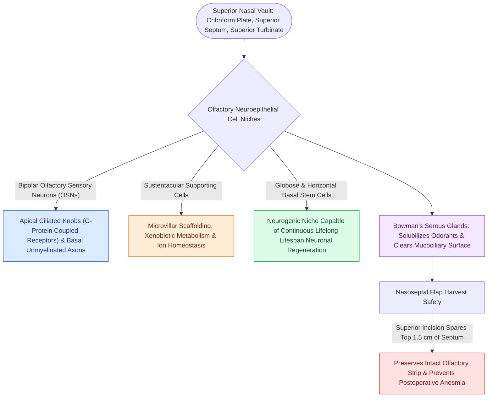

# Olfactory neuroepithelium contains bipolar sensory neurons and basal stem cells

## Active Recall

> [!question]- What cell population within the olfactory neuroepithelium drives lifelong neuronal regeneration?
> *Answer / Clinical Rationale*: **Globose basal stem cells**, which continuously divide and differentiate into mature bipolar olfactory sensory neurons every 30 to 60 days.

> [!question]- Where is olfactory neuroepithelium anatomically distributed within the nasal cavity?
> *Answer / Clinical Rationale*: Along the **horizontal cribriform plate**, the **superior $1.0\text{–}1.5\text{ cm}$ of the nasal septum**, and the medial aspect of the **superior turbinate**.

## Core Clinical & Mechanistic Principles
The **olfactory neuroepithelium (OE)** is a specialized pseudostratified neuroepithelium located in the superior vault of the nasal cavity, spanning the **cribriform plate**, the **superior $1.0\text{–}1.5\text{ cm}$ of the nasal septum**, and the **superior turbinate**.

### Neuroregenerative Capacity & Surgical Relevance
- **Lifelong Regeneration**: Olfactory sensory neurons are unique primary central nervous system neurons capable of continuous neurogenesis from **globose basal cells**.
- **Surgical Protection**: Resecting or stripping the superior septal mucosa or superior turbinate destroys this regenerative niche, causing permanent anosmia (see [[Preserving the superior septal mucosal strip prevents post-NSF anosmia|Preserving Olfactory Strip]]).

## Connected Concepts & Graph Traversal
- **Chemosensory Testing**: [[UPSIT and CCCRC tests quantify olfactory thresholds and odor identification in chemosensory disorders|UPSIT & CCCRC Olfactory Evaluation]]
- **Flap Preservation**: [[Preserving the superior septal mucosal strip prevents post-NSF anosmia|Olfactory Strip Preservation]]
- **Draf III Posterior Limit**: [[First olfactory filum marks the posterior limit of frontal drill-out to avoid CSF leak|First Olfactory Filum]]
- **Surgical Corridor**: [[Transcribriform EEA provides access to olfactory groove meningiomas and esthesioneuroblastomas|Transcribriform EEA]]
- **Olfactory Neoplasm Staging**: [[Esthesioneuroblastoma Kadish and Hyams staging determines craniofacial resection and adjuvant therapy|Esthesioneuroblastoma (ENB)]]
- **Small Round Blue Cell Differential**: [[Sinonasal small round blue cell tumors are differentiated by immunohistochemistry into SNUC, olfactory neuroblastoma, melanoma, lymphoma, and rhabdomyosarcoma|Sinonasal SRBCT IHC Panel]]
- **Quantitative Forensic Testing**: [[Quantitative olfactory testing with the UPSIT differentiates conductive from sensorineural dysosmia and detects deliberate malingering through below-chance forced-choice scoring|UPSIT Malingering Detection]]
