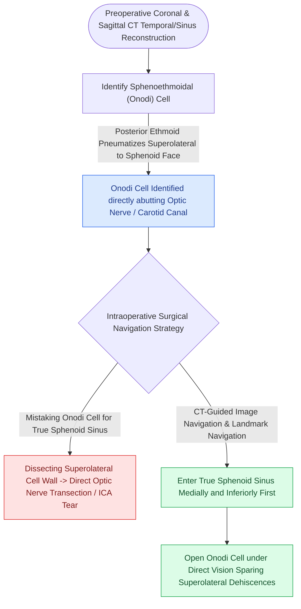

# Onodi cells place the optic nerve and carotid artery at risk during posterior ethmoidectomy

## Active Recall

> [!question]- Why is identifying an Onodi cell on preoperative CT critical before performing sphenoidotomy?
> *Answer / Clinical Rationale*: An Onodi cell wraps superiorly and laterally over the sphenoid sinus, placing the **optic nerve and internal carotid artery** directly within its lateral wall. Mistaking this cell for the sphenoid leads to direct optic nerve transection during lateral instrumentation.

> [!question]- What radiological sign on coronal CT distinguishes an Onodi cell from a normal posterior ethmoid cell?
> *Answer / Clinical Rationale*: A **horizontal or oblique septum** dividing the sphenoid face into a superior ethmoid cavity (Onodi) and an inferior true sphenoid cavity, with the optic nerve canal visible in the lateral wall of the superior cell.

## Core Clinical & Mechanistic Principles
An **Onodi cell (sphenoethmoidal air cell)** is the most posterior ethmoid air cell that pneumatizes **superior and lateral to the [[Transseptal sphenoidotomy provides wide bilateral midline access to the sphenoid rostrum|sphenoid sinus]]**. Because of this extreme postero-superior extension, the **optic nerve (CN II)** and frequently the **internal carotid artery (ICA)** course along the lateral wall of the Onodi cell rather than within the sphenoid sinus.

### Radiological Identification on CT
1. **Coronal CT**: Look for a horizontal or diagonal dividing septum across the sphenoid face, creating a cell positioned superior to the true sphenoid lumen.
2. **Axial CT**: Demonstrates posterior ethmoid cells extending posterior to the anterior wall of the sphenoid sinus, abutting or encircling the optic nerve canal.
3. **Sagittal CT**: Shows a "two-tiered" sphenoid configuration, where the superior cavity is an Onodi cell and the inferior cavity is the true sphenoid sinus.

## Critical Surgical Traps & Optic Nerve Injury
- **The Sphenoid Entry Mistake**: The surgeon mistakes the Onodi cell for the true sphenoid sinus. Attempting to enlarge the "sphenoid ostium" laterally or superiorly within an Onodi cell directly **transects the optic nerve** or lacerates the carotid artery.
- **Dehiscence Rate**: The optic nerve canal is dehiscent in up to **10–12%** of Onodi cells, leaving the optic nerve covered only by thin dura and mucosa.
- **Surgical Rule of Safe Entry**:
  - Always locate the true natural sphenoid ostium **medially in the sphenoethmoidal recess** close to the posterior choanal arch.
  - Never dissect laterally in the most posterior ethmoid cell without absolute confirmation of the sphenoid cavity.

## Connected Concepts & Graph Traversal
- **Critical Danger Zone**: [[The CLOSE checklist systematically evaluates critical radiological danger zones|CLOSE CT Checklist]]
- **Skull Base Waypoint**: [[The lateral and medial opticocarotid recesses define critical anatomical corridors in endoscopic skull base surgery|Opticocarotid Recess (OCR) Landmarks]]
- **Sphenoid Anatomy**: [[Sphenoid sinus pneumatization patterns dictate carotid and optic canal exposure|Sphenoid Sinus Pneumatization]]
- **Surgical Step**: [[The sphenoid sinus ostium lies medial to the superior turbinate above the choana|Sphenoidotomy Landmark]]
- **Carotid Crisis**: [[Intraoperative ICA injury requires two-surgeon suction and crushed muscle patch hemostasis|ICA Management]]
- **Diagnostic Imaging**: [[Supraorbital ethmoid cells suspend the anterior ethmoidal artery below the skull base|AEA Mesentery Anatomy]]
- **Danger Zone**: [[Revision endoscopic sphenoethmoidectomy clears recalcitrant osteitic partitions via posterior-to-anterior skull base skeletonization and medial orbital wall navigation|Revision Sphenoethmoidectomy]]
- **Anatomical Foundation**: [[Sphenoidotomy utilizes superior turbinate resection or the Bolger box parallelogram to identify the natural ostium while preventing Onodi cell injury|Bolger Box Sphenoidotomy]]
