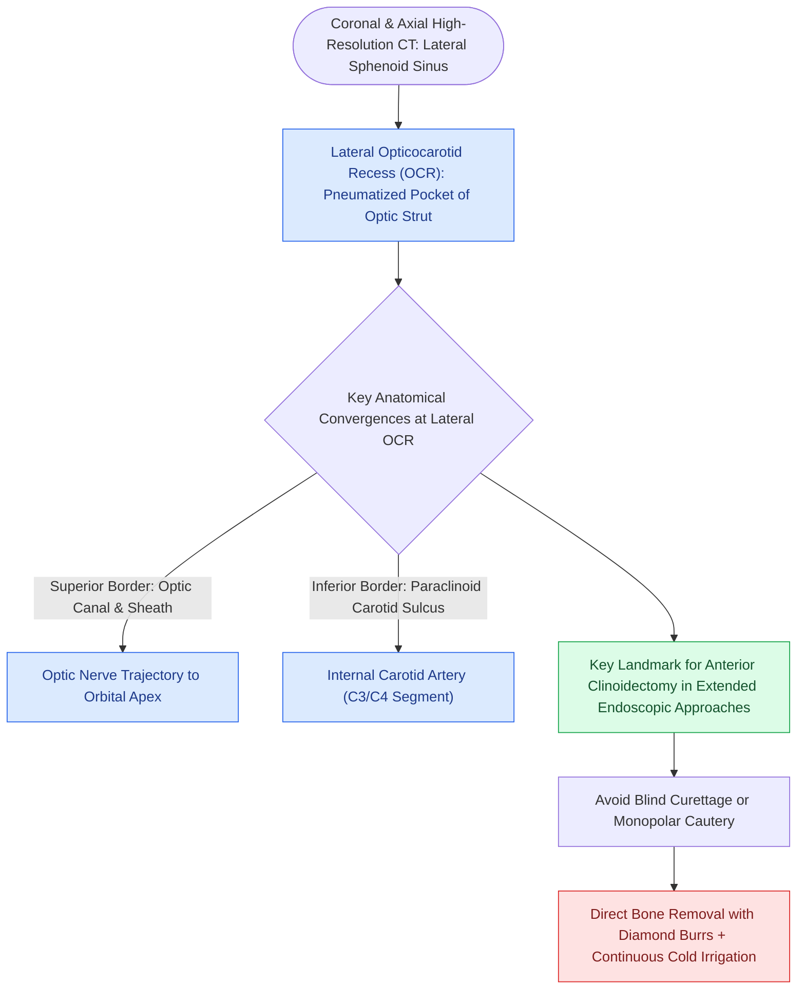

# Opticocarotid recesses on coronal CT demarcate the paraclinoid ICA and optic strut

## Active Recall

> [!question]- What intracranial structure corresponds to the lateral opticocarotid recess (OCR)?
> *Answer / Clinical Rationale*: The **pneumatized optic strut** and the base of the **anterior clinoid process (ACP)**.

> [!question]- What critical neurovascular structures meet at the opticocarotid recess?
> *Answer / Clinical Rationale*: The **optic nerve (CN II)** superiorly and the **internal carotid artery (paraclinoid ICA)** inferiorly.

## Core Clinical & Mechanistic Principles
The **Opticocarotid Recess (OCR)** is an indispensable anatomical and radiological landmark in endoscopic skull base surgery, formed by the junction of the **optic canal superiorly** and the **carotid canal inferiorly** on the anterolateral wall of the [[Transseptal sphenoidotomy provides wide bilateral midline access to the sphenoid rostrum|sphenoid sinus]].

### Surgical Landmark Significance
- In expanded transsellar and transplanum approaches, the **lateral OCR represents the exact anatomical landmark for the paraclinoid ICA and the optic strut**.
- Drilling the bone of the lateral OCR exposes the anterior clinoid process and allows safe $180^\circ$ decompression of the optic nerve.

## Connected Concepts & Graph Traversal
- **Transplanum Corridor**: [[Transplanum and transtuberculum EEA corridors expose suprasellar craniopharyngiomas|Transplanum EEA]]
- **Sphenoid Pneumatization**: [[Sphenoid sinus pneumatization patterns dictate carotid and optic canal exposure|Sphenoid Pneumatization]]
- **Carotid Safety**: [[Intraoperative ICA injury requires two-surgeon suction and crushed muscle patch hemostasis|ICA Injury Protocol]]
- **Diagnostic Evaluation**: [[Transcribriform EEA provides access to olfactory groove meningiomas and esthesioneuroblastomas|Transcribriform EEA Corridor]]
- **Anatomical Foundation**: [[Transpterygoid EEA exposes juvenile nasopharyngeal angiofibromas and lateral sphenoid defects|Transpterygoid EEA Corridor]]
- **Surgical Craft**: [[Endoscopic optic nerve decompression achieves 180-degree intracanalicular bony release with superomedial sheath incision to avoid ophthalmic artery injury|Endoscopic Optic Nerve Decompression]]
