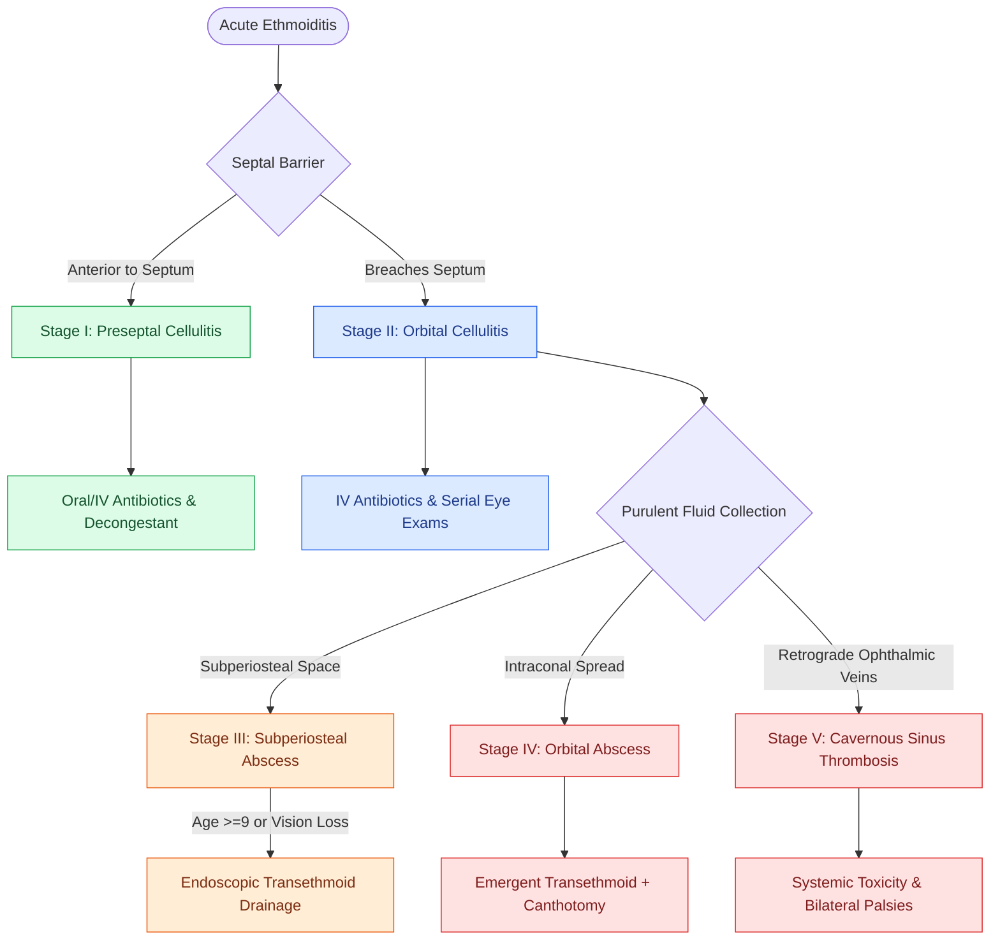

# Orbital complications of acute sinusitis staged by the Chandler classification dictate medical versus surgical drainage

## Active Recall

> [!question]- What anatomical landmark anatomically divides Chandler Group I (preseptal cellulitis) from Chandler Group II (orbital cellulitis)?
> *Answer / Clinical Rationale*: The **orbital septum**, a fibrous connective tissue sheet originating from the orbital rim periosteum (arcus marginalis) and inserting into the tarsal plates of the eyelids, acting as a physical barrier preventing preseptal cutaneous infections from entering the postseptal orbit.

> [!question]- Why is cranial nerve VI (abducens) typically the first cranial nerve impaired in cavernous sinus thrombosis?
> *Answer / Clinical Rationale*: CN VI courses **freely within the central lumen of the cavernous sinus** bathed directly in venous blood adjacent to the internal carotid artery, whereas CN III, IV, $V_1$, and $V_2$ are embedded within the protective dural lateral wall of the sinus.

## Core Clinical & Mechanistic Principles

**Orbital complications of acute rhinosinusitis** occur predominantly in children and young adolescents due to the paper-thin bone of the [[Lamina papyracea dehiscence predisposes to orbital fat herniation and medial rectus injury|lamina papyracea]], open congenital suture lines (dehiscences of Zuckerkandl), and valveless ophthalmic venous networks (veins of Breschet) linking the ethmoid and orbital plexuses.

The **Chandler Classification (1970)** stages orbital complications into five progressive anatomical tiers:

- **Group I: Preseptal (Periorbital) Cellulitis**: Edema and erythema restricted anterior to the **orbital septum** (the fibrous extension of periosteum from the orbital rim to the tarsal plates). Eye movements, visual acuity, and pupillary reflexes are completely normal; absence of proptosis or chemosis.
- **Group II: Orbital (Postseptal) Cellulitis**: Diffuse inflammatory infiltration of orbital fat and soft tissues posterior to the orbital septum without discrete abscess. Characterized by **chemosis, mild proptosis, and pain with extraocular movement (EOM)**, but preserved visual acuity and pupillary function.
- **Group III: Subperiosteal Abscess (SPA)**: Purulent collection between the bony **lamina papyracea and the periorbita (orbital periosteum)**. Manifests with marked proptosis (displacing the globe inferolaterally), chemosis, restricted EOM, and potential visual compromise.
- **Group IV: Orbital Abscess**: Discrete purulent collection within the orbital intraconal or extraconal fat space. Characterized by **severe proptosis, complete ophthalmoplegia**, and progressive loss of visual acuity / [[Retrobulbar hematoma requires emergent bedside lateral canthotomy and cantholysis|orbital compartment syndrome]].
- **Group V: Cavernous Sinus Thrombosis (CST)**: Retrograde septic thrombophlebitis via ophthalmic veins into the cavernous sinus. Presents with **bilateral orbital signs**, rapid loss of vision, systemic toxicity, and cranial neuropathies (see [[Cavernous sinus thrombosis presents with chemosis, proptosis, and progressive ophthalmoplegia from CN III, IV, V1, V2, and VI involvement|cavernous sinus thrombosis]]; CN VI is affected first due to its free-floating course in the cavernous sinus lumen).

### Surgical Technique & Craft Nuance: Medical vs. Endoscopic Surgical Decompression

1. **Diagnostic Contrast CT**: High-resolution CT of the paranasal sinuses and orbits with IV contrast is mandatory to differentiate preseptal cellulitis from subperiosteal/orbital abscess and evaluate optic nerve compression.
2. **Medical Therapy (Chandler I, II, & Select Small III)**:
   - Hospital admission, IV broad-spectrum antibiotics (**Ampicillin-sulbactam 3 g IV q6h OR Ceftriaxone 2 g IV q24h + Vancomycin** to cover *S. pneumoniae*, *S. aureus*, *S. pyogenes*, and anaerobes).
   - Intranasal decongestant (**oxymetazoline 0.05%**) and saline flushes.
   - Serial ophthalmologic examinations (visual acuity, color vision testing, intraocular pressure [IOP], and relative afferent pupillary defect [RAPD] q4-6h).
   - **Criteria for Medical Trial in Subperiosteal Abscess (SPA)**: Age <9 years, small medial SPA volume (<0.5–1.0 mL), normal vision and pupillary reflexes, and absence of intracranial extension.
### Key Consultation Supplies
- Coaxial surgical headlight
- Nasal speculum and rigid $0^\circ$ / $30^\circ$ Hopkins rod endoscopes ($2.7\text{ mm}$ and $4.0\text{ mm}$) with tower and anti-fog solution (Fred™)
- Topical decongestant/anesthetic spray (0.05% oxymetazoline + 1% lidocaine)
- Sinus culture trap / swab (for middle meatal purulence)
- Penlight / ophthalmoscope for pupil exam (evaluating for relative afferent pupillary defect [RAPD])
- Pocket Snellen eye chart and Ishihara color plates (visual acuity and dyschromatopsia testing)
- Tonopen / tonometer (for intraocular pressure measurement)
- Emergent lateral canthotomy tray (curved hemostat, iris/Stevens scissors, toothed forceps)

## References
1. Benninger, M.S., Roxbury, C.R., Stokken, J.K. (2020). Acute Rhinosinusitis: Pathogenesis, Treatment, and Complications. In Flint, P.W., et al. (Eds.), *Cummings Otolaryngology Head and Neck Surgery* 7e (pp. 643-648). Philadelphia, PA: Elsevier.
2. Chandler, J.R., Langenbrunner, D.J., Stevens, E.R. (1970). The pathogenesis of orbital complications in acute sinusitis. *Laryngoscope*, 80(9):1414-1428.
3. Giannoni, C.M. (2013). Complications of Rhinosinusitis. In Johnson, J.J., Rosen, C.A. (Eds.), *Bailey’s Head and Neck Surgery-Otolaryngology* 5e (pp. 573-585). Baltimore, MD: Lippincott Williams & Wilkins.
4. Rosenfeld, R.M., Piccirillo, J.F., Chandrasekhar, S.S., et al. (2015). Clinical Practice Guideline (Update): Adult Sinusitis. *Otolaryngol Head Neck Surg*, 152(2 Suppl):S1-S39.

## Connected Concepts & Graph Traversal
- **Emergent Decompression Technique**: [[Retrobulbar hematoma requires emergent bedside lateral canthotomy and cantholysis|Lateral Canthotomy & Cantholysis]]
- **Intracranial Sinus Extension**: [[Pott's puffy tumor represents subperiosteal abscess and frontal bone osteomyelitis from sinusitis|Pott Puffy Tumor]]
- **Endoscopic Drainage Anatomy**: [[The uncinate process superior attachment dictates the frontal sinus drainage pathway|Uncinate & Ethmoid Boundaries]]
- **Septic Thrombosis Endpoint**: [[Cavernous sinus thrombosis presents with chemosis, proptosis, and progressive ophthalmoplegia from CN III, IV, V1, V2, and VI involvement|Cavernous Sinus Thrombosis]]
- **Orbital Wall Dehiscence**: [[Lamina papyracea dehiscence predisposes to orbital fat herniation and medial rectus injury|Lamina Papyracea Vulnerability]]
