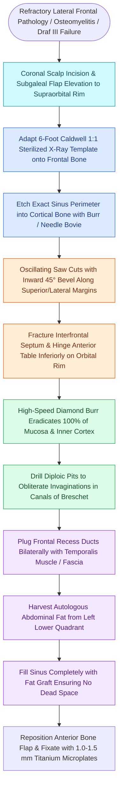

# Osteoplastic flap elevation utilizes a six-foot Caldwell radiographic template and beveled osteotomies for complete frontal sinus fat obliteration

## Active Recall

> [!question]- Why must the plain Caldwell radiograph used to create the osteoplastic flap template be obtained at an exact tube-to-film distance of 6 feet?
> *Answer / Clinical Rationale*: A tube-to-film distance of 6 feet (1.8 meters) virtually eliminates X-ray beam divergence, providing a **true 1:1 unmagnified radiographic representation** of the frontal sinus borders; using a standard non-calibrated film causes magnification error that leads to intracranial craniotomy cuts into the anterior fossa dura.

> [!question]- Why are the superior and lateral osteotomies of the anterior frontal table beveled 45 degrees inward toward the sinus cavity?
> *Answer / Clinical Rationale*: The inward 45-degree bevel creates a **bony shelf that prevents the anterior table from depressing or sinking** into the frontal sinus cavity upon anatomical replacement, while also directing the oscillating saw blade away from the intracranial dura of the anterior cranial fossa.

> [!question]- What is the absolute biological prerequisite for successful long-term frontal sinus obliteration with autologous fat?
> *Answer / Clinical Rationale*: **100% complete microscopic eradication of the mucosal lining** from both tables, using high-speed diamond burrs under continuous irrigation to grind away the inner cortical bone and ablate mucosal remnants buried within the **canals of Breschet** (diploic veins).

## Core Clinical & Mechanistic Principles
First described by Schonborn in 1894 and popularized by MacBeth, Goodale, and Montgomery, the **Osteoplastic Flap (OPF) with Frontal Sinus Obliteration** is the definitive open surgical approach for frontal sinus disease that cannot be addressed endoscopically. While endoscopic approaches like Draf IIb and Draf III have largely supplanted open surgery, OPF remains the gold standard for far-lateral frontal disease, refractory chronic osteomyelitis presenting as [[Pott's puffy tumor represents subperiosteal abscess and frontal bone osteomyelitis from sinusitis|Pott's puffy tumor]], lateral [[Frontal sinus mucoceles cause bony erosion, proptosis, and intracranial extension|frontal sinus mucoceles]], and revisions following circumferential neo-osteogenesis.

### Exposure & Soft-Tissue Planes
- **Coronal (Bitemporal) Incision**: Preferred incision; placed 2 to 3 cm behind the anterior hairline. Dissection proceeds through the SCALP layers (Skin, Subcutis, Galea, Loose areolar tissue, Pericranium).
- **Dissection Plane**:
  - *Subgaleal Plane*: Dissects in the loose areolar tissue, leaving pericranium on bone for vascular supply or secondary flap harvest.
  - *Subperiosteal Plane*: The pericranium is incised and elevated together with the scalp flap, protecting it from desiccation.
- **Nerve Safety**: As dissection nears the zygomatic arch and supraorbital rim, elevation must stay deep to the temporoparietal fascia to safeguard the temporal branch of CN VII.

### The 6-Foot Caldwell Radiographic Template Craft
1. **Template Fabrication**: A plain radiographic Caldwell view is exposed at an exact tube-to-film distance of 6 feet (minimizing optical magnification). The silhouette of the frontal sinus is cut out with scissors, creating a 1:1 spatial stencil.
2. **Intraoperative Registration**: The cut-out template is soaked in povidone-iodine (Betadine) for sterility. Following scalp elevation, the template is seated on the frontal bone, registered against the nasion and supraorbital rims.
3. **Perimeter Etching**: The margins of the template are scored into the external cortical bone with a fine drill burr or electrocautery. Alternatively, calibrated stereotactic navigation with merged CT can trace the perimeter.

### Osteotomy & Obliteration Craft
- **45-Degree Inward Bevel**: The oscillating saw is angled 45 degrees inward toward the center of the sinus along the superior and lateral edges. This prevents anterior cranial fossa dural entry and creates a resting ledge that prevents postoperative inward bone depression.
- **Supraorbital Hinge**: The inferior osteotomy along the supraorbital rim is deliberately incomplete, allowing the anterior table to be fractured forward while maintaining its osteoperiosteal blood supply.
- **Inner Table Diamond Burring**: A high-speed diamond burr with continuous saline irrigation is used to strip 100% of the mucosa and polish the inner cortical bone of both the anterior and posterior tables, destroying microscopic mucosal nests within the canals of Breschet. Failure to achieve complete de-epithelialization risks late mucocele recurrence up to 20 to 30 years postoperatively.
- **Recess Occlusion & Fat Grafting**: The frontal sinus ostia are permanently plugged with temporalis fascia, muscle, or cortical bone plugs. Autologous fat harvested from the left lower quadrant (avoiding appendectomy scars) is loosely packed into the cavity, and the anterior bone table is fixated with low-profile titanium microplates.

## Connected Concepts & Graph Traversal
- **Foundational Procedure**: [[Osteoplastic flap with frontal sinus obliteration manages lateral frontal disease and osteomyelitis|Osteoplastic Flap Protocol]]
- **Fat Graft Craft**: [[Abdominal fat obliteration of the frontal sinus requires meticulous complete mucosal de-epithelialization|Abdominal Fat Obliteration Craft]]
- **Endoscopic Alternative**: [[Draf III modified Lothrop unites both frontal sinuses into a common cavity|Draf III Modified Lothrop]]
- **Bony Resection**: [[Frontal sinus osteomas require endoscopic Draf or open osteoplastic resection when obstructing outflow|Frontal Sinus Osteomas]]
- **🔗 Facial Nerve Danger Zone (FPRS)**: [[Pitanguy's line defines the danger zone for the frontal branch of the facial nerve|Frontal Branch CN VII Safety]]
- **🔗 Surgical Landmark (FPRS)**: [[The sentinel vein marks the trajectory of the frontal branch of the facial nerve|Sentinel Vein Landmark]]
- **Osteoma Staging System**: [[The Chiu classification stages frontal sinus osteomas to dictate endoscopic endonasal resection versus open osteoplastic flap approaches based on tumor dimensions and attachment|Chiu Classification of Frontal Sinus Osteomas]]
