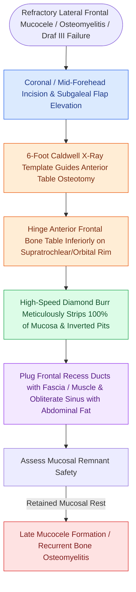

# Osteoplastic flap with frontal sinus obliteration manages lateral frontal disease and osteomyelitis

## Active Recall

> [!question]- Why is a 1:1 Caldwell radiographic template or intraoperative navigation used during osteoplastic flap elevation?
> *Answer / Clinical Rationale*: To accurately outline the **true perimeter of the frontal sinus**, preventing intracranial entry through the posterior table or orbital entry through the floor during bone sawing.

> [!question]- What is the most critical technical requirement to prevent late mucocele recurrence after frontal sinus obliteration?
> *Answer / Clinical Rationale*: **Complete $100\%$ microscopic removal of all mucosal lining and drilling of inner cortical bone** with a diamond burr before placing the fat graft.

## Core Clinical & Mechanistic Principles
The **Osteoplastic Flap (OPF) with Frontal Sinus Obliteration** is the historical gold-standard open approach for managing frontal sinus disease that is inaccessible endoscopically, particularly far-lateral frontal pathology, refractory frontal osteomyelitis, and failed [[Nasal beak drill-out and mucosal grafting prevent neo-ostium restenosis in Draf III|Draf III]] procedures.

### Modern Indications in the Endoscopic Era
1. Far-lateral frontal sinus mucoceles or osteomas with unfavorable anatomy for Draf III.
2. Chronic [[Pott's puffy tumor represents subperiosteal abscess and frontal bone osteomyelitis from sinusitis|frontal bone osteomyelitis]] (Pott's puffy tumor with extensive bone destruction).
3. Recurrent disease after failed Draf III revision with circular osteoneogenesis.

## Connected Concepts & Graph Traversal
- **Fat Graft Craft**: [[Abdominal fat obliteration of the frontal sinus requires meticulous complete mucosal de-epithelialization|Abdominal Fat Obliteration]]
- **Endoscopic Alternative**: [[Draf III modified Lothrop unites both frontal sinuses into a common cavity|Draf III Lothrop]]
- **Infection**: [[Pott's puffy tumor represents subperiosteal abscess and frontal bone osteomyelitis from sinusitis|Pott's Puffy Tumor]]
- **Diagnostic Evaluation**: [[Draf I frontal sinusotomy clears obstructing ethmoid cells without instrumenting the ostium|Draf I Frontal Sinusotomy]]
- **Anatomical Foundation**: [[Frontal sinus mucoceles cause bony erosion, proptosis, and intracranial extension|Frontal Sinus Mucocele]]
- **Structural / Flap Alternative**: [[Temporoparietal fascia free and pedicled flaps provide vascularized tissue when nasoseptal flaps fail|Temporoparietal Fascia Flap (TPFF)]]
- **Surgical Technique**: [[Osteoplastic flap elevation utilizes a six-foot Caldwell radiographic template and beveled osteotomies for complete frontal sinus fat obliteration|Osteoplastic Flap Elevation]]
