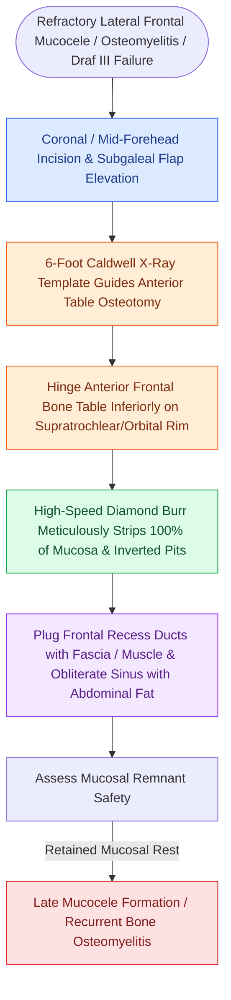

# Osteoplastic flap with frontal sinus obliteration manages lateral frontal disease and osteomyelitis

## Active Recall

> [!question]- Why is a 1:1 Caldwell radiographic template or intraoperative navigation used during osteoplastic flap elevation?
> *Answer / Clinical Rationale*: To accurately outline the **true perimeter of the frontal sinus**, preventing intracranial entry through the posterior table or orbital entry through the floor during bone sawing.

> [!question]- What is the most critical technical requirement to prevent late mucocele recurrence after frontal sinus obliteration?
> *Answer / Clinical Rationale*: **Complete $100\%$ microscopic removal of all mucosal lining and drilling of inner cortical bone** with a diamond burr—specifically ablating microscopic mucosal invaginations buried within the **canals of Breschet** (diploic veins)—before plugging the ducts and placing the fat graft.

> [!question]- Why must the plain Caldwell radiograph template be obtained at 6 feet, and why are the superior/lateral osteotomies beveled 45 degrees inward?
> *Answer / Clinical Rationale*: A **6-foot ($1.8\text{ m}$) tube-to-film distance** eliminates X-ray beam divergence to yield a **true 1:1 unmagnified silhouette** (avoiding intracranial dural cuts from magnification error). Beveling the oscillating saw **45 degrees inward** creates a resting bony shelf that prevents postoperative anterior table depression while directing the blade away from the anterior cranial fossa dura.

## Core Clinical & Mechanistic Principles
The **Osteoplastic Flap (OPF) with Frontal Sinus Obliteration** is the historical gold-standard open approach for managing frontal sinus disease that is inaccessible endoscopically, particularly far-lateral frontal pathology, refractory frontal osteomyelitis, and failed [[Nasal beak drill-out and mucosal grafting prevent neo-ostium restenosis in Draf III|Draf III]] procedures.

### Modern Indications & Surgical Craft in the Endoscopic Era
First described by Schonborn (1894) and popularized by MacBeth, Goodale, and Montgomery, the osteoplastic flap remains indicated for:
1. Far-lateral frontal sinus mucoceles or osteomas with unfavorable anatomy for Draf III.
2. Chronic [[Pott's puffy tumor represents subperiosteal abscess and frontal bone osteomyelitis from sinusitis|frontal bone osteomyelitis]] (Pott's puffy tumor with extensive bone destruction).
3. Recurrent disease after failed Draf III revision with circular osteoneogenesis.

- **Coronal Exposure & Nerve Safety**: A coronal (bitemporal) incision $2\text{–}3\text{ cm}$ behind the hairline proceeds through the SCALP layers either **subgaleally** (loose areolar plane, leaving pericranium intact for vascularity or salvage flap harvest) or **subperiosteally**. Laterally near the zygomatic arch and supraorbital rim, dissection must remain **deep to the temporoparietal fascia** to safeguard the temporal branch of CN VII.
- **Template Registration & Beveled Osteotomy**: A **6-foot ($1.8\text{ m}$) 1:1 Caldwell cutout stencil** soaked in povidone-iodine (or CT stereotactic navigation) is registered to the nasion and supraorbital rims to etch the exact perimeter onto bone. Superior and lateral osteotomies are cut with an oscillating saw **beveled $45^\circ$ inward**, while the inferior supraorbital rim cut is left incomplete as an osteoperiosteal hinge preserving bone vascularity.
- **Inner Table Obliteration & Fixation**: Continuous-irrigation diamond burring removes $100\%$ of mucosa and drills out diploic pits (**canals of Breschet**) to prevent late mucoceles (which can recur 20–30 years later). Both frontal recess ducts are plugged with temporalis muscle/fascia or bone, the cavity is filled with **left lower quadrant autologous abdominal fat** (avoiding appendectomy scars), and the bone flap is secured with **$1.0\text{–}1.5\text{ mm}$ titanium microplates**.

## Connected Concepts & Graph Traversal
- **Fat Graft Craft**: [[Abdominal fat obliteration of the frontal sinus requires meticulous complete mucosal de-epithelialization|Abdominal Fat Obliteration]]
- **Endoscopic Alternative**: [[Draf III modified Lothrop unites both frontal sinuses into a common cavity|Draf III Lothrop]]
- **Infection**: [[Pott's puffy tumor represents subperiosteal abscess and frontal bone osteomyelitis from sinusitis|Pott's Puffy Tumor]]
- **Anatomical Foundation**: [[Frontal sinus mucoceles cause bony erosion, proptosis, and intracranial extension|Frontal Sinus Mucocele]]
- **Bony Resection**: [[Frontal sinus osteomas require endoscopic Draf or open osteoplastic resection when obstructing outflow|Frontal Sinus Osteomas]]
- **Osteoma Staging System**: [[The Chiu classification stages frontal sinus osteomas to dictate endoscopic endonasal resection versus open osteoplastic flap approaches based on tumor dimensions and attachment|Chiu Classification of Frontal Sinus Osteomas]]
- **🔗 Facial Nerve Danger Zone (FPRS)**: [[Pitanguy's line defines the danger zone for the frontal branch of the facial nerve|Frontal Branch CN VII Safety]]
- **🔗 Surgical Landmark (FPRS)**: [[The sentinel vein marks the trajectory of the frontal branch of the facial nerve|Sentinel Vein Landmark]]
