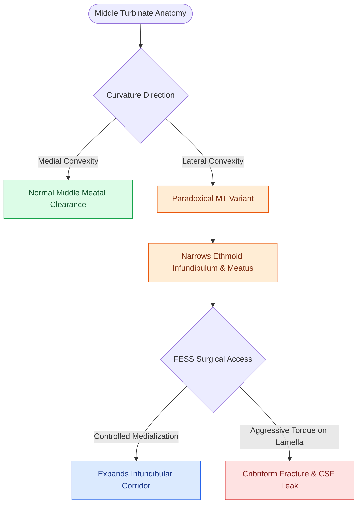

# Paradoxical middle turbinate curvature alters middle meatal airflow and surgical access

## Active Recall

> [!question]- How does a paradoxical middle turbinate differ anatomically from a concha bullosa on coronal CT?
> *Answer / Clinical Rationale*: A paradoxical middle turbinate consists of **solid bone with lateral convexity**, whereas a concha bullosa contains an internal **air-filled pneumatized cavity**.

> [!question]- What potential surgical complication can arise from overly aggressive medialization of a paradoxical middle turbinate?
> *Answer / Clinical Rationale*: Fracture of the **vertical attachment to the lateral lamella of the cribriform plate**, resulting in an iatrogenic skull base fracture and **CSF rhinorrhea**.

## Core Clinical & Mechanistic Principles
The normal middle turbinate exhibits a **medially convex curvature** (curving toward the nasal septum). In a **Paradoxical Middle Turbinate**, the curvature is reversed such that the **convexity faces laterally toward the lateral nasal wall**, compressing the [[The hiatus semilunaris and infundibulum form the primary drainage channel of the ostiomeatal complex|middle meatus]] and ethmoid infundibulum.

- **Clinical & Aerodynamic Significance**:
  1. **Infundibular Crowding**: The laterally bulging bony concavity encroaches on the [[The uncinate process superior attachment dictates the frontal sinus drainage pathway|uncinate process]] and [[The ethmoid bulla serves as the principal anatomical anchor for anterior ethmoidectomy|ethmoid bulla]], predisposing to ostiomeatal complex hypoventilation and recurrent anterior ethmoid/maxillary sinusitis.
  2. **Radiographic Differentiation**: Unlike a [[Concha bullosa pneumatization of the middle turbinate can obstruct the ostiomeatal complex|concha bullosa]] (which contains an air-filled pneumatized lumen within the bulbous portion), a paradoxical middle turbinate consists of **solid, non-pneumatized lamellar bone** with aberrant lateral curvature.

### Surgical Nuances in FESS
- **Controlled Medialization**: Gentle, controlled medialization using a Freer elevator at the anterior root of the middle turbinate creates adequate operative space for uncinectomy.
- **Preserving the Lateral Lamella**: Dissection must avoid excessive superior rotational torque on the vertical lamella of the middle turbinate to prevent transmission of shearing forces to the [[The Keros classification stages olfactory fossa depth and lateral lamella vulnerability|lateral lamella of the cribriform plate]] (the thinnest site of the anterior skull base).

## Connected Concepts & Graph Traversal
- **Anatomical Variant Counterpart**: [[Concha bullosa pneumatization of the middle turbinate can obstruct the ostiomeatal complex|Concha Bullosa Pneumatization]]
- **Ostiomeatal Complex Outflow**: [[The hiatus semilunaris and infundibulum form the primary drainage channel of the ostiomeatal complex|Hiatus Semilunaris & Infundibulum]]
- **Skull Base Danger Zone**: [[The Keros classification stages olfactory fossa depth and lateral lamella vulnerability|Keros Classification & Lateral Lamella]]
- **Postoperative Complication**: [[Middle turbinate lateralization causes secondary ostiomeatal obstruction and frontal sinus stenosis|Middle Turbinate Lateralization]]
- **Surgical Entry Corridor**: [[The ethmoid bulla serves as the principal anatomical anchor for anterior ethmoidectomy|Ethmoid Bulla Dissection]]
- **Differential Diagnosis**: [[Endoscopic septoplasty enables targeted spur resection and improves middle meatal access while minimizing mucosal dissection|Endoscopic Septoplasty]]
- **Anatomical Foundation**: [[Middle turbinate suture medialization prevents lateralization and iatrogenic frontal sinus ostial obstruction following ethmoidectomy|MT Suture Medialization]]
