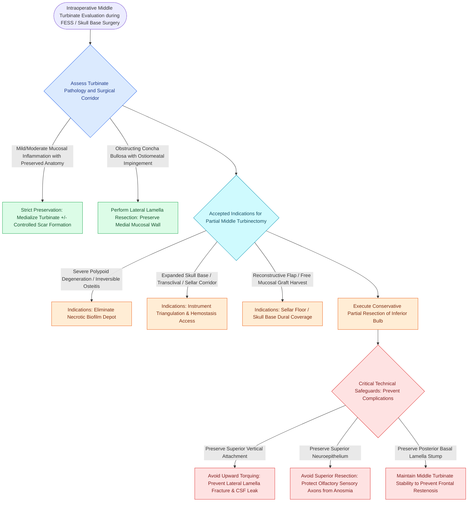

# Partial middle turbinectomy provides surgical access and prevents synechiae in selected polyposis or skull base cases while preserving superior attachments to protect olfaction and skull base stability

## Active Recall

> [!question]- What was the core philosophical division between the Wigand and Messerklinger schools regarding middle turbinate resection in endoscopic sinus surgery?
> *Answer / Clinical Rationale*: **M.E. Wigand (1978)** advocated routine resection of the anterior-inferior middle turbinate to maximize surgical exposure, eliminate middle meatal synechiae, and ensure permanent antrostomy visualization. Conversely, **W. Messerklinger and H. Stammberger (1985)** championed strict preservation, arguing that the middle turbinate is the primary anterior-posterior surgical landmark, conditions laminar airflow, and that its resection destabilizes the skull base and risks anosmia and frontal sinusitis.

> [!question]- Which specific anatomical attachments must be preserved during conservative partial middle turbinectomy to avoid skull base fracture, CSF leak, and olfactory compromise?
> *Answer / Clinical Rationale*: The **superior vertical attachment to the cribriform plate** and the **posterior sagittal attachment of the basal lamella** to the lamina papyracea and perpendicular plate of the palatine bone. Only the diseased or obstructing anterior-inferior conchal bulb is excised, avoiding any superior twisting or torquing force that could fracture the fragile lateral lamella of the cribriform plate.

## Core Clinical & Mechanistic Principles
The middle turbinate (ethmoturbinal) is an integral component of the ethmoid bone that plays vital physiological and anatomical roles. It functions as an aerodynamic baffle that shields the middle meatus, humidifies and warms inspired airflow, and directs laminar streams toward the upper nasal vault. Anatomically, it serves as the foundational compass for endoscopic sinus surgery: its vertical lamella inserts into the skull base at the junction of the cribriform plate and lateral lamella, its **[[The basal lamella of the middle turbinate divides anterior from posterior ethmoid cells|basal lamella]]** partitions the ethmoid labyrinth into anterior and posterior systems, and its anterior axilla demarcates the posterior boundary of the frontal recess.

The surgical management of the middle turbinate has historically been one of the most vigorously debated topics in rhinology. Total turbinectomy is universally condemned today because it destroys critical landmarks, provokes atrophic rhinitis, risks tearing olfactory fila on the superior turbinate surface, and destabilizes the frontal outfow tract, triggering **[[Middle turbinate lateralization causes secondary ostiomeatal obstruction and frontal sinus stenosis|frontal sinus stenosis]]**. However, contemporary evidence supports **judicious, conservative partial middle turbinectomy** in well-defined clinical scenarios, balancing surgical exposure against physiological preservation.

### The Historic Polarity: Wigand vs. Messerklinger
- **Wigand Paradigm (1978)**: Focused on complete disease exenteration. Routine resection of the anterior-inferior middle turbinate was championed to create an unobstructed view of the ethmoid roof, eliminate postoperative lateralization against the lamina papyracea, and facilitate postoperative office debridement. In 1991, Lawson reported on 1,077 intranasal ethmoidectomies, finding that partial middle turbinectomy minimized synechiae without increasing atrophic rhinitis. Davis (1991) demonstrated that antrostomy patency was significantly higher in patients undergoing partial middle turbinate resection ($96.5\%$) compared to those without ($93.6\%$, $p < 0.01$). Cook (1995) verified with rhinomanometry that partial resection significantly decreased nasal airway resistance without adverse drying.
- **Messerklinger Paradigm (1985)**: Focused on mucosal preservation and physiological ventilation. Opponents of routine resection emphasized that the middle turbinate protects the maxillary and frontal sinus ostia from drying, provides critical proprioceptive feedback, and houses olfactory receptors along its posteromedial and superior surfaces. Swanson (1995) presented CT evidence that frontal sinusitis developed in $75\%$ of patients who underwent partial resection versus $45\%$ in those whose turbinate was preserved ($p < 0.05$).

### Accepted Indications for Partial Middle Turbinectomy
1. **Severe Polypoid Degeneration and Osteitis**: Irreversibly diseased turbinates with microabscesses, extensive polyposis, or thick osteitic bone that cannot be salvaged medically.
2. **Obstructing Pneumatization (Concha Bullosa)**: When a large concha bullosa occludes the infundibulum, resecting its lateral half decompresses the middle meatus while maintaining turbinate support.
3. **Expanded Endoscopic Skull Base Corridors**: In transsphenoidal, transsellar, transclival, and transcribriform approaches, resecting the lower half of the middle turbinate significantly improves surgical triangulation, facilitates binasal four-handed instrumentation, and enhances direct vascular control.
4. **Vascularized Flap and Free Graft Harvest**: The middle turbinate mucosa provides an excellent pedicled flap (based on the middle turbinate branch of the sphenopalatine artery) or free mucosal graft to seal cribriform and sellar dural defects.

### Technical Safeguards to Prevent Complications
- **Protection Against CSF Leak**: The vertical lamella inserts into the thinnest portion of the skull base (lateral lamella of the cribriform plate). Never grasp, torque, or twist the middle turbinate with non-cutting forceps. Upward traction fractures the cribriform plate, tearing the overlying dura and producing an immediate CSF fistula.
- **Preservation of Olfaction**: Olfactory neuroepithelium extends onto the superior portion of the middle turbinate (Lang 1989). A prospective trial by Friedman demonstrated that conservative anterior-inferior resection produced no change in postoperative UPSIT smell scores, provided the superior third of the turbinate remained intact.
- **Preventing Frontal Restenosis**: The inferior resection must leave the posterior sagittal attachment of the basal lamella intact. Complete amputation destabilizes the remaining superior stump, which frequently collapses laterally into the frontal recess.

## Connected Concepts & Graph Traversal
- **Anatomical Pneumatization**: [[Concha bullosa pneumatization of the middle turbinate can obstruct the ostiomeatal complex|Concha Bullosa Obstruction]]
- **Reconstructive Tissue Source**: [[The middle turbinate vascularized flap provides an alternative rescue flap for skull base repair|Middle Turbinate Flap]]
- **Skull Base Vulnerability**: [[The Keros classification stages olfactory fossa depth and lateral lamella vulnerability|Keros Skull Base Depth]]
- **Frontal Drainage Boundary**: [[The frontal recess is bounded by the agger nasi, middle turbinate, and skull base|Frontal Recess Boundaries]]
- **Anatomical Variation**: [[Paradoxical middle turbinate curvature alters middle meatal airflow and surgical access|Paradoxical Middle Turbinate]]
