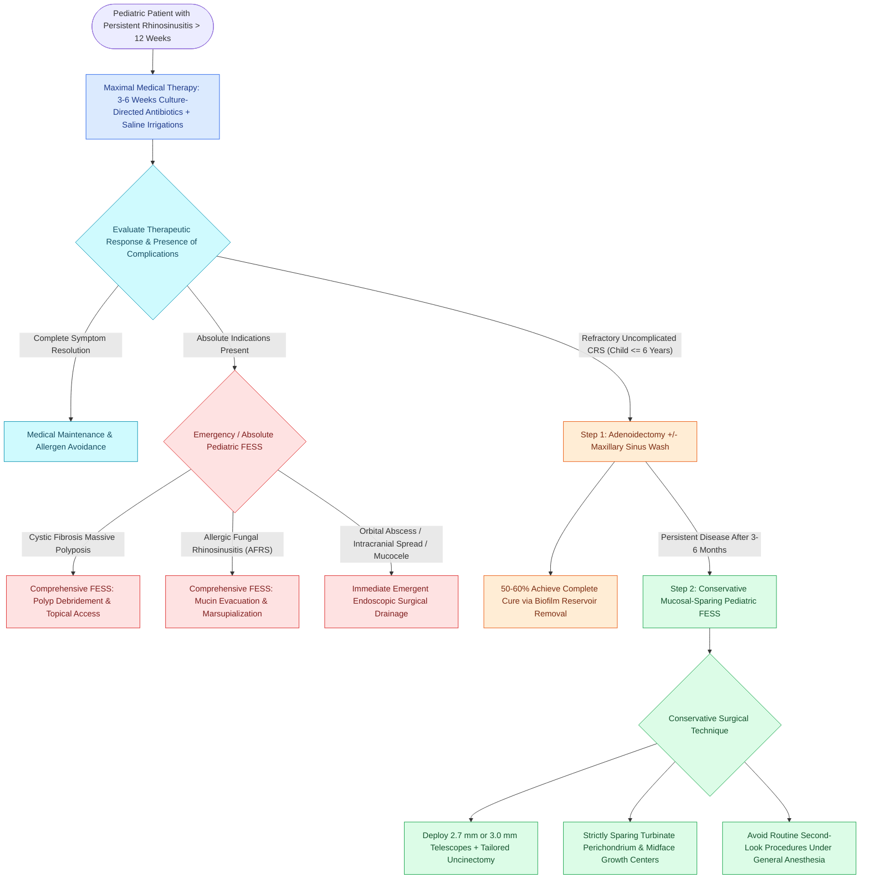

# Pediatric endoscopic sinus surgery employs a stepwise escalation algorithm following adenoidectomy and preserves midfacial growth centers through conservative mucosal sparing dissection

## Active Recall

> [!question]- Why is adenoidectomy established as the recommended first-line surgical intervention before functional endoscopic sinus surgery in children under 6 years of age with refractory chronic rhinosinusitis?
> *Answer / Clinical Rationale*: In young children, the adenoid pad functions as a **massive bacterial biofilm reservoir** (*Streptococcus pneumoniae*, *Haemophilus influenzae*, *Moraxella catarrhalis*) that continuously seeds the adjacent ostiomeatal complex, while simultaneously causing mechanical postnasal obstruction. Adenoidectomy achieves symptom resolution in **$50\%\text{--}60\%$ of pediatric CRS cases alone**, avoiding the risks of intranasal instrumentation and general anesthesia in infants.

> [!question]- What scientific evidence addresses the historical concern that functional endoscopic sinus surgery in children stunts midfacial and craniofacial skeletal growth?
> *Answer / Clinical Rationale*: Landmark animal models (Mair et al.) and **10-year prospective human cephalometric studies (Bothwell et al., Lusk et al.)** have conclusively proven that conservative, mucosal-sparing pediatric FESS does **NOT impair midfacial growth, facial angles, or maxillary dimensions**, provided that surgical manipulation avoids aggressive periosteal stripping and preserves mucosal basements and growth centers.

## Core Clinical & Mechanistic Principles
Pediatric chronic rhinosinusitis (CRS) is an inflammatory disease distinct in pathophysiology and natural history from adult CRS. Normal healthy children experience an average of 6 to 8 viral upper respiratory tract infections annually, predisposing the immature sinonasal mucosa to recurrent post-viral bacterial colonization. Furthermore, paranasal sinus development follows an age-dependent developmental timeline: while the maxillary and ethmoid sinuses are present at birth, the sphenoid sinus pneumatizes into the basisphenoid by age 3 to 5, and the frontal sinuses do not ascend into the frontal bone until age 6 to 8.

Inflammation in pediatric CRS predominantly centers upon the anterior ethmoid cells and the **[[The hiatus semilunaris and infundibulum form the primary drainage channel of the ostiomeatal complex|ethmoidal infundibulum]]**, resulting in ostiomeatal occlusion. Because young children cannot reliably tolerate office nasal endoscopy, diagnostic evaluation relies upon a detailed clinical history, physical examination, and fine-cut coronal CT scans obtained only after medical management has failed. However, pediatric rhinosinusitis can progress rapidly through thin congenital dehiscences into the orbit, manifesting as an acute **[[Orbital complications of acute sinusitis staged by the Chandler classification dictate medical versus surgical drainage|orbital subperiosteal abscess]]** requiring urgent intervention.

### The Stepwise Pediatric Surgical Algorithm
Ramadan and colleagues demonstrated that surgical success rates vary dramatically based on the child's age and surgical procedure: FESS with adenoidectomy ($87\%$), FESS alone ($75\%$), and adenoidectomy alone ($52\%$). In children aged 6 years and younger without asthma or massive polyposis, adenoidectomy alone provides equivalent clinical cure to FESS while avoiding intranasal dissection. Therefore, international consensus establishes a **stepwise escalation ladder**:
1. **Initial Surgical Intervention (Step 1)**: **Adenoidectomy** is performed first in young children ($\le 6$ years). It eliminates the pathogenic biofilm reservoir, relieves postnasal obstruction, and permits simultaneous middle meatal culture and maxillary sinus lavage to direct postoperative oral antimicrobial therapy.
2. **Targeted Endoscopic Sinus Surgery (Step 2)**: Indicated when symptoms persist following adenoidectomy, or primarily in children over 6 years of age with significant ostiomeatal CT opacification.
3. **Absolute Indications for Immediate Primary Pediatric FESS**:
   - Complete nasal airway obstruction from massive sinonasal polyposis in cystic fibrosis (CF).
   - Allergic fungal rhinosinusitis (AFRS).
   - Antrochoanal polyp.
   - Paranasal sinus mucoceles causing orbital or intracranial erosion.
   - Acute rhinosinusitis with Chandler Group III (subperiosteal) or Group IV (orbital) abscess, or intracranial complications (epidural abscess, meningitis).

### Preservation of Midfacial Growth Centers
A major historical concern that delayed the adoption of pediatric sinus surgery was the fear that surgical trauma to developing cartilaginous and bony growth centers would cause midfacial hypoplasia.
- **Experimental & Clinical Validation**: Landmark animal studies by Mair and colleagues, followed by long-term 10-year prospective cephalometric analyses by Bothwell et al. and Lusk et al., established that conservative FESS does not alter facial skeletal angles, maxillary growth, or dental occlusion.
- **Surgical Craft Rules**:
  - The mucoperichondrium and periosteum of the uncinate process, middle turbinate, and lateral nasal wall must be strictly preserved.
  - Aggressive bone stripping, complete middle turbinectomy, and extensive sphenoid/frontal drilling must be avoided.
  - Dissection is restricted strictly to the ostiomeatal complex: performing a delicate microdebrider uncinectomy, widening the natural maxillary ostium, and uncapping the ethmoid bulla.

### Second-Look Endoscopy Under General Anesthesia
Historically, a "second-look" nasal endoscopy with debridement was routinely scheduled under general anesthesia 2 to 3 weeks after pediatric FESS due to the impossibility of performing awake office debridement in young children. However, prospective trials (Fakhri et al., Cable & Mair) revealed that routine second-look procedures do **NOT improve surgical outcomes or reduce revision rates**, and over $72\%$ of pediatric otolaryngologists have abandoned routine second-look general anesthesia. Dissolvable middle meatal spacers and high-volume nasal saline rinses provide superior, atraumatic healing.

## Connected Concepts & Graph Traversal
- **Systemic Endotype**: [[Non-Type 2 CRS features neutrophilic inflammation associated with cystic fibrosis and ciliopathies|Cystic Fibrosis & Ciliopathies]]
- **Hypersensitivity Pathology**: [[Allergic fungal rhinosinusitis presents with eosinophilic mucin and Charcot-Leyden crystals|Allergic Fungal Rhinosinusitis]]
- **🔗 First-Line Surgical Step (Pediatrics)**: [[Adenotonsillectomy is the first-line surgical treatment for pediatric obstructive sleep apnea|Adenotonsillectomy in Children]]
- **Epithelial Physiology**: [[Respiratory epithelium drives mucociliary clearance toward natural ostia|Respiratory Epithelium & Ciliary Clearance]]
- **🔗 Pediatric Nasal Deformity (Pediatrics)**: [[Rapid maxillary expansion widens the hard palate and nasal floor to improve pediatric nasal breathing and OSA|Rapid Maxillary Expansion]]
