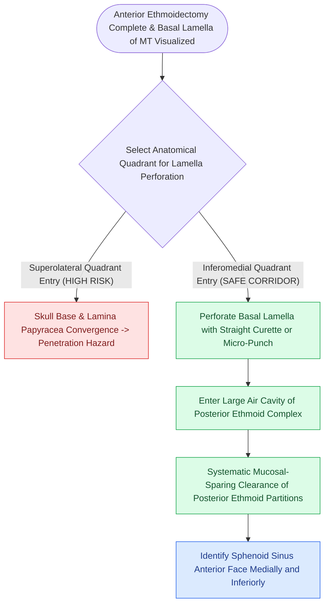

# Perforating the basal lamella inferomedially provides safe entry to posterior ethmoids

## Active Recall

> [!question]- Why is the superior vertical attachment of the middle turbinate preserved during basal lamella fenestration?
> *Answer / Clinical Rationale*: Preserving the superior attachment maintains the mechanical stability of the middle turbinate, preventing it from lateralizing against the lateral nasal wall and scarring across the middle meatus / frontal recess.

> [!question]- What endoscopic landmark indicates that the surgeon has successfully transitioned into the posterior ethmoids?
> *Answer / Clinical Rationale*: The appearance of **larger, fewer air cells** and direct visualization of the **superior turbinate** and anterior wall of the sphenoid sinus.

## Core Clinical & Mechanistic Principles
**Basal lamella fenestration** (Step 4 of FESS) transitions the surgical dissection from the anterior ethmoid labyrinth into the posterior ethmoid complex. Breaching this fundamental anatomical barrier must be executed with strict directional control to avoid destabilizing the middle turbinate or penetrating the skull base.

### Step-by-Step Fenestration Protocol
1. **Identification of the Basal Lamella**:
   - Following complete anterior ethmoidectomy, identify the third (coronal) attachment of the middle turbinate forming the posterior wall of the retrobullar recess.
2. **Inferomedial Puncture**:
   - Place a straight curette, ball-tipped seeker, or [[Powered microdebrider blade selection and suction irrigation maintain clean surgical optics|microdebrider]] in the **inferomedial quadrant** of the basal lamella, just superior to the horizontal lower edge of the middle turbinate.
   - Gently push through the bone in a posterior, slightly medial trajectory.
3. **Expansion & Clearance**:
   - Once inside the posterior ethmoid space, enlarge the opening laterally and superiorly using through-cutting forceps.
   - Maintain the superior vertical attachment of the middle turbinate intact to prevent **[[Middle turbinate lateralization causes secondary ostiomeatal obstruction and frontal sinus stenosis|middle turbinate lateralization]]** and secondary frontal outflow obstruction.

## Connected Concepts & Graph Traversal
- **Anatomical Boundary**: [[The basal lamella of the middle turbinate divides anterior from posterior ethmoid cells|Basal Lamella Anatomy]]
- **Next Step**: [[Posterior ethmoidectomy requires dissecting along the skull base from posterior to anterior|Posterior Ethmoidectomy]]
- **Preceding Step**: [[Entering the ethmoid bulla inferomedially avoids orbital and skull base penetration|Anterior Ethmoidectomy]]
- **Diagnostic Evaluation**: [[Draf I frontal sinusotomy clears obstructing ethmoid cells without instrumenting the ostium|Draf I Frontal Sinusotomy]]
- **Surgical Craft**: [[TIVA and greater palatine canal blocks optimize surgical field visibility in FESS|FESS Hemostasis Optimization]]
- **Structural / Flap Alternative**: [[Temporoparietal fascia free and pedicled flaps provide vascularized tissue when nasoseptal flaps fail|Temporoparietal Fascia Flap (TPFF)]]
- **Critical Safety / Complication**: [[Esthesioneuroblastoma Kadish and Hyams staging determines craniofacial resection and adjuvant therapy|Esthesioneuroblastoma (ENB)]]
