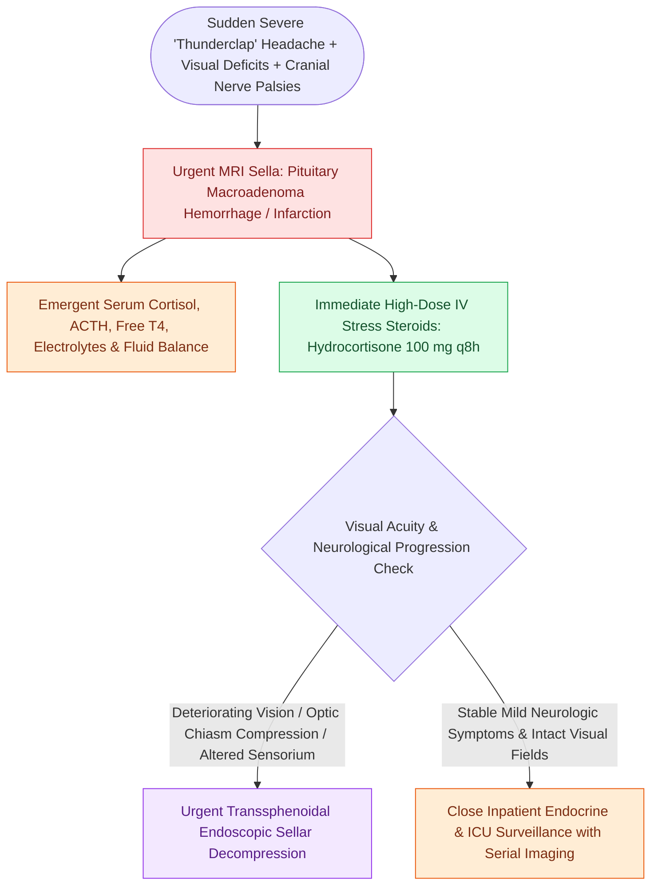

# Pituitary apoplexy causes acute chiasmatic compression and life-threatening panhypopituitarism

## Active Recall

> [!question]- What is the immediate medical management priority upon diagnosing acute pituitary apoplexy?
> *Answer / Clinical Rationale*: Immediate administration of **high-dose intravenous stress-dose corticosteroids (Hydrocortisone $100\text{ mg}$ IV)** to prevent fatal hemodynamic collapse from acute secondary adrenal insufficiency (ACTH crisis).

> [!question]- What visual field deficit classically results from suprasellar extension of a hemorrhaging pituitary adenoma?
> *Answer / Clinical Rationale*: **Bitemporal hemianopsia**, caused by upward compression of crossing decussating nasal retinal fibers in the optic chiasm.

## Core Clinical & Mechanistic Principles
**Pituitary Apoplexy** is an acute, life-threatening endocrine and neurosurgical emergency caused by sudden **infarction, hemorrhage, or necrosis of a pituitary adenoma** (or non-tumorous pituitary gland).

The expanding sellar mass compresses adjacent cranial nerves in the cavernous sinus, the optic chiasm, and the hypothalamus, while inducing acute **corticotropin (ACTH) deficiency and hemodynamic collapse**.

### Surgical vs Conservative Decision Protocol
- **Emergent Endoscopic Transsellar Decompression**: Indicated via [[Transsellar EEA provides direct access to pituitary adenomas and Rathke cleft cysts|Transsellar EEA]] for patients with **severe visual acuity decline, progressive visual field loss, or declining Glasgow Coma Scale (GCS)**.
- **Conservative Medical Management**: Reserved strictly for patients with mild, stable symptoms and normal visual fields under intensive steroid coverage.

## Connected Concepts & Graph Traversal
- **Surgical Corridor**: [[Transsellar EEA provides direct access to pituitary adenomas and Rathke cleft cysts|Transsellar EEA]]
- **Fluid & Endocrine**: [[Postoperative diabetes insipidus and SIADH require strict fluid balance and desmopressin titration|Post-Op DI & SIADH]]
- **Superior Expansion**: [[Transplanum and transtuberculum EEA corridors expose suprasellar craniopharyngiomas|Transplanum EEA]]
- **Diagnostic Evaluation**: [[Transcribriform EEA provides access to olfactory groove meningiomas and esthesioneuroblastomas|Transcribriform EEA Corridor]]
- **High-Stakes Safety**: [[Intraoperative ICA injury requires two-surgeon suction and crushed muscle patch hemostasis|Internal Carotid Artery Crisis Protocol]]
- **Precipitating Condition**: [[Endoscopic transplanum and transtuberculum approaches expose suprasellar lesions by decompressing the optic chiasm and preserving the superior hypophyseal arteries|Transplanum-Transtuberculum Technique]]
