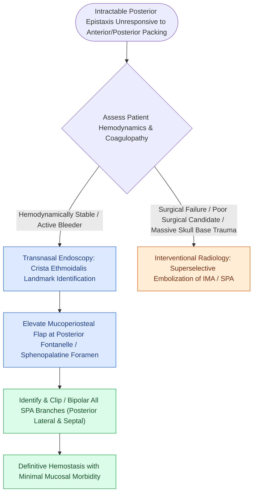

# Posterior epistaxis from sphenopalatine artery arborization requires endoscopic ligation or embolization

## Active Recall

> [!question]- What critical bony landmark guides endoscopic identification of the sphenopalatine foramen during surgical ligation?
> *Answer / Clinical Rationale*: The **crista ethmoidalis**, a prominent vertical projection of the perpendicular plate of the palatine bone located on the lateral nasal wall immediately anterior to the sphenopalatine foramen.

> [!question]- What physiological mechanism underlies the nasopulmonary reflex triggered by posterior balloon packing?
> *Answer / Clinical Rationale*: Mechanical mucosal pressure and distension in the posterior nasopharynx trigger trigeminal afferents ($\text{CN V}_2$) that stimulate central vagal motor nuclei, producing **hypoventilation, bronchoconstriction, bradycardia, and arterial hypoxemia**.

> [!question]- What is the emergency reversal agent and dose for dabigatran-associated refractory posterior epistaxis?
> *Answer / Clinical Rationale*: **Idarucizumab (Praxbind) $5\text{ g}$ IV** (administered as two consecutive $2.5\text{ g}$ doses), which binds dabigatran with 350-fold higher affinity than thrombin.

## Core Clinical & Mechanistic Principles
**Posterior epistaxis** accounts for $5\text{–}10\%$ of all nosebleeds, but carries disproportionately high morbidity. It originates posterior to the middle turbinate attachment along the lateral nasal wall or posterior septum:

- **Vascular Anatomy & Arborization**:
  - **Sphenopalatine Artery (SPA)**: The terminal branch of the internal maxillary artery (ECA system), passing through the sphenopalatine foramen. In $>95\%$ of patients, the SPA bifurcates *prior to or within* the foramen into **posterior lateral nasal branches** (inferior and middle turbinates) and **posterior septal (nasopalatine) branches**. Failure to identify and clip accessory/secondary branches is the leading cause of surgical failure in [[The crista ethmoidalis guides endoscopic sphenopalatine artery ligation|ESPAL]].
  - **Woodruff's Plexus**: A venous and arteriolar plexus located along the posterior lateral nasal wall inferior to the posterior end of the middle and inferior turbinates.
- **Clinical Presentation**: Characteristically brisk, high-flow arterial hemorrhage draining posteriorly into the pharynx, often presenting with nausea/hematemesis and hypovolemia in hypertensive elderly patients on anticoagulants.

### Anticoagulation & Antiplatelet Reversal Protocols

| Anticoagulant Class | Specific Agent(s) | Mechanism | First-Line Emergency Reversal Agent | Dosing & Clinical Pearl |
| :--- | :--- | :--- | :--- | :--- |
| **Vitamin K Antagonist** | **Warfarin** | Inhibits Vit K epoxide reductase (Factors II, VII, IX, X) | **4-Factor PCC** (Kcentra) + **IV Vitamin K** | 4F-PCC $25\text{–}50\text{ units/kg}$ based on INR + IV Vitamin K $5\text{–}10\text{ mg}$ slow infusion; normalizes INR in 15–30 min. |
| **Direct Thrombin Inhibitor** | **Dabigatran** | Competitive direct thrombin (IIa) inhibitor | **Idarucizumab** (Praxbind) | Humanized Fab fragment; dose: **$5\text{ g}$ IV** (two $2.5\text{ g}$ doses); immediate complete binding. |
| **Factor Xa Inhibitors** | **Apixaban**, **Rivaroxaban** | Direct Factor Xa catalytic site inhibition | **Andexanet alfa** (Andexxa) or **4F-PCC** | Recombinant decoy Factor Xa; if unavailable, administer **4F-PCC ($50\text{ units/kg}$)**. |
| **Antiplatelet Agents** | **Aspirin**, **Clopidogrel** | COX-1 / P2Y12 ADP receptor inhibition | **DDAVP** $\pm$ **Platelet Transfusion** | DDAVP $0.3\ \mu\text{g/kg}$ IV over 30 min (releases vWF/Factor VIII); platelets for severe refractory bleeds. |

**Key Links**: [[Topical hemostatic matrix agents and nasal packing mitigate postoperative epistaxis and synechiae|Hemostatic Matrix Substrates]] • [[Kiesselbach plexus anterior epistaxis is managed with cautery and anterior nasal packing|Anterior Epistaxis Protocol]]

### Endoscopic Surgical Ligation (ESPAL) & Interventional Embolization
1. **Endoscopic SPA Ligation (ESPAL)**:
   - Perform uncinectomy and wide maxillary antrostomy to localize the posterior fontanelle.
   - Elevate a mucosal flap along the lateral nasal wall $1\text{ cm}$ anterior to the posterior end of the middle turbinate.
   - Identify the **crista ethmoidalis**; the main SPA trunk exits immediately posterior to this crest.
   - Dissect circumferentially and apply titanium endoscopic hemoclips or bipolar electrocautery to **all branches** (including inferiorly migrating branches).
2. **Endovascular Embolization**:
   - Indicated for refractory posterior bleeding, surgical failures, or high-risk anesthetic candidates.
   - Superselective catheterization of the internal maxillary artery and facial artery branches using PVA particles or coils.
   - *Danger Zone*: Avoid embolizing anastomoses with the internal carotid system (ophthalmic artery or vidian branches) to prevent embolic stroke or blindness.

## Connected Concepts & Graph Traversal
- **Anterior Epistaxis Correlate**: [[Kiesselbach plexus anterior epistaxis is managed with cautery and anterior nasal packing|Kiesselbach Anterior Epistaxis]]
- **Critical Surgical Landmark**: [[The crista ethmoidalis guides endoscopic sphenopalatine artery ligation|Crista Ethmoidalis & ESPAL]]
- **Anatomical Innervation & Pterygopalatine Fossa**: [[The sphenopalatine ganglion serves as the primary parasympathetic relay for the sinonasal cavity|Sphenopalatine Ganglion & PPF]]
- **🔗 Endovascular Embolization (Otology)**: [[Preoperative embolization reduces intraoperative blood loss in hypervascular glomus jugulare tumors|Interventional Embolization]]
- **Precipitating Condition**: [[Endoscopic sphenopalatine artery ligation requires crista ethmoidalis resection and systematic multi-branch control to prevent recurrent epistaxis|Endoscopic SPA Ligation]]
- **Critical Safety**: [[Postoperative endoscopic sinus debridement requires staged removal of crusts and fibrin while strictly protecting the sphenopalatine foramen and skull base during mucosal recovery|Postoperative Sinus Debridement]]
