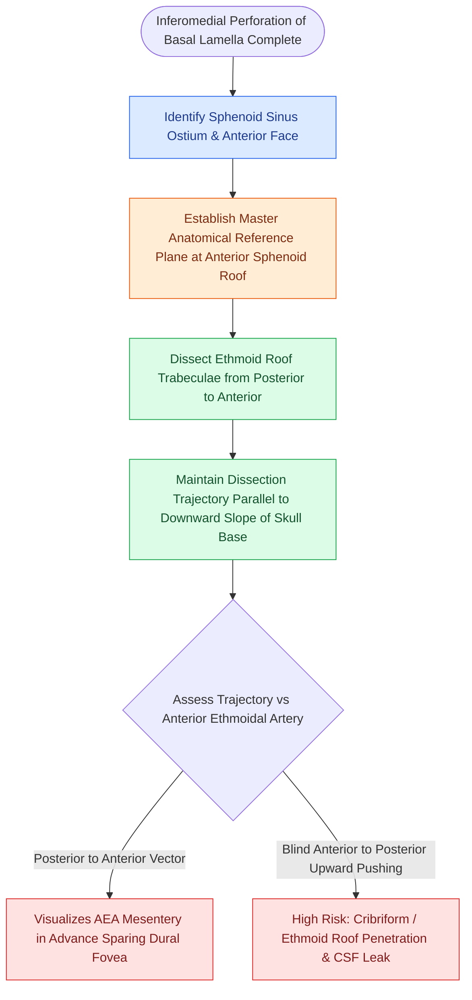

# Posterior ethmoidectomy requires dissecting along the skull base from posterior to anterior

## Active Recall

> [!question]- Why is it safer to skeletonize the ethmoid skull base from posterior to anterior rather than anterior to posterior?
> *Answer / Clinical Rationale*: The skull base is thickest and most constant posteriorly at the sphenoid junction. Identifying this firm reference plane allows the surgeon to safely trace the roof forward, avoiding inadvertent skull base penetration.

> [!question]- What medial structure serves as the primary landmark for identifying the posterior ethmoid cavity and sphenoid ostium?
> *Answer / Clinical Rationale*: The **superior turbinate**.

## Core Clinical & Mechanistic Principles
**Posterior ethmoidectomy** (Step 5 of FESS) involves clearing the posterior ethmoid air cells and skeletonizing the posterior ethmoid roof (fovea ethmoidalis). Dissecting in the posterior ethmoids requires a fundamentally different mental model than the anterior ethmoids: cells are **larger, fewer in number**, and directly border the **sphenoid face, optic canal, and skull base**.

### The Posterior-to-Anterior Dissection Principle
1. **Locating the Sphenoid Face**: Transition through the basal lamella directly to the anterior sphenoid face and identify the **superior turbinate**.
2. **Establishing the Skull Base Level**: Identify the junction of the sphenoid roof and the fovea ethmoidalis. The skull base at the sphenoid junction is thick, stable, and clearly defined.
3. **Dissecting Forward**: Follow the flat, glistening white plane of the fovea ethmoidalis **from posterior to anterior**, taking down intervening posterior ethmoid septations with through-cutting forceps or a [[Powered microdebrider blade selection and suction irrigation maintain clean surgical optics|microdebrider]] oriented parallel to the roof.

## Critical Failure Modes & Onodi Cell Hazards
- **The Onodi Cell Trap**: If an Onodi cell is present, the optic nerve and carotid artery may be dehiscent in its lateral wall (see [[Onodi cells place the optic nerve and carotid artery at risk during posterior ethmoidectomy|Onodi Cell Danger]]). Never dissect laterally in the posterior ethmoid without identifying the medial sphenoid ostium.
- **Keros III Lateral Lamella Perforation**: Dissecting medially near the cribriform plate can puncture the lateral lamella, causing an anterior skull base CSF leak.

## Connected Concepts & Graph Traversal
- **Preceding Step**: [[Perforating the basal lamella inferomedially provides safe entry to posterior ethmoids|Basal Lamella Fenestration]]
- **Next Step**: [[The sphenoid sinus ostium lies medial to the superior turbinate above the choana|Sphenoidotomy]]
- **High-Risk Variant**: [[Onodi cells place the optic nerve and carotid artery at risk during posterior ethmoidectomy|Onodi Cell Anatomy]]
- **Checklist**: [[The CLOSE checklist systematically evaluates critical radiological danger zones|CLOSE Checklist]]
- **Diagnostic Evaluation**: [[Draf I frontal sinusotomy clears obstructing ethmoid cells without instrumenting the ostium|Draf I Frontal Sinusotomy]]
- **Anatomical Foundation**: [[Transcribriform EEA provides access to olfactory groove meningiomas and esthesioneuroblastomas|Transcribriform EEA Corridor]]
- **Surgical Craft**: [[Transplanum and transtuberculum EEA corridors expose suprasellar craniopharyngiomas|Transplanum EEA Corridor]]
- **Surgical Technique**: [[Revision endoscopic sphenoethmoidectomy clears recalcitrant osteitic partitions via posterior-to-anterior skull base skeletonization and medial orbital wall navigation|Revision Sphenoethmoidectomy]]
