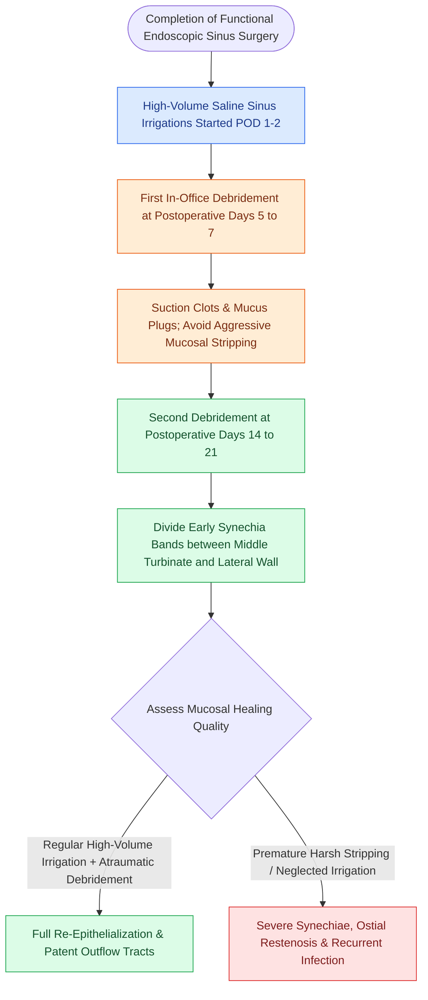

# Postoperative FESS debridement timing and technique prevent crusting and synechiae formation

## Active Recall

> [!question]- Why is the 7-to-14 day postoperative window optimal for the first endoscopic debridement?
> *Answer / Clinical Rationale*: Early fibrinous adhesions between the middle turbinate and lateral wall are **filmy and easily lysed** with suction before mature, dense collagen cross-linking and permanent fibrotic synechiae develop.

> [!question]- What topical steroid formulation is commonly added to high-volume saline irrigations following initial sinus healing?
> *Answer / Clinical Rationale*: **Budesonide respules ($0.5\text{–}1.0\text{ mg}$)** mixed into $240\text{ mL}$ of normal saline, providing high-volume mucosal distribution.

## Core Clinical & Mechanistic Principles
In-office endoscopic debridement of the surgical cavity during the initial postoperative period is critical to remove **desiccated blood crusts, retained bone fragments, and thick secretions**, promoting rapid re-epithelialization and preventing **synechiae formation and ostial stenosis**.

### Avoiding Mucosal Stripping During Debridement
- Debridement must be **gentle and selective**.
- Forcibly pulling adherent crusts off raw bone strips delicate regenerating [[Respiratory epithelium drives mucociliary clearance toward natural ostia|respiratory epithelium]] and causes fresh bleeding, accelerating scar formation. Crusts should be moistened with saline or peroxide prior to gentle aspiration.

## Connected Concepts & Graph Traversal
- **Endoscopic Tracking**: [[The Lund-Kennedy endoscopic staging system tracks mucosal edema, polyps, and discharge|Lund-Kennedy Score]]
- **Adhesions**: [[Middle turbinate lateralization causes secondary ostiomeatal obstruction and frontal sinus stenosis|Middle Turbinate Lateralization]]
- **Hemostatic Dissolution**: [[Topical hemostatic matrix agents and nasal packing mitigate postoperative epistaxis and synechiae|Dissolvable Packing]]
- **Critical Safety & Complication**: [[Steroid-eluting sinus implants deliver localized anti-inflammatory therapy to prevent restenosis|Steroid-Eluting Sinus Implants]]
- **Surgical Technique**: [[Postoperative endoscopic sinus debridement requires staged removal of crusts and fibrin while strictly protecting the sphenopalatine foramen and skull base during mucosal recovery|Postoperative Sinus Debridement]]
- **Complication Rescue**: [[The endoscopic cross-over flap technique reconstructs congenital choanal atresia by covering denuded bone without circumferential stenting|Cross-Over Flap (Choanal Atresia)]]
