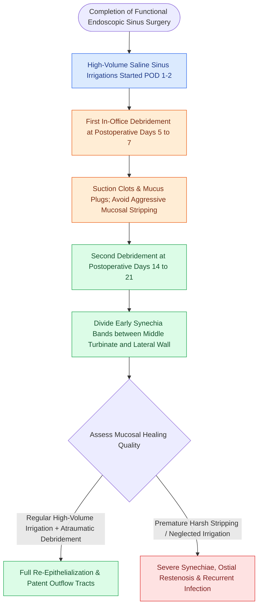

# Postoperative FESS debridement timing and technique prevent crusting and synechiae formation

## Active Recall

> [!question]- Why is the 7-to-14 day postoperative window optimal for the first endoscopic debridement?
> *Answer / Clinical Rationale*: Early fibrinous adhesions between the middle turbinate and lateral wall are **filmy and easily lysed** with suction before mature, dense collagen cross-linking and permanent fibrotic synechiae develop.

> [!question]- What topical steroid formulation is commonly added to high-volume saline irrigations following initial sinus healing?
> *Answer / Clinical Rationale*: **Budesonide respules ($0.5\text{–}1.0\text{ mg}$)** mixed into $240\text{ mL}$ of normal saline, providing high-volume mucosal distribution.

> [!question]- How long does physiological mucociliary impairment persist after FESS, what is the "10-day rule" near the sphenopalatine foramen, and along which nasal surface should instruments be advanced?
> *Answer / Clinical Rationale*: Ciliary beat impairment persists for **$3\text{ to }12\text{ weeks}$** postoperatively. Adherent eschar over the **sphenopalatine foramen and resected middle turbinate stump/axilla must remain undisturbed for $\ge 10\text{ days}$** (the 10-day rule) to prevent severe outpatient secondary sphenopalatine arterial hemorrhage. Instruments should hug the **lateral nasal wall rather than the densely innervated, tender nasal septum** to maximize patient tolerance.

## Core Clinical & Mechanistic Principles
In-office endoscopic debridement of the surgical cavity during the initial postoperative period is critical to remove **desiccated blood crusts, retained bone fragments, and thick secretions**, promoting rapid re-epithelialization and preventing **synechiae formation and ostial stenosis**.

### Staged Clinic Schedule & Anatomical Danger Zones
- **Avoid Mucosal Stripping & Respect Mucociliary Stasis**: Ciliary clearance remains impaired for **$3\text{–}12\text{ weeks}$**, making stagnant mucus and crusts a biofilm nidus. Debridement must be **gentle and selective**: forcibly pulling adherent crusts off raw bone strips regenerating [[Respiratory epithelium drives mucociliary clearance toward natural ostia|respiratory epithelium]] and accelerates scarring. Moisten crusts with saline or peroxide prior to gentle aspiration, and allow [[Topical hemostatic matrix agents and nasal packing mitigate postoperative epistaxis and synechiae|hemostatic matrix agents]] to liquefy rather than peeling them off raw bone.
- **Visit 1 (POD 5–7)**: Anesthetize with $4\%$ lidocaine or cocaine pledgets and advance an olive-tip/Frazier suction **along the lateral nasal wall** (avoiding the tender septum) to clear non-adherent fibrin, liquefying packing, and clots.
- **The 10-Day Sphenopalatine Rule & Visit 2 (Days 12–14)**: Because [[The crista ethmoidalis guides endoscopic sphenopalatine artery ligation|sphenopalatine artery]] branches exit just posterior to the crista ethmoidalis, firm clot/eschar overlying the sphenopalatine foramen, posterior fontanelle, and resected middle turbinate stump must **NOT be stripped before POD 10** to prevent arterial bleeding. At Week 2, safely mobilize matured crusts and lyse early filmy synechiae.
- **Visit 3 (Weeks 4–5) & Skull Base Safeguard**: Resect localized osteitic bone spicules or granulation with fine through-cutting forceps, while leaving adherent fibrin **undisturbed over denuded fovea ethmoidalis, cribriform plate, or planum sphenoidale** (never scrape with Blakesley forceps, risking dural tear or occult CSF leak).

## Connected Concepts & Graph Traversal
- **Endoscopic Tracking**: [[The Lund-Kennedy endoscopic staging system tracks mucosal edema, polyps, and discharge|Lund-Kennedy Score]]
- **Adhesions**: [[Middle turbinate lateralization causes secondary ostiomeatal obstruction and frontal sinus stenosis|Middle Turbinate Lateralization]]
- **Hemostatic Dissolution**: [[Topical hemostatic matrix agents and nasal packing mitigate postoperative epistaxis and synechiae|Dissolvable Packing]]
- **Anti-Inflammatory Adjunct**: [[Steroid-eluting sinus implants deliver localized anti-inflammatory therapy to prevent restenosis|Steroid-Eluting Sinus Implants]]
- **Maxillary Cavity Debridement**: [[Complete uncinectomy and posterior fontanelle resection unify the natural maxillary ostium with fontanelle defects to prevent mucus recirculation loops|Maxillary Antrostomy Technique]]
- **Sphenoid Cavity Clearance**: [[Sphenoidotomy utilizes superior turbinate resection or the Bolger box parallelogram to identify the natural ostium while preventing Onodi cell injury|Sphenoidotomy Landmarks]]
