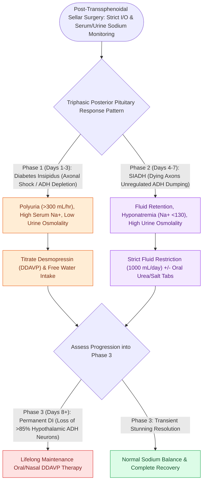

# Postoperative diabetes insipidus and SIADH require strict fluid balance and desmopressin titration

## Active Recall

> [!question]- What is the physiological mechanism underlying the second phase (SIADH) of the triphasic pituitary response?
> *Answer / Clinical Rationale*: Unregulated **leakage of pre-formed, stored ADH from degenerating posterior pituitary axons and pituicytes**, causing water retention and dilutional hyponatremia.

> [!question]- What is the diagnostic threshold for urine output when suspecting acute postoperative diabetes insipidus?
> *Answer / Clinical Rationale*: Urine output exceeding **$>250\text{–}300\text{ mL/hour}$ for 2 consecutive hours** with low urine specific gravity ($<1.005$).

## Core Clinical & Mechanistic Principles
Surgical manipulation or transection of the [[Transsellar EEA provides direct access to pituitary adenomas and Rathke cleft cysts|pituitary]] stalk (infundibulum) and posterior pituitary gland during transsellar and transplanum surgery disrupts **Arginine Vasopressin (AVP / Antidiuretic Hormone / ADH)** regulation, leading to **Diabetes Insipidus (DI)**, **SIADH**, or the classic **Triphasic Response**.

### Diagnostic Triad of Acute Diabetes Insipidus
1. **Polyuria**: Urine output $>250\text{–}300\text{ mL/hour}$ for 2 consecutive hours (or $>4\text{–}5\text{ L/day}$).
2. **Dilute Urine**: Specific gravity $<1.005$ and Urine Osmolality $<200\text{ mOsm/kg}$.
3. **Serum Hypernatremia**: Serum Sodium $>145\text{ mEq/L}$ and Serum Osmolality $>295\text{ mOsm/kg}$.

## Connected Concepts & Graph Traversal
- **Sellar Surgery**: [[Transsellar EEA provides direct access to pituitary adenomas and Rathke cleft cysts|Transsellar EEA]]
- **Suprasellar Expansion**: [[Transplanum and transtuberculum EEA corridors expose suprasellar craniopharyngiomas|Transplanum EEA]]
- **Apoplexy**: [[Pituitary apoplexy causes acute chiasmatic compression and life-threatening panhypopituitarism|Pituitary Apoplexy]]
- **Diagnostic Evaluation**: [[Transcribriform EEA provides access to olfactory groove meningiomas and esthesioneuroblastomas|Transcribriform EEA Corridor]]
- **Anatomical Foundation**: [[Transpterygoid EEA exposes juvenile nasopharyngeal angiofibromas and lateral sphenoid defects|Transpterygoid EEA Corridor]]
