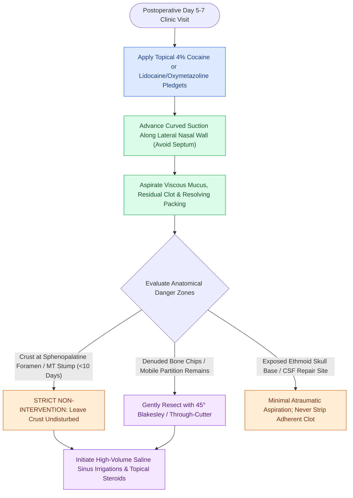

# Postoperative endoscopic sinus debridement requires staged removal of crusts and fibrin while strictly protecting the sphenopalatine foramen and skull base during mucosal recovery

## Active Recall

> [!question]- How long does physiological mucociliary clearance impairment persist following comprehensive functional endoscopic sinus surgery?
> *Answer / Clinical Rationale*: Ciliary impairment and mucociliary stasis persist for 3 to 12 weeks postoperatively. During this window, stagnant blood, mucus, and fibrin form a biologic medium for microbial colonization and biofilm propagation if not cleared by irrigation and serial debridement.

> [!question]- What is the mandatory "10-day rule" regarding crusting near the sphenopalatine foramen during clinic debridement?
> *Answer / Clinical Rationale*: Crusting at or adjacent to the sphenopalatine foramen and the axilla/stump of a resected middle turbinate must be left undisturbed for at least 10 days postoperatively. Premature mechanical detachment of adherent eschar can provoke severe secondary sphenopalatine arterial hemorrhage in the outpatient office.

> [!question]- Along which anatomical surface should suction and debridement instruments be advanced to minimize patient discomfort?
> *Answer / Clinical Rationale*: Instruments should be guided along the lateral nasal wall rather than the nasal septum. The nasal septum possesses dense sensory innervation and remains exceptionally sensitive and tender during early healing; instrumentation along the lateral wall is significantly better tolerated.

## Core Clinical & Mechanistic Principles
Postoperative endoscopic débridement is an essential determinant of long-term surgical success after functional endoscopic sinus surgery, as established in [[Postoperative FESS debridement timing and technique prevent crusting and synechiae formation]]. The removal of retained bone partitions, blood clots, and fibrinous exudate suppresses inflammation, prevents middle meatal synechiae, and fosters rapid mucosal remargination.

However, overaggressive or misplaced clinic debridement can convert an uncomplicated surgical outcome into a severe complication. Because the sphenopalatine artery branches exit just posterior to the crista ethmoidalis, as described in [[The crista ethmoidalis guides endoscopic sphenopalatine artery ligation]], forceful avulsion of vascular crusts in the posterior middle meatus risks arterial bleeding. Hemostatic agents placed at surgery, as detailed in [[Topical hemostatic matrix agents and nasal packing mitigate postoperative epistaxis and synechiae]], must be allowed to dissolve or undergo gentle suctioning rather than traumatic peeling.

### Staged Débridement Schedule and Technical Craft
1. **Physiologic Window of Mucociliary Impairment**:
   - Following mucosal elevation and bone resection, ciliary beat frequency and coordinated mucociliary transport remain paralyzed for **$3\text{ to }12\text{ weeks}$**.
   - Stagnant mucus and blood crusts form an ideal nidus for microbial superinfection, persistent mucosal edema, and fibroblastic bridging (synechiae).
2. **Clinic Timing Schedule**:
   - *Visit 1 (Days 5–7)*: Topical anesthesia with $4\%$ lidocaine or cocaine pledgets. Suction non-adherent fibrinous exudate, liquefying hemostatic packs, and retained secretions from the inferior and middle meatus using an olive-tip or Frazier suction.
   - *Visit 2 (Week 2, Days 12–14)*: The 10-day vascular safety window has passed. Matured crusts over the middle turbinate and posterior meatus may be mobilized gently. Identify and lyse early filmy synechiae.
   - *Visit 3 (Weeks 4–5)*: The cavity shows advanced mucosalization. Resect any persistent osteitic bone spicules or localized granulation polyps with fine through-cutting forceps.
3. **The 10-Day Sphenopalatine Rule**:
   - Firm eschar and clot overlying the sphenopalatine foramen, posterior fontanelle, and resected middle turbinate axilla must **NOT** be mechanically stripped prior to postop day 10.
   - Premature dislodgement tears friable arterial branches of the sphenopalatine artery, requiring emergency endoscopic electrocautery or packing.
4. **Skull Base and Dural Safety**:
   - Over denuded skull base bone (fovea ethmoidalis, cribriform plate, planum sphenoidale), mechanical scraping with Blakesley forceps is strictly contraindicated.
   - Adherent fibrin should be left in situ to prevent tearing the underlying dura or reopening occult micro-fractures.

## Connected Concepts & Graph Traversal
- **Maxillary Cavity Debridement**: [[Complete uncinectomy and posterior fontanelle resection unify the natural maxillary ostium with fontanelle defects to prevent mucus recirculation loops|Maxillary Antrostomy Technique]]
- **Sphenoid Cavity Clearance**: [[Sphenoidotomy utilizes superior turbinate resection or the Bolger box parallelogram to identify the natural ostium while preventing Onodi cell injury|Sphenoidotomy Landmarks]]
- **Synechiae Prevention Target**: [[Middle turbinate lateralization causes secondary ostiomeatal obstruction and frontal sinus stenosis|Middle Turbinate Lateralization]]
- **Endoscopic Mucosal Monitoring**: [[The Lund-Kennedy endoscopic staging system tracks mucosal edema, polyps, and discharge|Lund-Kennedy Endoscopic Staging]]
- **Physiologic Mucociliary Driver**: [[Respiratory epithelium drives mucociliary clearance toward natural ostia|Mucociliary Clearance Dynamics]]
