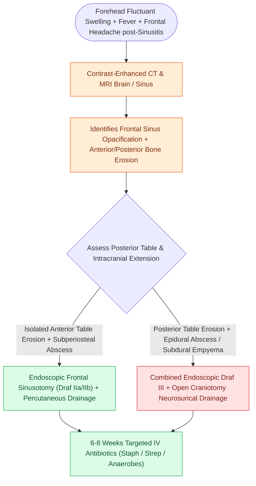

# Pott's puffy tumor represents subperiosteal abscess and frontal bone osteomyelitis from sinusitis

## Active Recall

> [!question]- What anatomical vascular network allows frontal sinusitis to spread through intact bone to create a Pott's puffy tumor?
> *Answer / Clinical Rationale*: The **valveless diploic veins of Breschet**, which allow bidirectional septic thrombophlebitis to spread through the marrow space of the frontal bone.

> [!question]- What intracranial complications are frequently associated with Pott's puffy tumor?
> *Answer / Clinical Rationale*: **Epidural abscess, subdural empyema, meningitis, cavernous/superior sagittal sinus thrombosis**, and frontal lobe cerebritis/abscess.

## Core Clinical & Mechanistic Principles
First described by Sir Percivall Pott in 1760, **Pott’s Puffy Tumor** is a **subperiosteal abscess of the anterior frontal bone associated with underlying frontal bone osteomyelitis**, arising as a direct complication of untreated or inadequately treated frontal sinusitis.

### Clinical Presentation & Multimodal Management
- **Triad**: Forehead swelling/edema, severe frontal headache, and fever.
- **Microbiology**: Polymicrobial (Streptococcus milleri/anginosus group, *Staphylococcus aureus*, anaerobes).
- **Treatment**: Combined **endoscopic [[The uncinate process superior attachment dictates the frontal sinus drainage pathway|frontal sinus]] drainage (Draf IIa/Draf III)** + incision and drainage of subperiosteal abscess + **$6\text{ weeks}$ of targeted intravenous antibiotic therapy**.

## Connected Concepts & Graph Traversal
- **Anatomical Boundary**: [[The frontal recess is bounded by the agger nasi, middle turbinate, and skull base|Frontal Recess Anatomy]]
- **Endoscopic Drainage**: [[Draf IIa frontal sinusotomy resects the sinus floor between middle turbinate and lamina|Draf IIa Sinusotomy]]
- **Percutaneous Drainage**: [[Frontal sinus trephination provides combined endoscopic and percutaneous visualization and irrigation|Frontal Trephination]]
- **Open Surgical Obliteration**: [[Osteoplastic flap with frontal sinus obliteration manages lateral frontal disease and osteomyelitis|Osteoplastic Flap]]
- **Vascular Hemostasis**: [[Intraoperative ICA injury requires two-surgeon suction and crushed muscle patch hemostasis|Internal Carotid Artery Crisis Protocol]]
- **Orbital Decompression**: [[Retrobulbar hematoma requires emergent bedside lateral canthotomy and cantholysis|Retrobulbar Hematoma Protocol]]
- **Emergency Debridement**: [[Acute invasive fungal rhinosinusitis requires emergent surgical debridement and systemic amphotericin B|Acute Invasive Fungal Rhinosinusitis (AIFRS)]]
