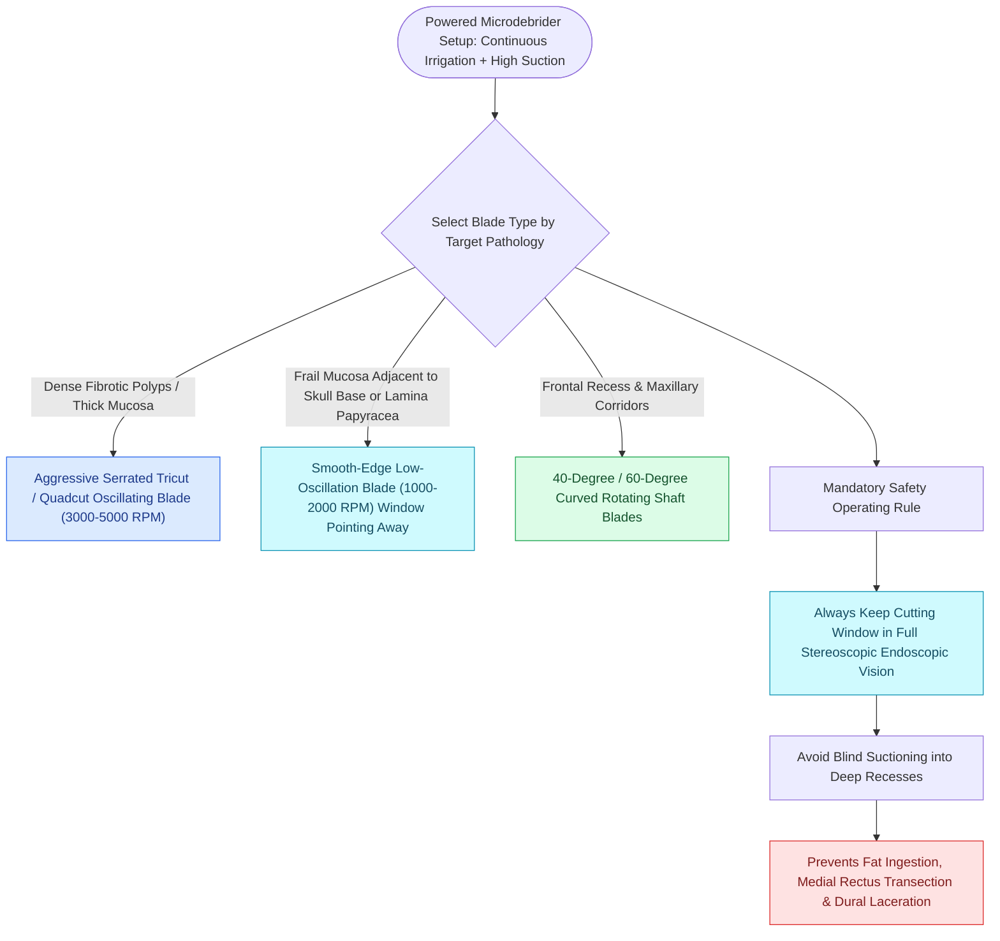

# Powered microdebrider blade selection and suction irrigation maintain clean surgical optics

## Active Recall

> [!question]- Why must the cutting window of a microdebrider never be turned toward the lamina papyracea during ethmoidectomy?
> *Answer / Clinical Rationale*: The powerful suction will aspirate herniated orbital fat and the **medial rectus muscle** directly into the oscillating blade, causing irreversible transection and permanent diplopia within a fraction of a second.

> [!question]- What blade action mode is utilized for resecting inflammatory polyps without mucosal stripping?
> *Answer / Clinical Rationale*: **Oscillating mode** ($3,000\text{–}5,000\text{ RPM}$), which shears tissue cleanly at the port margin without catching and stripping adjacent normal mucosa.

## Core Clinical & Mechanistic Principles
The **powered microdebrider (shaver)** combines continuous suction, internal irrigation, and high-speed blade oscillation ($3,000\text{–}5,000\text{ RPM}$) to resect polypoid tissue and thin bone cleanly without mucosal stripping.

### Preventing Catastrophic Orbital & Brain Avulsion
- The microdebrider draws tissue into its cutting window via high negative suction.
- If the port is placed against a dehiscent [[Draf IIb frontal sinusotomy extends from lamina papyracea to the nasal septum|lamina papyracea]] or skull base, it can **suck in and transect the medial rectus muscle or frontal lobe dura in less than one second**.

## Connected Concepts & Graph Traversal
- **Orbital Risk**: [[Lamina papyracea dehiscence predisposes to orbital fat herniation and medial rectus injury|Lamina Papyracea Dehiscence]]
- **Bulla Entry**: [[Entering the ethmoid bulla inferomedially avoids orbital and skull base penetration|Inferomedial Bulla Entry]]
- **Hemostasis Control**: [[TIVA and greater palatine canal blocks optimize surgical field visibility in FESS|TIVA Hemostasis]]
- **Surgical Craft**: [[CSF leak defect preparation requires circumferential bone de-mucosalization|CSF Defect Bed Preparation]]
- **Anatomical Foundation**: [[Maxillary antrostomy requires incorporating accessory fontanelle ostia to prevent recirculation|Maxillary Antrostomy Technique]]
