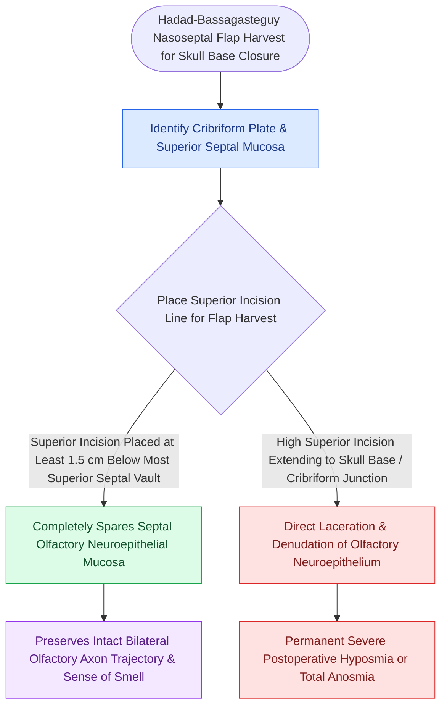

# Preserving the superior septal mucosal strip prevents post-NSF anosmia

## Active Recall

> [!question]- How far inferiorly does olfactory neuroepithelium typically extend onto the nasal septum from the cribriform plate?
> *Answer / Clinical Rationale*: Approximately **$1.0\text{ to }1.5\text{ cm}$** below the superior vault of the nasal septum.

> [!question]- What technical error during nasoseptal flap harvest leads to irreversible bilateral anosmia?
> *Answer / Clinical Rationale*: Carrying the superior incision all the way up to the cribriform plate, stripping the olfactory neuroepithelium on the harvest side (and on the contralateral side during septectomy).

## Core Clinical & Mechanistic Principles
The **[[Olfactory neuroepithelium contains bipolar sensory neurons and basal stem cells|olfactory neuroepithelium]]** is not confined strictly to the horizontal cribriform plate; it extends inferiorly onto the **superior $1.0\text{–}1.5\text{ cm}$ of the nasal septum** and the superior turbinate.

During harvest of a [[Temporoparietal fascia free and pedicled flaps provide vascularized tissue when nasoseptal flaps fail|Hadad-Bassagasteguy]] nasoseptal flap (NSF), placing the superior incision directly against the skull base strips these primary olfactory sensory neurons, resulting in **permanent postoperative anosmia or severe hyposmia**.

### Surgical Safety Protocol
- **The $1.5\text{-cm}$ Rule**: The superior horizontal incision of the NSF must be made at least **$1.0\text{ to }1.5\text{ cm}$ inferior to the junction of the septum and the ethmoid roof**.
- **Cold Knife Technique**: Use a cold sickle knife or Beaver blade rather than monopolar electrocautery near the olfactory zone to avoid collateral thermal injury to adjacent olfactory neurons.

## Connected Concepts & Graph Traversal
- **Flap Craft**: [[The Hadad-Bassagasteguy nasoseptal flap is pedicled on the posterior septal artery|Nasoseptal Flap Harvest]]
- **Draf III Landmark**: [[First olfactory filum marks the posterior limit of frontal drill-out to avoid CSF leak|First Olfactory Filum]]
- **Skull Base Corridor**: [[Transcribriform EEA provides access to olfactory groove meningiomas and esthesioneuroblastomas|Transcribriform EEA]]
- **Critical Safety / Complication**: [[Esthesioneuroblastoma Kadish and Hyams staging determines craniofacial resection and adjuvant therapy|Esthesioneuroblastoma (ENB)]]
- **Anatomical Foundation**: [[The Keros classification stages olfactory fossa depth and lateral lamella vulnerability|Keros Classification]]
